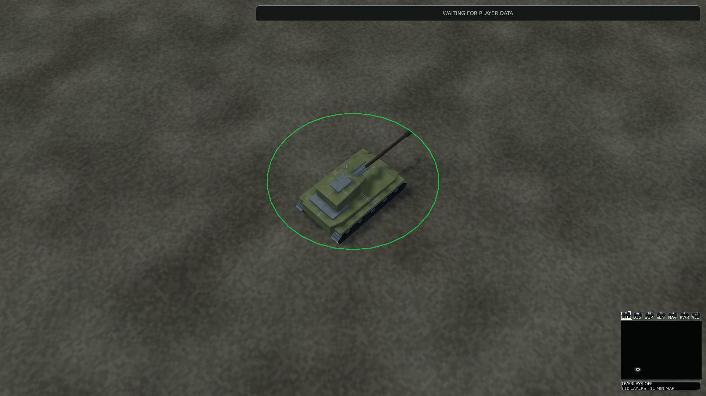

# Artillery Blender preservation and inspection

[Documentation](README.md) · [Complete catalog](DocumentationIndex.md)

<details>
<summary>On this page</summary>

- [Current-source audit](#current-source-audit)
- [Authoring boundary](#authoring-boundary)
- [Reproduction](#reproduction)
- [Observed native checkpoint](#observed-native-checkpoint)
- [Clean review-source and complete-suite evidence](#clean-review-source-and-complete-suite-evidence)
- [Native D3D12 observations](#native-d3d12-observations)
- [Reproducible installed player](#reproducible-installed-player)
- [Integration decision](#integration-decision)
- [Merge reconciliation](#merge-reconciliation)

</details>

## Current-source audit

Integration/default branch `master` was fetched at
`b32bf04671fb579e01a7e282eac76ff91c5b2f1d`, version `0.1.428`.
The remote branch inventory contained only `master`; there was no unfinished
artillery branch or open related PR to continue. Integrated PR #186 already owns
the artillery kit, 4648-triangle chassis, 640-triangle weapon, reduced LODs and
damage/critical/wreck geometry. PRs #228–231 supply the strict Blender round trip,
surface review, typed mechanical authoring and saved tank precedent. Their changed
files, review comments and source-bound checks were inspected. Historical failures
are not relabelled as passing current-master results.

The demonstrated gap is the missing saved native artillery master. Existing
artwork is reused, without reauthoring geometry, shared PBR atlases or mechanical
metadata. The independent collision, stable IDs, muzzle/gun/recoil/turret sockets,
3.8 × 3.2 × 7.5 scale, 1.4-m root height, state selection and projected-size LOD
thresholds/hysteresis remain authoritative. There is no deployed gameplay mode,
circulating tread, new physical stabilizer or new ballistic controller.

PR #268 is integrated, but its physical jobs were skipped and its complete-frame,
GPU-memory, thermal, lifecycle and explicit human acceptance gates remain open.
The ownership manifest still reserves canonical sources/compiler. This work stays
outside those paths. Exact master main CI run 39547596264, job 119049220997 fails
the version step: expected `0.1.429`, found `0.1.428`; subsequent build/product gates
are skipped. This is inherited integration history, not an artillery result.

## Authoring boundary

`build/artillery/fixture.json` binds all seven existing visual mesh IDs plus the
independent collision ID. `author.py` delegates strict import/export to the current
adapter. The rest project preserves source geometry, original part hierarchy,
ordered material slots, UVs/normals/tangents and named sockets. Collections expose
LOD/state assets separately; the intact chassis and weapon are initially visible.
Coordinates retain engine `(x,y,z)` → Blender `(x,-z,y)`, metre units and original
normalized source pivots. Instance scale is applied only by the existing runtime
and inspection fixture, not silently baked into compiler sources.

The separate packed PBR inspection project contains generated idle, forward,
reverse, stopped, paused, firing, recovery, unpowered, destroyed-disabled and
LOD-neutral sample poses. These are sampled copied presentation inputs, not new
runtime animation clips or authoritative combat events. Its part frames are
flattened only after composing complete world matrices, avoiding Blender local
TRS shear under the artillery's nonuniform metric scale. The strict export master
keeps the original hierarchy. Independent .NET comparison retains the established
0.00002 matrix tolerance, including outer turret yaw, elevation, recoil, wheel
travel and LOD-neutral behavior.

Packed images retain original source bytes, sRGB Base Color and linear Normal/ORM.
Inspection uses the existing shared shader approximation; ORM AO remains a game
shader input. It does not bake arbitrary material graphs or promise Blender/game
shader parity. Rest projects accept preservation exports only; changed mechanical
properties are rejected. The generic motion adapter owns supported metadata edits
for its qualified fixtures; artillery would need a separately qualified extension
of this family workflow. These rest properties are not an approved motion-edit
exporter. Inspection actions/PBR graphs
are deliberately rejected as strict export inputs.

## Reproduction

Use pinned Blender 5.2.2 x64, the exact .NET SDK selected by [global.json](../global.json) and PowerShell 7.4+:

```powershell
dotnet restore ForgeLine.sln
dotnet build ForgeLine.sln --configuration Release --no-restore
pwsh tools/blender/Invoke-Blender.ps1 -Action Check -OutputRoot artifacts/ar-check
pwsh build/artillery/Qualify-Master.ps1 -OutputRoot artifacts/ar2 -RenderPreviews
python build/artillery/retained.py
```

Choose fresh short output paths. Qualification saves independent first/second
rest masters, reopens the first, compares source/runtime bytes, compiles all four
catalogs, validates without source access, rejects invalid native edits and checks
typed geometry/material/LOD/socket/range plus 429 pose matrices. It hashes all
canonical sources before/after. The optional `FORGELINE_ARTILLERY_RUNTIME_SEED`
test input composes a full sealed isolated player catalog without editing
`assets/runtime` or canonical definitions.

The initial one-time retention command was `python build/artillery/retained.py
artifacts/ar2`, before `assets/staged/artillery` existed. It deliberately refuses
to overwrite an existing retained master. On an existing checkout run the
argument-free verifier and compare fresh qualification output; do not delete or
replace retained projects as an automatic reproduction step.

The first real run under `artifacts/ar1` failed the generic nested inspection
matrix representability check after strict rest export. Its logs remain intact.
The family-scoped flattened inspection addresses that representability limit;
no runtime transform, source part hierarchy or comparison tolerance is changed.

## Observed native checkpoint

The qualified authoring/tool content is retained at
`aeee2a3cf76e9f8565be6303f4802b0c6b601f35`, version `0.1.429-dev`.
The first authoring run started before that commit was recorded; its exact family
script content matches that commit. Source signatures bind the actual unchanged
canonical artwork independently. Two genuine Blender projects and eight GLBs are
retained under `assets/staged/artillery`; collision stays an independent reference.
No external artwork, image, third-party mesh or new license input is introduced.

Pinned Blender 5.2.2 x64 build `d13f752e3b9c`, executable SHA-256
`f141a3c5754500e6f84361099a4cd53f0bb7662b6a0d2cfaaa8fbb63e92234a0`,
saved both independent rest projects and reopened the first. All four scoped
catalogs compile and pass source-less integrity. First/second/reopened source
and runtime trees are byte-identical. Both opt-in typed tests pass: all mesh,
material, dependency, LOD, collision, socket, mechanical range and surface-channel
comparisons, plus 429 independent runtime pose matrices. Maximum matrix error is
`0.000002026558`, below the unchanged `0.00002` tolerance. Eight invalid native
edits reject and an unchanged saved rest project validates.

Both the full Release solution and the focused test build pass with zero warnings
or errors. All 29 existing portable source/export contracts pass. The dependency
graph passes for 44 projects. The natural seed-2026 validation match terminates
without forced outcomes at tick 55,210: Victory / CommandCoreDestroyed, winner 1,
exit 0. This repeats the prior authoritative result without changing combat code.

The three artillery-only scenes also build with zero warnings/errors in isolated
`artifacts/arf` output, leaving the running full-suite binaries unchanged. All 98
focused scene, authorized artillery aim and existing mechanical regression cases
pass through `dotnet test --project tests/ForgeLine.Presentation.Tests/ForgeLine.Presentation.Tests.csproj
--configuration Release --no-build --artifacts-path artifacts/arf -- --filter-class
ForgeLine.Presentation.Tests.ArtilleryReferenceLoadTests
ForgeLine.Presentation.Tests.VisualReferenceSceneTests
ForgeLine.Presentation.Tests.ArtilleryAimPresentationTests
ForgeLine.Presentation.Tests.MechanicalMotionTests
ForgeLine.Presentation.Tests.MechanicalMotionQualityTests --parallel none`.
The earlier direct-DLL invocation rejected its CLI option before running tests;
its log remains under artifacts and is not counted as a passing test run.

Original qualification, compiler/source-less reports, packed-image hashes,
negative contracts, headless diagnostics and the failed first native attempt are
retained under [`artillery/evidence`](artillery/evidence). The two small Blender
PNGs are authoring inspections, not native game images or approved goldens.

## Clean review-source and complete-suite evidence

Review executable and installed package source:
`2f561376c8b938d7d081987353612ab2e8fc2094`, `0.1.429-dev`.
The clean solution builds into isolated `artifacts/arf` with zero warnings/errors.
All 100 focused tests pass there, including both enabled native geometry/pose
tests, the three new artillery-only loads, scene/authorized-aim/mechanical
regressions and a full sealed candidate overlay.

All five hosted checks on that exact executable source subsequently completed
successfully: main `build-test`, navigation, CPU scale, frame contracts and the
fresh-checkout retained-artillery verifier. Optional remote native jobs were
skipped; actual local Blender/GPU execution is reported separately. Later evidence
and documentation commits retain their own current-head CI; the earlier source's
success is not automatically assigned to a later head.

The complete serialized standard-output Release suite belongs to the earlier
tool checkpoint `aeee2a3cf76e9f8565be6303f4802b0c6b601f35`:
**3,230 total, 3,202 passed, 28 optional skips, zero failures**, 37m 32.065s.
Its binaries stayed untouched while the subsequent reference-scene delta was
built and tested in isolated output. These are separate observations; the earlier
whole-suite result is not relabelled as a complete suite on the later source.
Existing runtime interruption/corruption/process contracts also pass under
`artifacts/arp/af7fd9ffd4d74ccbb93c0d980c380b50`.

Both complete catalogs compile/validate without source directories:

| Metric | Canonical | Isolated artillery candidate |
| --- | ---: | ---: |
| Asset records | 1,363 | 1,363 |
| Total container bytes | 74,844,350 | 74,844,493 |
| Mesh container bytes | 11,307,367 | 11,307,510 |
| Texture container bytes | 59,453,925 | 59,453,925 |
| Studio-splash texture bytes | 1,786,417 | 1,786,417 |

The 143-byte mesh-container difference does not increase vertex/index counts or
GPU geometry costs. Gameplay texture containers are 57,667,508 bytes, below the
unchanged 56-MiB limit of 58,720,256. Container bytes are not GPU residency.

## Native D3D12 observations

`build/artillery/Capture-Review.ps1` captured the same source, hardware, camera,
lighting and profile against canonical and candidate catalogs. Its six cohorts
cover High at 1080p/4K and close/normal/strategic zooms, Low/Medium, dark/wet,
1/100/1000 artillery and Low/strategic 1000. Additional supported inspection
overrides use `ArtillerySingle` at 30 m and the two repeated artillery scenes at
70 m, High/1080p/CloseTactical. All runs use three warmups, eight requested samples
and eight independent repeated readbacks. Completed GPU timestamp sample counts
are retained as observed, not inferred to equal CPU sample counts.

There are **34 original images / 17 before-after pairs**. All per-image repeats
match, with zero mesh fallback instances or texture/material binding failures.
All paired instance/draw, material and tracked resource dictionaries match.
Thirteen pairs are pixel-exact. The other four have these unchanged zero-tolerance
observations:

| View | Changed pixels | Maximum channel delta |
| --- | ---: | ---: |
| 1000 Low/strategic | 1 | 1 |
| 100 High, 70-m LOD0 inspection | 13 | 2 |
| 1000 High, 70-m LOD0 inspection | 15 | 2 |
| Single High, 30-m inspection | 1 | 1 |

No causal explanation, changed tolerance or golden approval is inferred from the
30 changed pixels. The close workload counts distinguish source actors, visibility
and part instancing:

| Native view | Source actors | Visible actors / LOD | Instance draws |
| --- | ---: | --- | ---: |
| Single, 30 m | 1 | 1 LOD0 | 6 |
| 100, 70 m | 100 | 84 LOD0 | 6 |
| 1000, 70 m | 1000 | 125 LOD0 | 6 |
| 1000, normal RTS distance | 1000 | 979 LOD1 | 1 |

The 125 visible LOD0 vehicles submit 1,625 rigid-part instances. This is not a
claim that 1000 LOD0 vehicles are visible or firing authoritative missions.
Static reduced LODs intentionally do not display the copied articulated poses.

Hardware: NVIDIA RTX PRO 5000 Blackwell Generation Laptop GPU, D3D12 Level 12_1,
driver 32.0.15.9653; Intel driver 32.0.101.8724, Windows 26300, .NET 10.0.12,
24 logical processors. The debug layer was unavailable. The 25,309,478,912-byte
adapter capacity is not process VRAM usage. The single inspection reports
44,760,596 tracked resident texture bytes and 84 descriptors of 4096, equal within
its pair; these are partial resource metrics, not complete GPU memory.

Original manifests retain CPU/GPU frames, passes, allocation/timestamp observations
and their p50/p95/p99 summaries. The short, sequential shared-workstation runs do
not qualify sustained FPS, thermal stability, moving LODs, live firing/aim,
complete-frame GPU/memory or the 30-minute lifecycle gate. In particular, the
installed close-1000 image-parity run records CPU mean **171.459 ms**, versus
**31.063 ms** in its development reference. That uncontrolled observation remains
an open performance concern; neither a cause nor performance non-regression is
claimed. It is not concealed by the matching pixels/resource counters.

The supplementary capture wrapper's trailing log redirection was misplaced and
returned exit 1 after its six native captures and initial comparisons completed.
The original images/manifests remain unchanged; independent standard-comparator
revalidation completed successfully in `artifacts/artillery-extra-validation.log`.
The original wrapper is not reported as a successful whole command.

## Reproducible installed player

```powershell
pwsh build/Publish-PreAlpha.ps1 -Configuration Release -OutputRoot artifacts/arpkg -VerifyReproducible -RuntimeAssetRoot artifacts/ar2/overlay/runtime
pwsh build/rendering/asset-residency/Test-PlayerPackage.ps1 -PublishRoot artifacts/arpkg/win-x64/publish -ArchivePath artifacts/arpkg/FORGELINE-0.1.429-dev-win-x64.zip -Source 2f561376c8b938d7d081987353612ab2e8fc2094 -OutputRoot artifacts/arps
```

The two published checksum trees match. The source tree was clean. ZIP size is
55,136,662 bytes; SHA-256:
`894299943eb75357f1037752350ed698c95d0b03775b9976290ee3aab691ebce`.
Fresh extraction under `artifacts/arpi` verifies all **1,487 file hashes**;
the archive has 1,539 entries including directories. Published and freshly
extracted player smokes both exit 0 and load their own packaged runtime with fresh
settings and child PATH limited to Windows/.NET. There are zero authoring/compiler
files in the archive. System-wide Blender was not removed.

The actual extracted executable adds three native High/1080p cases: the full
state gallery, single 30-m LOD0 inspection and close 1000 workload. All three are
pixel-exact against development output and repeat independently eight times.
The native whole-directory fingerprint correctly differs: publishing adds 63
existing audio/branding files. A complete file/hash comparison proves all **1,364
common catalog/payload files** byte-identical, no candidate-only file and no changed
common file. The sealed manifest is identical. No fingerprint policy is changed or
silently declared equal; the original `sameRuntime: false` records are retained.

[`native/index.json`](artillery/evidence/native/index.json) lists all **37 original
PNGs (258,506,836 bytes)**, source/device identities, raw reports and hashes.
Complete local capture trees remain at `artifacts/arc`, `artifacts/arx` and
`artifacts/ari`. The checked-in gallery contains eleven unchanged selected PNGs
(74,876,147 bytes). Raw JSON copies are explicitly renamed `*-reference.json`;
this selected gallery is not a complete standalone capture directory.



## Integration decision

`ArtillerySingle`, `ArtilleryRepeated100` and `ArtilleryRepeated1000` append native
review scenes without renumbering existing scene identities. They reuse the same
authoritative unit definition and immutable presentation extraction. Repeated
scenes contain only artillery; a quarter share the existing fixed firing/recoil
pose, with the existing travel/aim inputs. They contain no projectile or muzzle
event and do not claim 100/1000 active simulation fire missions. Existing eight-unit
gallery and mixed 1000-vehicle fixture behavior is preserved.

This is a staged preservation/review candidate, not completed high-fidelity
modernization or approved production adoption. Canonical definitions and renderer
bindings are unchanged. Remaining gates include required current-head CI, human
native visual/moving-LOD and simultaneous-fire review, controlled 100/1000-artillery
physical measurements and explicit human art acceptance. Source-less package
observations above stay bound to their measured source. Short static captures do not certify sustained
FPS, authoritative firing behavior or every elevation/terrain case. Do not merge,
release, approve goldens or promote source bindings while acceptance is open.

Concurrent PR #273 appeared after the initial audit and owns logistics source/review
work. It initially shared the 0.1.429 allocation. Integrate serially against current
master, preserving integrated scene identities and reconciling exactly one PATCH.
No other branch is modified by this work.

## Merge reconciliation

Merged master `2f8a8ae230ab0d653658a858b3e693ead24f5c1f` (PR #276) into this
review branch. Preserve every integrated enum value, including the eight operational
building scenes, then append the three artillery scenes. Both scene factories keep
their own dispatch. The PR version is now **0.1.430**, exactly one PATCH above
master's 0.1.429. Earlier executable, image and 0.1.429 package observations remain
bound to the source checkpoints recorded above; they do not certify this merge.

Reconciliation validation: all 63 integrated scene enum IDs retain their numeric
positions; no unresolved conflict remains. The complete Release solution build
(`--artifacts-path artifacts/merge274`) passes with zero warnings/errors. All
108 selected presentation tests pass without skips (31.060 seconds), including
artillery native geometry/pose checks against `artifacts/ar2`, artillery loads,
operational building loads, general reference scenes, aim and mechanical motion.
Retained-master validation confirms both Blender projects and all eight exports
match current canonical sources; the 44-project reference graph remains acyclic.
These are merge validation results, not a new native capture or package run.

Master advanced again during that push: `8b85daf2fdcdffdffa2889f078802040e2650492`
integrates PR #275 and its truck sources/reference scenes. The subsequent merge
preserves all **69** integrated enum IDs, appends artillery after the truck scenes,
and combines family selection/count/placement with the existing artillery-only
cosmetic poses. Truck and mixed-family behavior retain master's implementation.
The current PR version is **0.1.431**, one PATCH above master's 0.1.430; the earlier
0.1.430 reconciliation and 0.1.429 package are historical checkpoints.

Second reconciliation validation: Release solution build passes with zero
warnings/errors (56.64 seconds). The expanded selected test run passes: **114
passed, two optional truck catalog comparisons skipped, zero failed** (37.107
seconds). The skipped comparisons require separately compiled before/after truck
catalogs; all six truck reference workloads execute and pass. Artillery native
geometry/pose checks execute against the existing qualified master data. Retained
artillery hashes/geometry, all 69 integrated enum IDs, the 44-project graph and
whitespace checks pass. This does not rerun the incoming PR's native truck capture
or relabel any historical package evidence.
