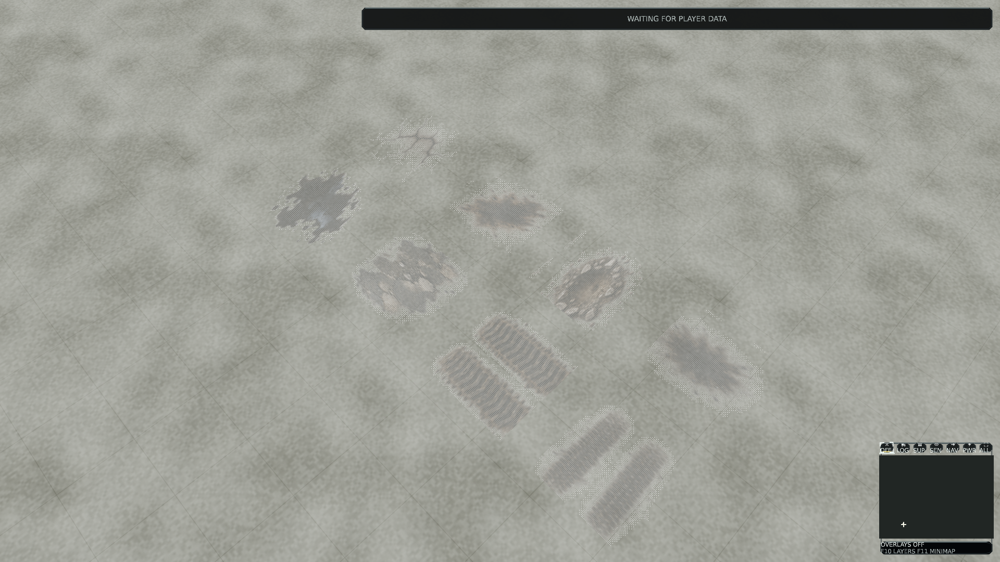
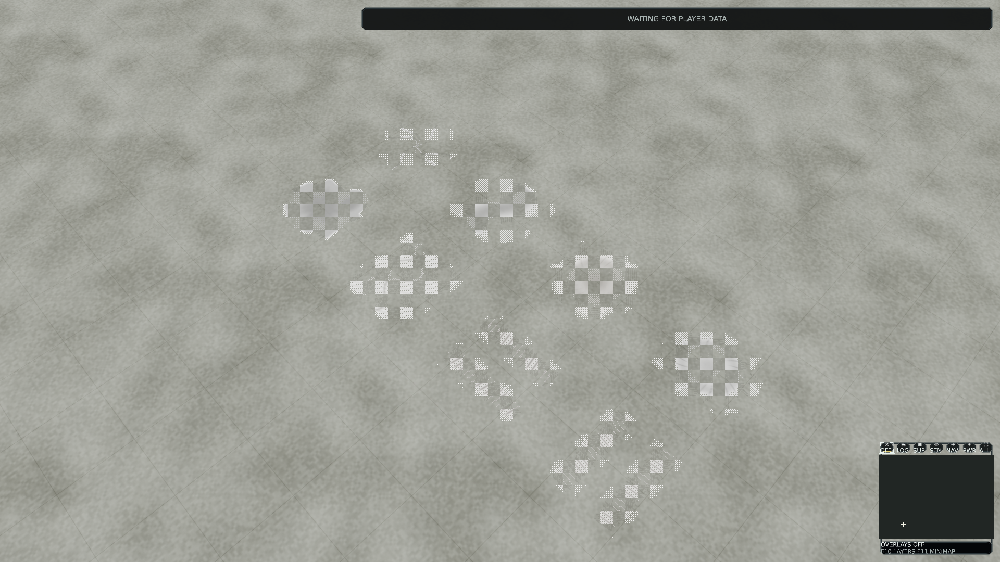

# Battlefield decal bakes

## Integration audit

Audited remote integration/default branch `master` at
`a524b0a8164390abe1e9cb38170e690f46147574`, version 0.1.436. No related open PR
or unfinished decal/render/surface/bake remote branch was found. Existing
production art (#139), metallic/roughness lighting (#188), bounded live decals
(#191) and render qualification (#268) are integrated and reused. Their changed
files and issue/review/inline comments were inspected; no comments/reviews were
present on #139/#191/#268. #191's final historical main CI failed, while its
focused checks passed. Current exact-master main CI, navigation and retained
Scout checks pass; optional native Scout is skipped. The historical #191 failure
is not relabelled as success.

The optimization tooling is integrated, but #268's actual paired physical,
complete-frame, GPU/memory/thermal/lifecycle and human review gates remain open.
This branch is an isolated review candidate. No merge, release, tag or golden
approval is performed. Initial branch `art/battlefield-decal-bakes` starts directly
from audited master; version 0.1.437 is one PATCH above that base.

The source/renderer/compiler, focused lifecycle/disclosure/material tests,
existing EffectsBarrage native fixture, Blender launcher and provisioned-runner
workflows were inspected, together with Architecture, Project Context,
Development, Asset Pipeline, Release Versioning, World and Terrain, World Asset
Presentation, World Environment Rendering, Combat/Industrial Rendering and the
bounded decal decision. Simulation/headless remain independent of authoring and
graphics. No authority, visibility, pool, shader, sampling or global budget is
changed.

## Demonstrated source gap and repair

The existing eight materials share an integrated 1254-square color/alpha atlas,
one materialless quad and fixed cell UVs. No saved native impression masters or
matching normal/ORM maps exist. Prelit color contains directional shadows and
specular highlights; the flat material response cannot react consistently to
lighting/wetness. The shared quad lacks a tangent channel for directed relief.
Existing lifetime, terrain alignment, copied event and visibility ownership are
already implemented and are reused.

Eight genuine editable Blender 5.2.2 masters now preserve original geometric
impressions and point material attributes. CPU Cycles selected-to-active bakes
produce a shared 1024-square color/straight-alpha, tangent Normal and ORM atlas.
Color is unlit and encoded once to sRGB. Numeric maps stay linear; oil is smooth,
dry tracks/debris/soot rough, and every family remains nonmetallic. Blender's
NEG_Y bake is checked against the exported engine TBN at 25 geometric points per
family; the native preview graph performs its own green conversion.

The shared carrier keeps its stable ID, original four vertices/two triangles,
normals, normalized UVs, bounds and materialless section. Only a derived tangent
channel is added. Its source now points to the saved master export. All eight
material IDs, cell transforms and map/event placements are retained. All maps
share the existing four-mip limit; base remains capped at 512 and the two new
numeric maps at 256. BC7 base/ORM and lossless RGBA8 normals target 783,360 resident bytes;
actual compiled/global/resource results are recorded below when executed.

The production pool remains 512 active / 16 per 256m anchor cell / 128 published,
strength at most .65 and final-fifth fade. Ground visibility still requires
center/corners; hidden/dead/reused receivers retire their marks. Terrain height,
navigation, cover, collision, combat and saved simulation data are unchanged.
Single planes can still intersect curved terrain; receiver marks retain proxy
faces rather than projected-volume geometry.

## Authoring and diagnostic checks

Fresh pinned-version Check passes. The current-master Release build passes with
zero warnings/errors. Its complete source-less-capable baseline compile has
1,363 assets, 74,844,887 container bytes, 59,453,925 texture-container bytes and
1,786,417 studio-splash bytes. Initial focused decal/reference tests pass: 23,
zero failed/skipped. These working-tree checkpoints are not clean-source native
runtime acceptance.

Original failed development attempts are retained: a literal array passed through
the native PowerShell CLI was rejected before baking; the first saved color
buffer lost coverage during a colorspace switch; the corrected pilot exposed
linear color being stored directly as sRGB bytes. Floating bake buffers and one
explicit transfer correct that. An initial atlas contract rejects equal blast
and shell alpha footprints; blast coverage is then made broader and distinct.
No failed attempt is counted as final visual qualification.

Four pure diagnostic terrain substrates use actual industrial/asphalt-like,
concrete, dirt and gravel material IDs through the existing terrain renderer.
The fixture region selects one material with strength one while leaving terrain
geometry unchanged. Authored diagnostic copies cover 1/100/1,000 quads and
bounded overlap/opacity, using stable world/decal materials and sampled terrain
normals. These stress copies are independent of the unchanged live pool cap;
input count and actual admitted/visible counts are reported separately. Existing
pool/extraction tests retain live expiry, receiver identity and disclosure checks.

The adopted source passes the current Release solution build (zero warnings /
errors), four portable decal contracts, two actual scoped compiler/texture/
source-less tests and 24 presentation/lifetime/disclosure/reference tests, all
with zero skipped. The reference tests include a real terrain-slope review
point, terrain-normal alignment through quarter-turn rotations, four pure
substrates and preservation of the live publication cap. The dedicated native
workflow is opt-in on provisioned Blender runners; hosted contracts are distinct
from its actual authoring execution.

## Executed qualification

All native measurements and the player package bind to clean production commit
`cdfa458581cbc70be7563f111f75b9b6618d6fa1` (0.1.437), against the audited
`a524b0a8164390abe1e9cb38170e690f46147574` asset baseline. Subsequent changes add
only documentation and recorded evidence. Both catalogs use the same current
compiler and capture binary; the before catalog overlays the original ten
changed definitions/materials/carrier and original base image, omitting the two
new map definitions. It is not a comparison between different executables.

### Source, compiler and contracts

- `dotnet build ForgeLine.sln --configuration Release --artifacts-path artifacts/decal-build --no-restore -m:1`: zero warnings/errors, 1m34.42s at the clean measured commit.
- Portable source suite: 123 passed. The four decal contracts were rerun after compression changes: four passed. Actual scoped compiler/decode/source-less tests: two passed; presentation, terrain orientation, publication, lifetime and disclosure: 24 passed, zero skipped.
- `Validate-ProjectReferences.ps1`: 44 projects, no cycles. `Validate-SemVer.ps1 -BaseRef origin/master`: exactly one PATCH, 0.1.437.
- `Test-BlenderDecals.ps1 -OutputRoot artifacts/decal-native-2`: pinned Blender 5.2.2, build `d13f752e3b9c`, 16 genuine saved-master reopens, including eight isolated copies with no external textures; byte-identical packed images and carrier exports; eight actual four-pass rebakes reproduce all 24 atlas channels exactly. The 200 geometric TBN probes have maximum component error 0.099219 against the fixed 0.18 threshold. A real tire-relief edit changes the normal bake and leaves the flat runtime carrier byte-identical. The scoped compiled catalog validates against an explicitly absent source directory.

The first full RGBA8 catalog exceeded the unchanged 56 MiB gameplay texture
container budget by 518,207 bytes. Main CI at `691c1233` failed at that exact
Window-mode budget check; the original failure is retained. BC7 normals were
then rejected at the predeclared 12-degree maximum angular error: Balanced
15.06 degrees and Best 13.86 degrees. Neither threshold was relaxed. Base and
ORM now use balanced BC7; normals remain lossless RGBA8. All four mips are
compared to separately compiled RGBA8 references: minimum compressed RGB PSNR
48.58 dB, mean alpha error at most 0.739 byte, maximum alpha error 8 against
limits 32 dB / 2 / 16. Normal pixels are lossless; floating angular comparison
has at most 0.040 degrees of normalization roundoff. See
[compiled quality](evidence/battlefield-decals/decal-hybrid-quality.json).

| Compiled observation | Before | After |
|---|---:|---:|
| Assets | 1,363 | 1,365 |
| Runtime container bytes | 74,844,887 | 75,112,571 |
| Texture container bytes | 59,453,925 | 59,719,280 |
| Gameplay textures, excluding unchanged splash | 57,667,508 | 57,932,863 |
| Shared decal resident texels | 519,640 | 783,360 |

The unchanged gameplay limit is 58,720,256 bytes; remaining room is 787,393
bytes. Base was actually 313-square after the existing repeated-halving importer,
within its 512 cap; the new power-of-two source compiles to 512-square within
the same cap. Normal/ORM compile to 256-square, each with four mips. Exactly ten
existing payloads change: eight materials, base texture and quad. Another 1,353
payloads are byte-identical. Only two stable texture IDs are added. Metadata
changes are confined to the intended texture dependencies; bounds, collision,
LOD, animation, sockets and mechanical references remain identical. Both complete
catalogs validate source-less. See [catalog comparison](evidence/battlefield-decals/decal-runtime-comparison.json).

### Native images, counters and timing

Windows build 26300, .NET 10.0.12 / SDK 10.0.401, native Direct3D 12 on NVIDIA
RTX PRO 5000 Blackwell Generation Laptop GPU, driver 596.53. No WARP acceptance
is substituted. The fixed matrix contains 43 before/after pairs and 86 original
unscaled PNGs (490,740,544 bytes), with eight repeat readbacks per capture.
Every repeat agrees exactly; all 43 asset comparisons change pixels. No shader,
texture/material binding or fallback geometry errors are reported.

| Cohort | Pairs | Conditions | Existing 15% timing gate |
|---|---:|---|---|
| Galleries | 6 | Four substrates, sampled slope, 128 overlapping stamps; High/1080p/40m | Failed |
| Distances | 15 | Four substrates plus slope; close, normal, strategic | Failed |
| 4K | 5 | Four substrates plus slope; High/40m | Failed |
| Quality | 4 | Asphalt/concrete; Low and Medium/40m | Failed |
| Dark | 4 | Four substrates; daylight .25, cloud .65 | Failed |
| Wet | 4 | Four substrates; wetness .75, cloud .35 | Failed |
| Loads | 3 | 1/100/1,000 decals; High/normal/1080p | Failed |
| Dense close | 1 | 1,000 decals; High/80m | Passed |
| Moving load | 1 | 1,000 decals; Sweep camera, 32 warmups/128 samples | Passed |

Other cases use eight warmup frames and 32 measured frames. CPU/GPU mean,
p50/p95/p99 and actual timestamp sample counts are retained in
[native timings](evidence/battlefield-decals/native-timings.csv); complete raw
CPU frames, GPU fence readbacks and pass distributions are in the metadata.
GPU sample counts can be below CPU frame counts because only completed fences
are read. Passes can overlap and are not summed. These short observations are
not sustained-FPS acceptance or evidence of causal attribution.

The 1/100/1,000 load cases actually submit and display 1/100/1,000 instances,
with 1/8/8 object draw calls respectively. These are authored diagnostic copies;
the live pool remains 512/16/128 and its diagnostic active count is zero in the
pure fixtures. All paired geometry, submissions, cameras, fixture fingerprints,
terrain counters and decal counters agree. At full texture quality, maps add
263,720 resident bytes and two texture objects/descriptors. Lower quality has its
own smaller, constant delta. Fixed-camera sample phases have no texture upload,
release or descriptor churn. The Sweep phase loads one extra terrain texture
in both variants; per-frame object submissions match and each quality-specific
decal resource delta remains constant. Peak after residency is 45,098,676 bytes,
with at most 99 descriptors against the unchanged 4,096 capacity. These observations
do not certify device teardown, recovery or long-duration lifecycle limits.

The continuous GPU trace has 1,141 samples: all P8, graphics clock 172-180 MHz,
memory clock 405 MHz, 11.00-20.82 W and 42-45 degrees C. This shared-workstation
run is not a controlled physical baseline. No system power settings were changed.
Seven cohorts fail the unchanged timing gate; e.g. gallery asphalt CPU mean
11.58 -> 34.44 ms. Failed runs are retained, not repeated until a pass appears.
Physical performance acceptance remains open despite the two passing stress
cohorts. See [GPU observations](evidence/battlefield-decals/gpu-observations.json)
and [native inventory](evidence/battlefield-decals/decal-native-inventory.json).

The current ordered alpha-coverage renderer remains visible in close images.
Human review must still judge edge softness, oil/soot/crack differentiation,
wet response, distant readability and temporal aliasing. Still-image repeatability
and a moving-camera workload do not approve those visual properties. The Sweep
captures record the measured path and final still, not a reviewed animation video.

Concrete before / after (unaltered native 1080p images):

Additional original [asphalt](evidence/battlefield-decals/asphalt-after.png),
[wet concrete](evidence/battlefield-decals/concrete-wet-after.png) and
[dense 1,000-decal](evidence/battlefield-decals/thousand-close-after.png) images
and their paired originals are included beside this evidence.

### Reproducible installed player

`Publish-PreAlpha.ps1 -Configuration Release -OutputRoot artifacts/dcp437 -VerifyReproducible -RuntimeAssetRoot artifacts/dcha`
produces two hash-identical publish trees. The fresh ZIP is 55,172,802 bytes,
SHA-256 `561864c34c973d301f69f4fac2ae9f89278614aa0efe2edcaa7e87ffb36ebc31`.
All 1,489 installation file hashes pass; there are no Blender, GLB/glTF or
Python/PowerShell authoring files. The 1,366 compiled manifest/container files
are byte-identical to the measured runtime. The publisher adds 63 media files,
so its overall runtime fingerprint differs; it is not relabelled identical.

Published and freshly extracted players start with fresh settings, the package's
own runtime root and child PATH limited to Windows/.NET; both exit zero without
timeout. Blender remains installed on the host but is absent from the package
and child PATH. Five installed native cases (four substrate galleries and the
1,000-decal close view) reproduce the corresponding measured PNG pixels exactly.
See [installation](evidence/battlefield-decals/decal437-installation.json) and
[installed comparison](evidence/battlefield-decals/installed-native-comparison.json).

### Evidence and integration decision

[Evidence index](evidence/battlefield-decals/evidence-index.json) hashes every
retained original file and selected native PNG. The complete local raw archive
`artifacts/battlefield-decal-evidence437.zip` contains 571 original files,
487,824,734 bytes, SHA-256
`ac39f7a4e47d33335ca4c03168a5b20e60f3492ae79776460aa761427f8d5e09`;
every archived entry was read back and hash-verified. The archive remains local;
all metadata and eight selected unchanged PNGs are committed. Committed JSON
uses portable repository/workspace path tokens; original raw files stay unchanged
in the archive. The metadata gzip is reproducible (`mtime=0`).

Hosted decal, navigation, CPU scale and frame contracts pass at the measured
commit; the previously failing Window/budget smoke also passes. Main CI for the
final PR head must still complete independently. Optional provisioned native
workflow jobs are skipped, while the actual local Blender/D3D12 executions above
are separately recorded. Source-only CI is not counted as native art acceptance.

PR #282 remains **draft**. Rendering optimization's broader physical,
complete-frame, memory/thermal/lifecycle and human visual gates remain open;
local failed timing gates additionally prevent performance promotion. No merge,
release, tag or golden approval is made. The intended result is a reproducible,
reviewable source/runtime candidate, not a claim of completed production acceptance.
