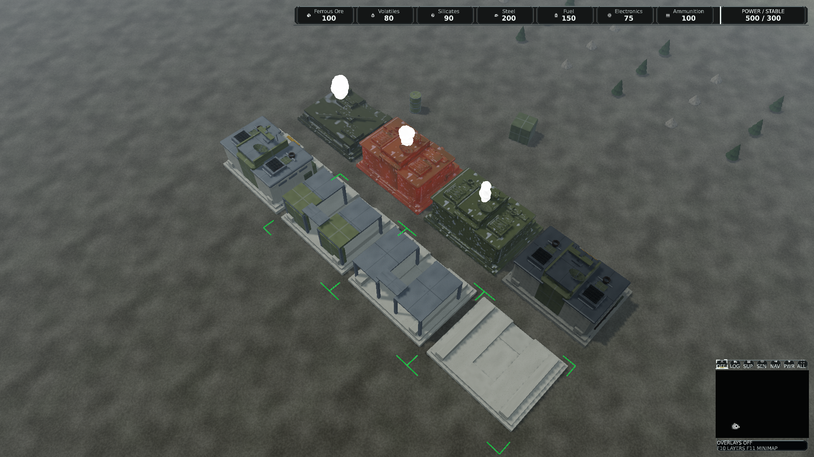

# Command Core Blender qualification, 21 October 2026

Status: implemented for draft review; production acceptance remains open.
The source and editing contract is in
[CommandCoreBlenderProduction.md](CommandCoreBlenderProduction.md).
[Qualification.json](qualification/command-core-blender/Qualification.json)
retains the source hashes, all measured cases, per-case CPU/GPU p50/p95/p99,
resource counters, package verification and final test totals.

## Source and revision boundaries

Original measured base: `d3acf9b0fb94da75ecfd26173cc387398f317096`, version `0.1.426`.
Current integration base: `538ddc0bd49a722462bf185cfc118cf5a3e5008f`,
`master`, version `0.1.427`. Branch: `art/command-core-blender`.
The PR allocates exactly one PATCH against that current base, `0.1.428`.
Current master was merged to preserve the exact captured commit identities.
Its changes add qualification tools, documentation, a Client test and version
metadata; production runtime source is unchanged. Final-base validation is
recorded separately below.

The captured client and reproducible package are bound to
`562435d9b252273f997a3639021ca22989c623a8`,
`0.1.427-dev+562435d9b252273f997a3639021ca22989c623a8`.
Subsequent changes correct test fixtures and authoring-source checks, normalize
four packed-image paths, and retain evidence. They do not change player source,
compiled mesh exports, runtime material/texture definitions or gameplay.

The genuine editable master is 17,131,559 bytes, SHA256
`6e8590cc36cb63c09a38f45ecf336c5d98e11c984310b90178db1fa83b25d48d`.
The earlier saved master was `883cbe9dad184409837b9cccd17d3f9932e5baafd8fce62351f35e08f519da7f`.
Blender changed only four packed texture path records: geometry, transforms,
UVs, normals and packed shader contents remained equal. The decompressed final
master has no internal workspace-path markers. All ten exported GLBs are
byte-identical across independent saved-master exports, a fresh Git checkout,
and the normalized final master. The legacy kit generator remains historical;
current runtime definitions explicitly reference the separate `blender/*.glb`
files. No reviewed geometry is regenerated on Export.

Original geometry derives from the repository's Command Core kit; the numeric
emissive mask is original. Shared PBR atlas provenance is retained. Three
sockets, centre pivot, basis, footprint, collision and state identities remain
unchanged. No new gameplay, simulation authority, physics or renderer interface
is introduced.

## Actual Blender and compiler checks

Blender **5.2.2 x64**, build `d13f752e3b9c`, ran through the pinned offline
launcher. Its saved project reopens and exports successfully. Twelve invalid
scene edits reject, including units, roots, sockets, module frames, UVs,
modifiers, animation, added objects, missing construction roots, material graph
changes and normals. An intentional saved piping edit changes only LOD0.
Two further native tests reject changed source material references and material
values. Git LF/CRLF conversion is accepted without accepting changed values.

Maximum observed editor normal encoding error is `5.1212125981692225e-05`;
authoritative normals are restored before the unchanged export comparison.
Maximum socket instance-world error is `1.2874603250168093e-07` metres.

The full compiler catalog has **1363 assets**, 309 meshes, 901 textures and
132 materials: **74,844,350 bytes**, versus 75,122,812 bytes at the base.
The isolated Core closure contains 21 assets: 11 meshes including the unchanged
collision proxy, four textures and six materials, totaling 7,800,507 bytes.
Both the full and isolated catalogs validate with absent source directories.
The canonical `assets/runtime` catalog is generated through the compiler.

Logical intact vertex/index bytes are 211,680 / 88,080 / 35,568 for LOD0/1/2.
These are not complete device allocations. Triangle counts are 1960 / 812 / 324
against the retained ceilings 4244 / 952 / 348. Source bounds and section counts
remain unchanged. No budget is increased.

## Native D3D12 evidence

Adapter: **NVIDIA RTX PRO 5000 Blackwell Generation Laptop GPU**, feature level
12_1, 25,309,478,912 dedicated bytes; driver **32.0.15.9653**. Hardware rendering
was used; the debug layer was unavailable. SDK 10.0.401 and .NET 10.0.12 were
observed.

There are **61 structural-pass cases**: 18 baseline, 18 corresponding candidate
gallery views, 12 candidate 1/100-instance workloads, four cardinal views, four
dark/wet views, two 35-metre access inspections and three installed-player
comparisons. Each has eight warmups, 32 samples and two repeated captures.
Every case has equal repeated pixels, zero mesh fallbacks, zero material binding
failures and zero submission faults. Requested profiles and native surface
sizes are recorded in the JSON.

The paired gallery covers Low/Medium/High, close/normal/strategic, 1080p/4K and
the existing eight ECS-derived states. The 1/100 workloads copy the extracted
operational presentation instance; they measure renderer instances, not a
100-building economic simulation. All 100 are visible. Low/Strategic selects
LOD2 for three instances and LOD1 for 97. Other cases exercise LOD0 and LOD1.
Selection, lifecycle transitions, sustained motion and LOD popping still need
separate interactive acceptance. The isolated workload HUD has no player
experience data; its waiting banner is diagnostic fixture context.

These are maxima of per-case p99 values among nine cases per display,
not pooled distributions or a controlled performance equivalence claim:

| Display | Before CPU p99 ms | After CPU p99 ms | Before GPU p99 ms | After GPU p99 ms |
| --- | ---: | ---: | ---: | ---: |
| 1920x1080 | 37.6677 | 43.9039 | 13.8592 | 15.5602 |
| 3840x2160 | 53.2997 | 65.7420 | 39.5566 | 40.3107 |

The workstation was shared, thermal/clock stability was not observed, and these
are short fixed-scene samples. The measured timings do **not** establish a
speedup, sustained FPS, complete live-client cost or performance acceptance.

Maximum resident texture bytes rise from 44,782,084 to **44,783,476**; descriptors
rise from 87 to **88**, within the unchanged 4096-slot capacity. The extra
1392-byte emissive texture remains resident alongside shared scene resources.
The selected family surface payload cap stays **7,325,040 bytes**. The unchanged
56-MiB compiled-content gate, excluding only studio splash textures, observes
**57,667,508 bytes** against 58,720,256. The 64-MiB resident-texture and 96-MiB
shared-pinned limits are unchanged. These distinct quantities are not interchangeable.

## Review images

The following are unmodified native captures, not approved goldens.

| View, Medium/1080p | Before | After |
| --- | --- | --- |
| Close tactical | [Before](images/command-core-blender/Before-CloseTactical.png) | [After](images/command-core-blender/After-CloseTactical.png) |
| Normal gameplay | [Before](images/command-core-blender/Before-NormalGameplay.png) | [After](images/command-core-blender/After-NormalGameplay.png) |
| Strategic | [Before](images/command-core-blender/Before-Strategic.png) | [After](images/command-core-blender/After-Strategic.png) |

[Access inspection](images/command-core-blender/AccessInspection.png),
[dark](images/command-core-blender/Dark.png),
[wet](images/command-core-blender/Wet.png),
[100 instances including LOD2](images/command-core-blender/RepeatedLowStrategic.png).



The revised roof equipment and protected spine remain readable in the close
gallery. Repeated atlas wear is still conspicuous on damaged surfaces. Material
coherence, role readability on physical displays and final artistic approval
remain human review items.

## Functional tests and installed package

All 14 test projects were executed in Release. Final per-project results total
**3213 cases: 3192 passed, 21 optional measurements skipped, zero failures**.
This includes all 170 Asset tests, 1564 passed/15 skipped Presentation cases and
450 passed/two skipped Client cases. **95 portable Python contracts pass**.
The Release solution and final committed client builds have zero warnings and
errors; the 44-project reference graph preserves architectural boundaries.

Earlier runs retain their original reports: an eight-minute native timeout,
prototype source/path checks, stale material test fixtures, and missing runtime
or repository-nested temporary-directory prerequisites. Final reruns use a
compiler-generated runtime catalog and the normal system temp directory. The
state-material renderer fixture now covers both Core-specific and shared
building materials. Failed captures and prototypes are not promoted to goldens.

`Publish-PreAlpha.ps1 -VerifyReproducible` produced equal publish manifests.
ZIP SHA256: `2beed0fae434ebf8d28d594dbf2e16f4afd2e84ec770b5d4b8c2b162378029b9`.
All **1487 extracted manifest hashes** verify; all 1363 runtime assets are present.
No Blender, GLB/glTF, authoring script or AssetCompiler files ship. The fresh
installed player captures the state gallery, single and 100-instance views;
all three match development pixels exactly.

Reproduction anchors:

```powershell
dotnet build ForgeLine.sln --configuration Release --no-restore
./build/Validate-ProjectReferences.ps1
python -m unittest discover -s tools/blender/tests -p 'test_*.py'
./tools/blender/Test-BlenderCommandCore.ps1 -OutputRoot artifacts/cc-review
dotnet test --solution ForgeLine.sln --configuration Release --no-build --max-parallel-test-modules 1
./build/Validate-SemVer.ps1 -BaseRef origin/master
./build/Publish-PreAlpha.ps1 -Configuration Release -VerifyReproducible -OutputRoot artifacts/cc-package -RuntimeAssetRoot assets/runtime
```

The local Blender checks were executed as their individual native/export/compiler
steps; the opt-in provisioned workflow job is registered but was not dispatched.
Its runner availability is not established by these local results.

## Integration decision

Keep the PR **draft**. [Renderer qualification #268](https://github.com/DaveBeusing/Forgeline/pull/268)
was merged into current master from `37ad6e0428894ecbc12aac8181c9092a1924230b`.
Integration does not itself establish completion of the recorded physical
performance, thermal, lifecycle or human acceptance requirements.
The original measured base's [build-test run](https://github.com/DaveBeusing/Forgeline/actions/runs/39506391125)
failed its Test step; downstream package checks were skipped. This is an inherited
record, not an identified Core regression. Current-master and new PR CI must be assessed separately.

Sustained paired performance/resource acceptance, human
art review, physical-display readability and interactive lifecycle/selection
review remain open. No merge, tag, release or new golden approval is authorized
by this evidence.
