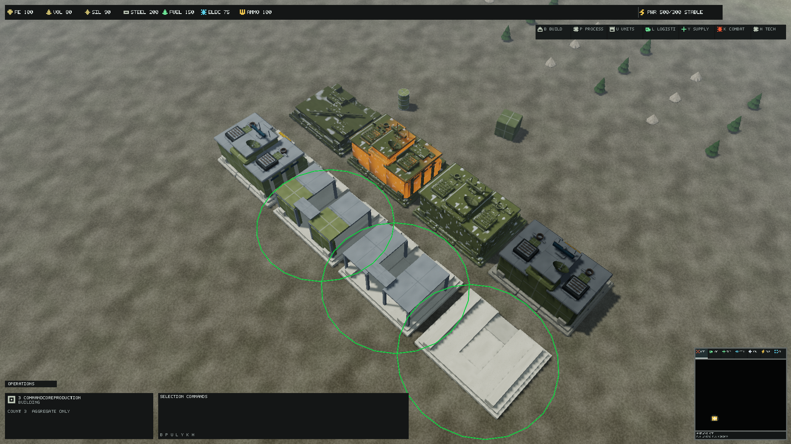

# Directorate Command Core production brief

The current production source and reproduction workflow are documented in
[CommandCoreBlenderProduction.md](CommandCoreBlenderProduction.md). The brief
below records the earlier parametric-kit milestone; its triangle counts,
source-of-truth and material restrictions describe that historical stage.

The existing identity is building.directorate.command_core; gameplay footprint
is 20 x 20 metres with 12-metre visual scale, centre pivot and +Y up/+Z access.
LOD0 previously had 300 triangles and LOD1/2 share the same 36-triangle source.
Its six box masses and three fittings lack recessed access, a readable
communications array, independent strategic reduction and authored construction.
Primary metadata has no sockets. The shared collision box remains unchanged.

Produce a low, wide reinforced headquarters, split command blocks surrounding
an access court, a broad communications spine, roof heat exchangers, tapered
blast walls, stepped foundation, recessed loading portal and serviced roof.
Use the current sixteen-cell PBR atlas with concrete, painted steel, structural
steel, glass, warning and equipment cells; no new texture or material family.
Keep one material section per mesh. Large roof/access landmarks survive LOD2.

Retain X [-.505,.505], Z [-.34,.48] and top Y .56 (20.2 x 16.4 x 12.72m
relative to the current transform). Deliberately extend only the foundation
bottom from Y -.34 to -.5: existing placement centres at half the 12m height,
so the old base floats 1.92m above flat ground. The new bottom seats at ground
without changing centre pivot, gameplay footprint, placement or navigation.
This is a cosmetic foundation change; collision/spatial authority is unchanged.
LOD1/2 will retain these extents to avoid silhouette/bounds jumps. No alternate
building definition, simulation changes or cosmetic collision detail.

Editable component recipes and a deterministic mesh exporter are the source.
Export standalone modular glTF pieces and dedicated assembled LOD0/1/2.
Construction and operational attachments are Command-Core-specific variants
of the existing state vocabulary; authoritative priority remains unchanged.
Destroyed geometry is a collapsed command/array wreck, not a physics object.
Socket additions are named authoring anchors only, with no new gameplay logic.

Visual acceptance requires production D3D12 renders at 120/420/1000m, normal
role read and state distinction. Compilation is not final art approval.

## Editable sources and reproduction

Edit `assets/source/buildings/directorate/authoring/command_core.kit.json`:
component dimensions, bevels, atlas cells, explicit LOD membership and state
recipes are independent of compiled runtime files. With Python and numpy,
run `python build/Author-CommandCore.py`. Use `--output <empty-directory>`
for an isolated reproducibility check. No DCC installation is required;
assembled and individual component glTFs are directly importable into glTF
editors. Each export embeds its own buffer and names the mesh. JSON recipes
remain the parametric source of truth; editing an exported mesh is an
explicit fork and is not silently imported back into the kit.

The `sources/command_core/kit` directory exports foundation, command blocks,
access portal, roof systems, communications, structural frame, partial shell,
isolation shutters, damaged plates, critical exposed ribs and wreck modules.
These are editable reusable authoring pieces, not eleven new runtime types.
Other Directorate families retain their existing source and state modules.
Existing bevel/detail batch scripts must not replace this family's new paths;
use this dedicated exporter when regenerating the Command Core.

| Runtime identity suffix | glTF filename | Triangles |
| --- | --- | ---: |
| primary | command_core_assembled_lod0.gltf | 4244 |
| .lod1 | command_core_assembled_lod1.gltf | 952 |
| .lod2 | command_core_assembled_lod2.gltf | 348 |
| .foundation | command_core_foundation.gltf | 108 |
| .structural_frame | command_core_structural_frame.gltf | 240 |
| .partial_shell | command_core_partial_shell.gltf | 288 |
| .unpowered | command_core_unpowered.gltf | 36 |
| .damaged | command_core_damaged.gltf | 48 |
| .critical | command_core_critical.gltf | 180 |
| .destroyed | command_core_destroyed.gltf | 204 |

All runtime identities have explicit asset metadata and one material section.
The three new LOD silhouettes retain the complete foundation, armoured wing
masses, open service mouth, communications spine, broad signal panel and dish.
LOD0 adds manufactured bevel faces, roof louvres, hollow exhaust collars,
windows, joints, hatches, hinges and antenna feed. LOD1 removes subpixel
fittings/bevels and reduces curved tessellation. LOD2 keeps the role landmarks
and removes most roof fittings. Projected-size selection and hysteresis retain
the existing engine policy. The old LOD1/2 shared 36-triangle representation
is retained as historical source, not referenced by the new metadata.

One section reuses structural atlas PBR; authored local face charts stay inside
an intended cell with the existing .018 inset. Faces have explicit outward
normals; the compiler generates tangent bases from UVs. Weathering and normal
relief come from matched existing production atlas maps, with no painted light,
AO in Base Color or new unique textures. Unpowered shutters obscure glazing
and close the broad signal panel. Damaged/critical add displaced armour,
exposed ribs and a hanging plate; existing material/VFX state remains active.
Destroyed substitutes low collapsed mass and a fallen communications mast.
State priority, construction progress thresholds and authority are unchanged.

Primary socket anchors are communications (0,.395,.06), service_access
(0,-.414,.25), roof_maintenance (.29,.19,.05). They are normalized in the
retained visual coordinate system and do not drive gameplay. The unchanged
shared collision proxy and 20 x 20 x 12m gameplay definition remain authoritative.
The new bottom -.5 seats at the centre sample; the existing terrain slope and
placement validity policies still govern permitted sites, not cosmetic detail.

Original ForgeLine component geometry has no external mesh, image or DCC
library input. Provenance is in the kit; repository ownership/terms apply.
No external license grant or final art approval is implied. All PBR sources
retain their existing provenance. `command_core.exports.json` records source
SHA256, vertex/triangle counts and extents for every generated file.

## Qualification method

Compile through the existing Asset Compiler; the catalog gains seven meshes:
348 assets, 165 meshes, 56 textures and 127 materials. Compiler outputs are
generated only. Run the visual inventory exporter after compiling. A fresh
export to an isolated directory matched all source hashes; every triangle in
the kit, assembled LODs and states was finite, nondegenerate, correctly wound
and paired with unit-length normals. Compiled tests check UV/tangent/material
sections, full LOD extents, descending index counts, an open loading mouth,
anchors, collision resolution and state references.

`CommandCoreProduction` is an opt-in immutable Central Divide terrain fixture
with three construction stages, operational, unpowered, damaged, critical and
wreck instances at the real gameplay scale. It derives all states through ECS
extraction. Existing family galleries remain available. Capture it through
`Invoke-RtsReferenceQualification.ps1 -Capture -Scenes CommandCoreProduction`
at CloseTactical/NormalGameplay/Strategic and native review displays. This
fixture checks fixed states; it does not prove continuous lifecycle motion,
selection interaction, physical-monitor readability or gameplay acceptance.

Qualification results and remaining acceptance limits are recorded below.

The raised foundation has a real sloped service ramp and a cut-through lane.
It rises from a six-centimetre front lip to the 1.032m loading floor across
4.6m, within the retained bounds. The entry anchor follows that threshold.
The ramp is cosmetic; vehicle pathing does not sample its triangles.

## Local qualification, 11 October 2026

Source/render revision: `18440019c5dccb21b1fecbce64d823bcfbd877d6`, based on
master `1e63a8e41f38278252a44b64ce5c74261744004c`. Build identity is
`0.1.345-dev+18440019c5dccb21b1fecbce64d823bcfbd877d6`; one PATCH increment.
Final runtime fingerprint:
`FF7EC2444C3B54C5529E8D01A155426BEA791CEB8D5CE0F308D81BDB47B131BC`.
Subsequent documentation commits do not change the captured model or binaries.

Restore and the 42-project dependency validation passed. The serial Release
solution build passed with zero warnings/errors; affected presentation/client
and test projects were rebuilt after their final changes. Focused compiled
building assets passed; 25 final state/gallery tests passed, including zero
allocated bytes during 1,000 warmed state-resolution loops. Graphics tests:
67 passed, two optional measurements skipped. All 21 final source exports
matched an isolated re-export by SHA256; triangle and normal checks passed.
The final canonical full solution run passed: 1,722 total, 1,713 successful,
nine optional measurements skipped, zero failures, 6m 35.196s; log
`artifacts/command-core-full-tests-final.log`. An additional unit catalog
expectation was updated to include the seven new meshes. Gameplay/content
definitions are unchanged; separate headless/terminal smoke was not repeated
locally. Remote CI still needs to exercise its complete required sequence.

Clean compilation and subsequent final-source incremental qualification passed
with no issues: 348 assets, 165 meshes, 56 textures, 127 materials. The final
inventory exporter passed. Runtime containers occupy 57,475,699 bytes:
2,530,653 mesh, 54,795,759 texture and 149,287 material bytes. Texture payload
is unchanged from the base. Mesh containers grew by 701,812 bytes overall.
The three assembled logical vertex/index buffers are respectively 479,856,
101,664 and 38,160 bytes; those figures are not total device memory.

The final `artifacts/command-core-native-production/manifest.json` reports
**structural-pass**, 36/36 cases with equal repeated native pixels, zero mesh
fallbacks/material binding failures, real requested backbuffer sizes and
active requested profiles. Matrix: Low/Medium/High, 120/420/1,000m,
1920x1080/2560x1440/3840x2160/3440x1440; eight warmups, 32 samples,
two captures each. This is native NVIDIA D3D12, not software rendering.
Adapter: RTX PRO 5000 Blackwell Generation Laptop GPU, feature level 12_1,
25,309,478,912 dedicated bytes; driver 32.0.15.9653. Debug layer unavailable.

Maximum per-case statistics across profiles/zooms (milliseconds):

| Native display | GPU mean | GPU p99 | CPU p99 | Max local device usage, bytes |
| --- | ---: | ---: | ---: | ---: |
| 1920x1080 | 23.095 | 25.635 | 29.311 | 402,780,160 |
| 2560x1440 | 28.276 | 32.901 | 64.395 | 494,120,960 |
| 3840x2160 | 47.185 | 52.569 | 54.381 | 732,672,000 |
| 3440x1440 | 32.552 | 41.812 | 40.668 | 567,980,032 |

Maximum visible instances: 224; instance draws: 27. Resident textures:
52,708,956 bytes, 187 descriptors; no pending retirements or submission faults
were reported. These are short gallery samples on a shared workstation,
including terrain/HUD/shadows, not isolated model cost, sustained gameplay
performance or a 60-fps acceptance. No baseline performance equivalence is
claimed. Earlier source/fixture matrices recorded a 1440p Medium normal-view
repeat mismatch; their evidence remains separate and is not an accepted
golden. The final matrix passed without promoting or overwriting them.

Production 1,000-instance smoke exited successfully in both native modes.
The canonical qualification passed at windowed 1600x900 (11 instance batches,
938/1,517 visible instances); borderless 5120x2160 produced a report with
13 instance batches and 950/1,517 visible instances, then failed the unchanged
11-batch gate. This wider-display gate was already an open base qualification
issue; this result does not establish a new cause or resolve it. Stress cubes
are deliberate fallback geometry and are not missing Command Core content.

## Visual observations and acceptance still pending

Unmodified native Medium/1920x1080 review captures from the final matrix:
[120m](images/command-core/CloseTactical.png),
[420m](images/command-core/NormalGameplay.png),
[1,000m](images/command-core/Strategic.png). These are review evidence,
not approved goldens or new runtime textures.

The close view shows the paired blocks, open access/ramp, roof equipment,
communications panel/dish, construction phases, isolation shutters, displaced
plates, critical ribs and a low wreck with a horizontal fallen mast. At 420m
the broad block/roof landmarks remain visible; fine equipment becomes small.
Existing atlas wear has conspicuous repeated chips in close views. Artistic
approval and coherent weathering review remain pending; compiler success and
pixel repetition do not supply that approval.

The unchanged 150/45-reference-pixel policy with 12% hysteresis retains LOD1
at 1,000m, including Low. No final gallery row selected LOD2. Its compiled
bounds, normals, tangents and descending index count are verified; a native
view beyond the transition is still required for LOD2 visual acceptance.
The terrain-following production selection circle encompasses the visual
bounds; it is not a rectangular foundation trace. The foundation seats at the
sampled centre. Slope-specific placement and vehicle traversal through the
cosmetic access are not newly qualified by this gallery.

Fixed-state ECS extraction verifies state bindings, not continuous
construction-to-completion or damage-to-destruction lifecycle acceptance.
Manual Central Divide lifecycle/placement/selection review, physical-display
readability, sustained motion, device removal and final artistic approval
remain open. Required remote `build-test` and relevant rendering/asset checks
remain pending until publication. The branch is suitable for draft review;
these explicit blockers prevent a merge-ready/final visual acceptance claim.

## Blender source preservation

The [Blender round-trip fixture](BlenderAssetRoundTrip.md) imports this family's
current source definitions, companion states, LODs and collision dependencies into
an editable project with named pivots and sockets. Isolated GLB exports pass the
same asset compiler and compare against the original runtime geometry/metadata.
This does not replace the parametric source owner or change gameplay dimensions,
material identities, rigid animation ownership or production asset paths.

## Bounded Blender surface review

The [surface and LOD workflow](BlenderSurfaceProduction.md) inspects this kit and its state/LOD dependencies with packed PBR inputs, calibrated modifier candidates and measured limits. Default output preserves the current three LODs and leaves collision/state sources unchanged. The kit generator remains authoritative; successful source clones are not automatically installed.
