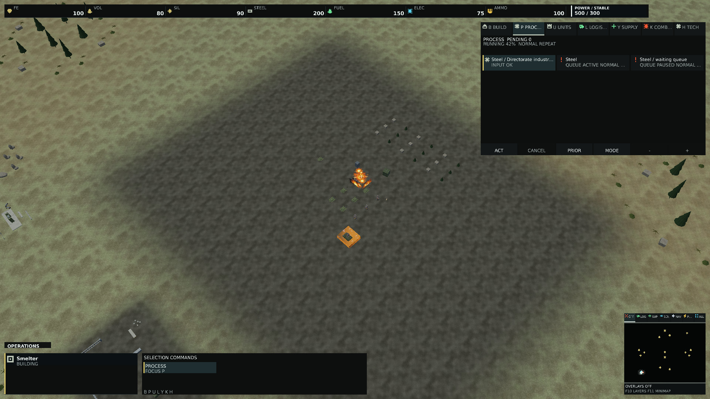
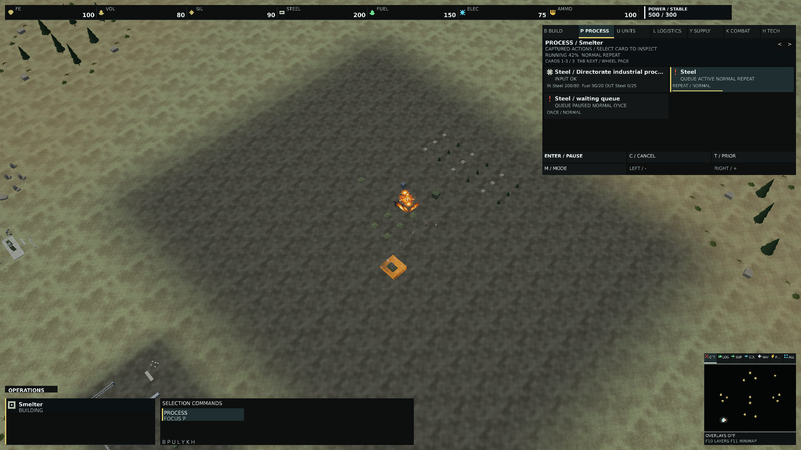
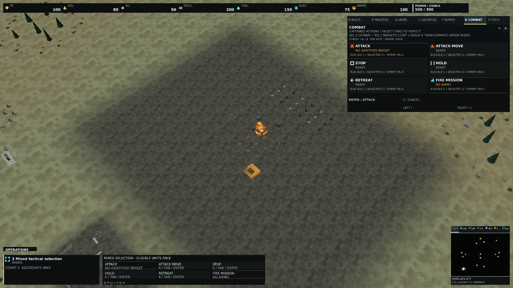
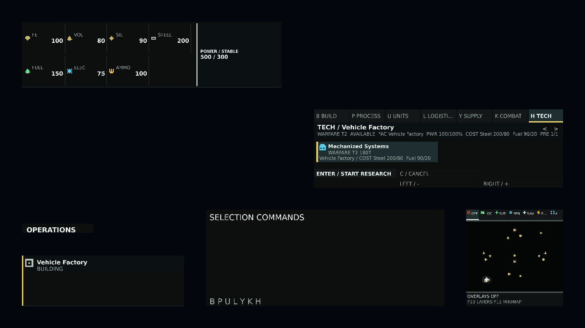
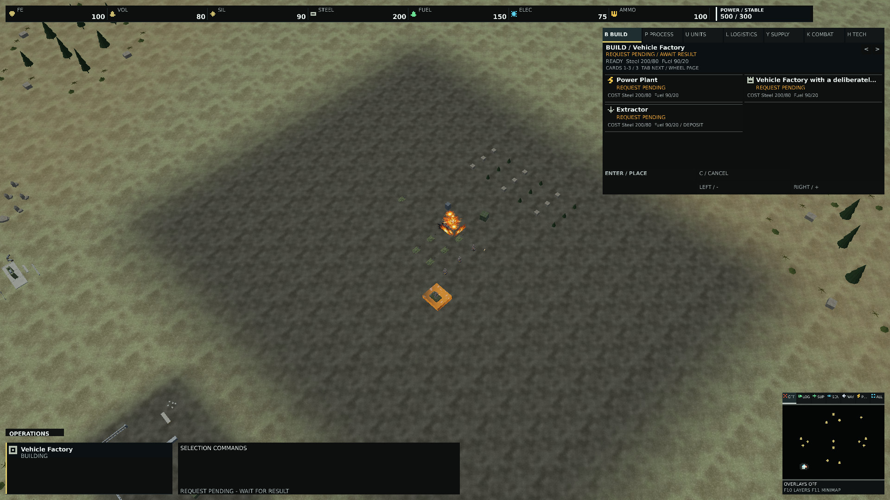

# Command dock qualification — 0.1.367

Qualified package source: fbebb54d067859d957e58940d38bb3c93db86f26.
Baseline: 4eb34e783d513bdbd179486f7eb0f0c0e196ab29, capture entry point added before production dock changes.
Subsequent benchmark-only changes use shared internal card geometry; they do not change the qualified dock methods.

## Validation
- Release build: zero warnings/errors.
- Presentation: 896 passed, seven opt-in hardware measurements skipped.
- Client: 261 passed. Game: 393 passed.
- Targeted navigation/geometry/context tests: 18 passed.
- Hover hot paths: 54 cases, zero warm allocations and bounded geometry.
- Project graph, version grammar and SemVer gate passed.
- Reproducible Windows x64 publish from a clean source tree: both publish manifests matched.
- Runtime catalog: 493 assets; font atlas/provenance/package checks passed.
- Normal packaged menu startup Ready. Windowed 1600×900 and BorderlessFullscreen 5120×2160 smoke: frames submitted/presented, no pending resize, no binding failures.

## Native coverage
353 cases: seven modes × five sizes (720p, 1080p, 1440p, ultrawide, 4K) × three DPI values (96/144/192) × scales 0.75/1/2, plus 38 blocked/pending/empty/accepted/rejected/queue reference cases. All repeated captures matched pixels; zero missing/dropped atlas glyphs. This tests layout DPI on a 144-DPI monitor, not physical certification on three monitors.
Fixtures are explicitly authored owned copied read models. They are never dispatched and are not a naturally played match. Original world intelligence remains intact; only the 1080p reference states include terrain/meshes. Existing client journeys exercise actual request paths.
Reviewed native examples: all seven modes, long names, prerequisites, missing materials/input/ammunition, queue work, pending and compact technology. Titles may ellipsize; explicit status and footer controls remain separate.
The retained gameplay-ui-geometry.json records the former debug bitmap layout. command-dock-geometry.json is a separately named implementation-reviewed candidate, not a human-accepted native golden.

## Performance
CPU null-graphics comparison: 120 matching rebound UI cases, 128 warmups and 256 samples each, TieredCompilation=0. Zero managed allocations after warmup on both versions. This measures full HUD rebuild, glyph geometry and requested uploads; it excludes actual GPU copies, world extraction, waits and Present. The baseline uses the same benchmark driver with the frozen pre-change Presentation assembly. The CPU reports retain the benchmark's assembly version (0.1.0.0), which does not identify its source revision; qualified source identities are recorded above and native reports record renderer hashes.
Native timings on NVIDIA RTX PRO 5000 Blackwell Generation Laptop GPU: complete clear/HUD/text frame without world, 64 warmups and 128 samples, distinct completed submission fences (124–126 GPU samples). CPU submit includes waits and Present. Runs are sequential on one machine with a time gap and variable system/power conditions; these observations are not a portable performance improvement claim.

| Mode | Before GPU P50 ms | After GPU P50 ms |
|---|---:|---:|
| Construction | 5.428 | 4.266 |
| Production | 5.576 | 5.191 |
| UnitProduction | 5.746 | 3.609 |
| Logistics | 5.535 | 2.630 |
| Supply | 5.550 | 3.338 |
| Tactical | 5.343 | 2.793 |
| Technology | 5.654 | 4.976 |

## Evidence
Full reports: [native before](evidence/command-dock/native-before.json), [packaged native after](evidence/command-dock/native-after.json), [CPU before](evidence/command-dock/cpu-before.json), [CPU after](evidence/command-dock/cpu-after.json), [hover](evidence/command-dock/hover.json), [package provenance](evidence/command-dock/package-provenance.json).
Full-resolution JPEG derivatives below are format-only conversions; original repeated pixel hashes are in the native reports. No composite or painted UI is used.







## Review status
Human native visual acceptance remains pending. On evidence revision ce5417a, [Frame hot paths](https://github.com/DaveBeusing/Forgeline/actions/runs/38631728670) and [Scalability qualification](https://github.com/DaveBeusing/Forgeline/actions/runs/38631728684) passed. The earlier hover fixture failure was traced to obsolete hardcoded coordinates and corrected using the shared card geometry; both the corrected local 54-case run and hosted hover gate passed.

[Main CI](https://github.com/DaveBeusing/Forgeline/actions/runs/38631728674) passed build, version, HUD, typography, asset and native WARP reference checks and was still running its Windows apphost reference completion contract at inspection. The cause and final result of that running step are not established. Subsequent window-mode smoke, full tests, hosted package, fresh-install and full-match gates were pending. Local packaged startup/windowed/borderless evidence does not substitute for those hosted checks.

Continuation verification passed nine dock/layout tests and twelve gameplay journey tests. The version preparation was idempotent at 0.1.367; one-PATCH SemVer, version grammar and the 42-project architecture check passed. Only benchmark friendship changes after the qualified package affect the Presentation project; dock runtime source is unchanged. No merge or release is performed.

Physical monitor transitions, complete live native command interactions, human visual acceptance and sustained whole-match performance remain unqualified. Keep the pull request draft until those required acceptance items and current-head CI are resolved.

## Reproduction

Run the packaged player with its compiled runtime asset directory and an empty output directory:

```powershell
ForgeLine.Client.exe --command-dock-capture <empty-output> <runtime-root>
ForgeLine.Client.exe --command-dock-reference <empty-output> <runtime-root>
dotnet test --project tests/ForgeLine.Presentation.Tests/ForgeLine.Presentation.Tests.csproj --configuration Release --no-build -- --filter-class ForgeLine.Presentation.Tests.PlayerActionDockHudTests ForgeLine.Presentation.Tests.CommandDockLayoutTests ForgeLine.Presentation.Tests.GameplayUiFixtureTests
dotnet test --project tests/ForgeLine.Client.Tests/ForgeLine.Client.Tests.csproj --configuration Release --no-build -- --filter-class ForgeLine.Client.Tests.GameplayInteractionJourneyTests
dotnet run --project benchmarks/ForgeLine.Rendering.Benchmarks --configuration Release --no-build -- --hover-hotpaths <report.json>
```

For the paired CPU measurement, run the existing `--gameplay-ui-hotpaths <report.json>` benchmark with `DOTNET_TieredCompilation=0` in that benchmark process only. Restore the previous environment value afterward. Preserve renderer hashes and use sequential workloads on the same adapter/driver for comparison. Captures and geometry candidates do not grant visual golden approval.
