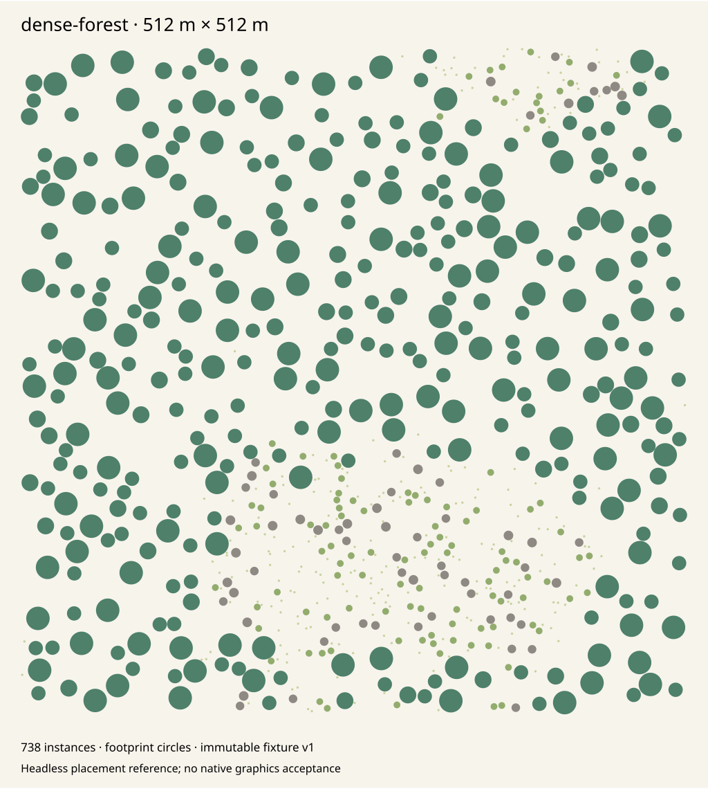
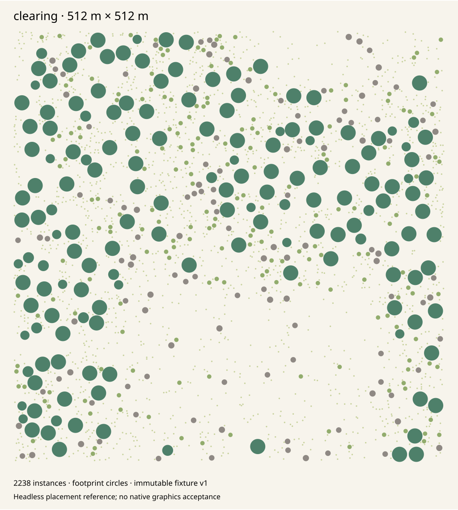
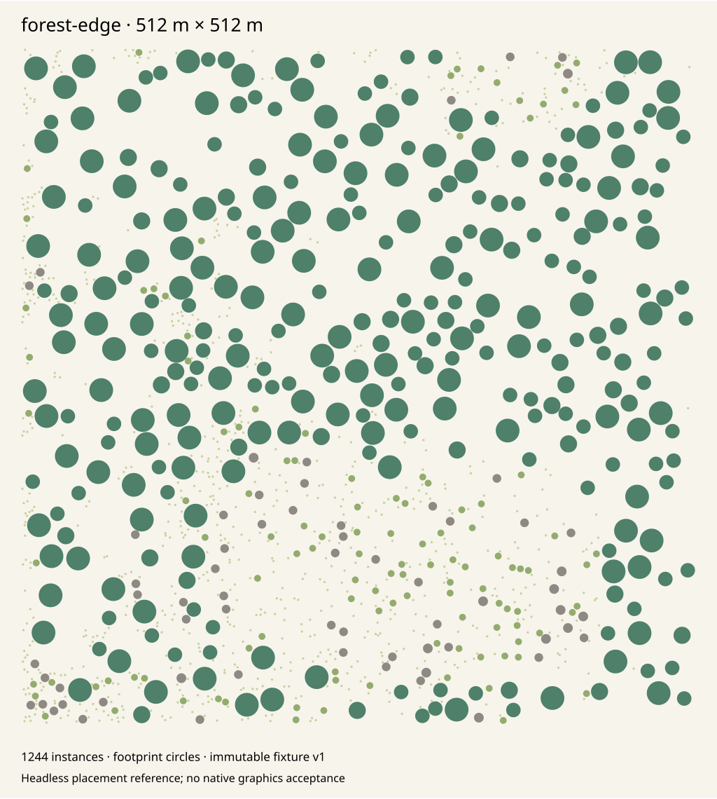
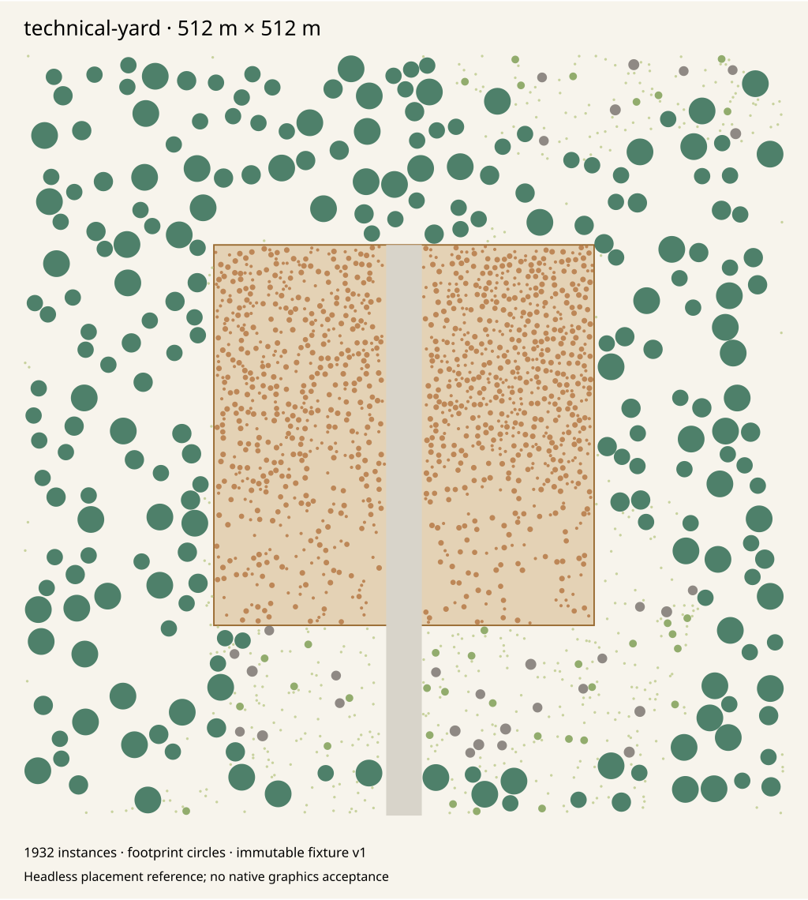

# Deterministic environment scatter

`EnvironmentScatterGenerator` produces immutable, palette-indexed decoration per
chunk. `BattlefieldScatterClearance` adapts existing gameplay geometry and the
strategic reservation raster into a frozen exclusion snapshot. Generation owns
no ECS entities, renderer, fog state, navigation obstacles or save payloads.
Existing authored maps, `WorldObjects`, static dressing extraction and scenario
loading are unchanged. Rendering, visibility admission and persistence of these
new sets require separate integration.

## Composition

Construct the generator from a validated `WorldGenerationRecipe`, an
`EnvironmentScatterProfile`, an immutable `IEnvironmentQuery` and a complete
`IScatterClearance` snapshot. `BiomeField` supplies the normal terrain, climate,
soil and softly weighted biome inputs. For a generated strategic layout, use
`BattlefieldScatterClearance.FromLayout(layout, accessSnapshot, decorativeYards)`.
That adapter retains all cells of `layout.Reservations` as hard exclusions.
The layout and environment must describe the same immutable world.

`accessSnapshot` must include every existing dock, conveyor port and construction
approach not already covered by construction/resource/traffic areas. The static
battlefield definition has no runtime facility list; this adapter does not infer
gameplay access from decorative meshes or read live simulation state. A caller
integrating existing runtime facilities must provide their complete frozen access
snapshot. Generating against a stale or incomplete snapshot is unsupported.

Decorative yard rectangles are explicit inputs. Hard gameplay exclusions always
win inside them. Industrial props require their complete footprint to fit in a
yard; vegetation and natural rocks cannot overlap a yard boundary. Without yard
inputs, the profile emits no industrial props. Annotating a construction area as
a yard cannot make it eligible for scatter.

## Version 1 placement

The grid is fixed at 256 m chunks, 65 terrain samples and 4 m candidate cells.
There is one candidate per global cell, jittered by 250..3750 mm on each axis.
Integer floor ownership handles negative chunks. No candidate lies exactly on
a cell or chunk border. The 64-bit identity packs the signed global Z/X cell
coordinates as two's-complement uint32 values, Z in the upper half. Zero is a
valid decoration identity; it is not an ECS `EntityId`. Consumers namespace IDs
by world/gameplay and decoration identity, not by the bare cell ID across worlds.

Indexed `WorldGenerationRandom.At` calls supply four fixed streams:

| Stream | Purpose |
|---|---|
| `0x534301` | Candidate jitter and density draw |
| `0x534302` | Weighted species, scale, yaw and tint |
| `0x534303` | Local priority and budget admission |
| `0x534304` | Smooth global cluster lattice |

Vegetation owns natural candidate streams; the Props domain owns candidates whose
cell centers are in explicit yards and industrial variation/priority. Cubic
smoothstep value noise uses integer UNorm16 arithmetic and a profile-defined
global period. Its scalar field controls density and tree/shrub/grass weights,
producing groves, sparse clearings and soft margins without chunk-local reseeding.
Biome weights, slope, moisture, soil and temperature further filter and weight
species. Missing environment samples produce no candidate. Invalid normalized
biome data fails explicitly. Water is excluded; built surfaces permit industrial
props only inside explicit yards. Habitat inputs are sampled at the anchor;
gameplay clearance tests use the entire conservative footprint.

Eligible raw candidates are thinned by a finite neighbor halo. Trees precede
rocks/industrial props, then shrubs, then grass; hash priority and stable ID break
ties. Any intersecting eligible raw neighbor with lower ordering suppresses the
candidate, even if that neighbor is itself suppressed elsewhere. This is a
conservative local-priority process, not order-dependent greedy placement or a
maximal Poisson packing. It can leave extra empty space. The halo covers twice
the largest profile radius and is evaluated independently across chunk edges.
Every call owns its own scratch array; no global mutable RNG or accepted-instance
list influences neighboring chunks.

All output centers and conservative spacing circles remain inside the recipe's
world rectangle. Changing that rectangle is changing a generation input and may
change edge admission and quotas. Changing chunk request order or render LOD
cannot change output for the same complete recipe and snapshots. Render quality
is deliberately absent from the generator API; later rendering may filter the
fixed desired scene without regenerating it.

## Profiles and assets

`EnvironmentScatterProfile` copies and ordinally sorts its bounded species
palette. Every asset ID must be a unique lowercase ASCII identifier. Species
records contain classification, physical target bounds, maximum-scale spacing
radius, scale range, vertical pivot, biome affinities and habitat limits.
All numerical rules are included in canonical output identity. Version 1
defaults reference these existing mesh families:

| Classification | Existing asset IDs |
|---|---|
| Trees | `mesh.world.vegetation.conifer`, `mesh.world.vegetation.broadleaf`, `mesh.world.environment.conifer_swept`, `mesh.world.environment.broadleaf_asymmetric` |
| Shrubs | `mesh.world.vegetation.scrub` |
| Grass patches | `mesh.world.vegetation.grass_clump` |
| Rocks | `mesh.world.prop.rock`, `mesh.world.environment.rock_leaning` |
| Yard props | `mesh.world.prop.crate`, `mesh.world.prop.drum`, `mesh.world.prop.pallet` |

No new mesh, texture, third-party dependency or asset license is introduced.
These are frozen placement profiles referencing the existing catalog and variant
namespace; generation performs no asset import or runtime catalog I/O. A future
render consumer must resolve and validate the palette against its compiled catalog.

`ScatterTransform.SizeMeters` is the desired pre-yaw physical bounding-box size,
including the instance's scale variation. It is **not** an unchecked multiplier
for arbitrary source-mesh coordinates. A consumer normalizes the resolved mesh
bounds about their X/Z center and the species' declared vertical pivot before
applying this size. `PivotHeightPermille` is zero for rooted plants and 500 for
centered props. The returned Y includes the corresponding offset above sampled
ground. Yaw is the only orientation; normal-aligned tilt is not implemented.
The validated radius encloses the largest scaled horizontal box under every yaw.
Native mesh/anchor fidelity must be qualified when the rendering adapter is built.

## Gameplay clearance

An immutable 64 m spatial index stores rectangles, capsules and yard zones using
signed floor addressing. Queries visit overlapped buckets and test exact integer
rectangle-circle or capsule-circle geometry; capsule projection uses `Int128`.
It does not allocate fake entities to use the mutable entity spatial index.

The battlefield adapter preserves the authored minimum buffers, plus the selected
species' complete maximum-scale radius:

| Input | Additional clearance |
|---|---:|
| Start/site construction rectangle | 12 m |
| Resource horizontal bounding circle | 24 m |
| Road centerline capsule | 28 m |
| Crossing passage rectangle | 32 m |
| Explicit dock / construction approach | 12 m |
| Explicit conveyor port | 8 m |
| Static navigation obstacle | Its complete rectangle |
| Existing authored world object | Its rotated horizontal bounding circle |

Rectangle endpoints round outward to millimeters. Road/resource/object capsules
include a 2 mm guard for endpoint/center quantization. World extents round inward.
The strategic mask is checked directly with integer 16 m addressing against every
overlapped footprint cell, including boundary cells. This avoids converting mask
queries through float positions. No reserved flag can be overridden by a yard.
Both index geometry and the complete retained mask contribute to clearance SHA-256.

## Bounds and budgets

| Limit | Version 1 |
|---|---:|
| Physical coordinate magnitude | 1,000,000,000 mm |
| Candidate spacing grid | 4,000 mm |
| Species palette | 1..64 entries |
| Spacing radius | 250..16,000 mm |
| Target width/depth | 1..32,000 mm |
| Target height | 1..64,000 mm |
| Uniform scale | 250..2,000 permille |
| Density | 0..1,000 permille |
| Cluster period | 64,000..1,024,000 mm |
| Per-chunk instance cap | 1..4,096 |
| Total instance cap | 1..4,000,000; default 1,000,000 |
| Clearance input areas | At most 65,536 |
| Spatial cell references | At most 2,000,000 |
| Clearance padding | 0..128,000 mm |
| Strategic reservation raster | At most 1,000,000 cells |

The shared recipe's existing grid/sample-count limits still apply, so not every
nominal instance cap can be filled by every extent. A per-chunk quota divides
the total cap by the recipe's chunk count; the first Z/X ordinals receive the
remainder. Accepted candidates with the smallest priority/ID are retained to that
quota, then sorted by stable ID. Unused quota is not redistributed according to
loading order. The total is a strict ceiling, not a promise of requested density.

Maximum halo width is eight cells; generation scratch contains at most 80x80
candidates. There is no persistent chunk cache. Callers may retain immutable
outputs under their own explicit byte/count budget, or stream and release them.
Current output retains both a struct array and canonical bytes; the 28-byte wire
size below is not a 28-byte total process-memory claim. No instances are appended
to `BattlefieldMapArtifact` or serialized as per-instance JSON objects.

## Canonical output and fingerprints

Each chunk holds its palette, sorted immutable instance records and defensive
canonical bytes. A record has exactly 28 little-endian bytes:

| Field | Encoding |
|---|---|
| Stable cell ID | uint64 |
| Local X, absolute Y, local Z | Three int32 millimeter values |
| Palette index, yaw, scale | Three uint16 values; yaw in centidegrees, scale in permille |
| Tint, classification | Two bytes; tint UNorm8, classification values 1..5 |

The canonical header writes uint32 `0x31435453` (`STC1`), length-prefixed canonical
recipe bytes from an empty `WorldGenerationFingerprint.Gameplay`, the complete
profile/version/parameters and ordinal species records, and length-prefixed
32-byte clearance SHA-256. Chunk X/Z/count int32 values and packed instances
follow. `Sha256` hashes the full byte sequence. The recipe-only header is input
identity, not a claim of complete gameplay content.

`CreateDecorationFingerprint(gameplay)` binds the chunk to the caller's complete
gameplay identity using the existing separate Decoration contract. Canonical data
is split into schema-1 `0x53430001` records of at most 65,536 bytes at the canonical
chunk-origin sample coordinate; page index is the record's stable ID. This remains
within the existing per-fingerprint limits. For large scenes, retain chunk
decoration fingerprints and hash their sorted sequence; do not put millions of
instances into one 16 MiB canonical container. Decoration never mutates gameplay
identity. Cache ownership must retain the complete snapshot/recipe context.

Input environment queries must be immutable for the generator lifetime and for
parallel calls. Pure integer placement has fixed reference vectors; that does
not turn arbitrary floating terrain/normal providers into cross-platform proofs.
Windows x64 / SDK 10.0.402 is the executed qualification boundary.

## Diagnostics and reference plots

After the normal Release build:

```powershell
dotnet run --project tools/ForgeLine.MapCompiler/ForgeLine.MapCompiler.csproj --configuration Release --no-build -- --scatter-diagnostics --seed 17 --maximum-instances 10000 --qualification-output artifacts/environment-scatter/report.json --reference-plots artifacts/environment-scatter/references
pwsh ./build/Test-EnvironmentScatter.ps1
```

The main report uses actual Central Divide terrain, BiomeField and authored
gameplay clearances. It includes per-chunk counts/hashes, palette distribution,
whole-footprint exclusion violations and a deterministic aggregate decoration
identity bound to actual map/terrain source hashes. Only bounded summaries are
JSON. Invalid options, profiles or budgets fail before scatter allocation.

The four plots use explicitly synthetic immutable 512 m fixtures: forest biome,
meadow clearing, smoothly mixed forest edge, and a built yard with a reserved
approach. They show conservative footprint circles, not native meshes, lighting,
approved art or physical graphics acceptance. Seed and chunk hashes are embedded
in each SVG description. Re-run the command to reproduce them.

| Dense forest | Clearing |
|---|---|
|  |  |

| Forest edge | Technical yard |
|---|---|
|  |  |

## Executed qualification

Source base: master `1f006f7f67ba48dc58ee21f4141ec2d3f6ab3bdf`, plus the scatter
implementation and tests in this PR; .NET SDK 10.0.402, Release, Windows x64.

- Canonical solution restore and Release build pass with zero warnings/errors;
  the unchanged 46-project reference graph has no cycles or boundary violations.
- The World suite passes 89 cases, including four fixed signed-chunk hashes,
  parallel/reversed generation, all-pairs cross-chunk spacing, independent
  brute-force clearance parity, quotas, immutable output, water/built/slope rules,
  actual procedural terrain/biome sampling and a one-million-instance streaming
  fixture. Existing tests remain unchanged.
- 53 selected Game cases pass: new gameplay clearances, existing dressing,
  strategic layout/reservation qualification, compiled terrain/scenario/navigation
  parity and match persistence. Both authored map and terrain hashes remain at
  their registered values. Five registered scenarios pass headless startup,
  Save/Replay recovery and missing-content rejection.
- CLI seed 17 with a 10,000-instance cap yields 8,035 instances and zero blocked
  footprints; repeated aggregate SHA-256 is
  `0db7e1f080eb9270ecd09cfacff4a5ad670666bcba4390aa01412e5bf9434be4`.
  All four SVG fixtures were rendered and inspected. Forest has more tree
  placements than clearing; yard props stay inside the annotated zone and the
  approach remains clear. Unknown options and invalid budgets fail explicitly.
- The streamed grass-only fixture uses seed 17, 30x30 chunks at (-15,-15), a
  64 m cluster period, density 1000, a 400 mm radius and a 1,000,000-instance cap.
  It produces exactly 1,000,000 records, at most 1,112 in one chunk. One local
  run observed 2,036.5007 ms and a maximum sampled `GC.GetTotalMemory(false)` of
  5,632,208 bytes while releasing chunks. This is a shared-host observation,
  not a timing gate, process working-set peak or retained-scene memory budget.

The ordinary required `build-test`, production asset/package checks, native
acceptance and natural terminal match remain separate gates. No test, reference
hash, allocation threshold or match rule is weakened. This module adds no runtime
renderer or persistence behavior, and does not claim native visual acceptance.
