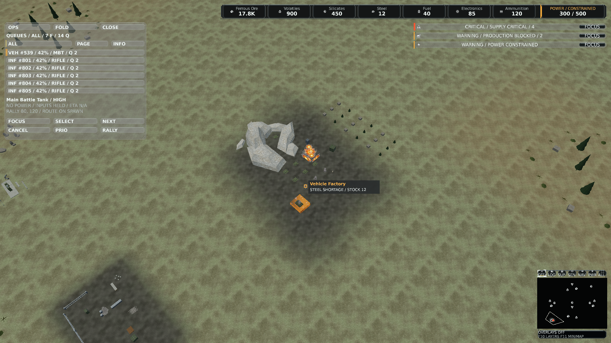
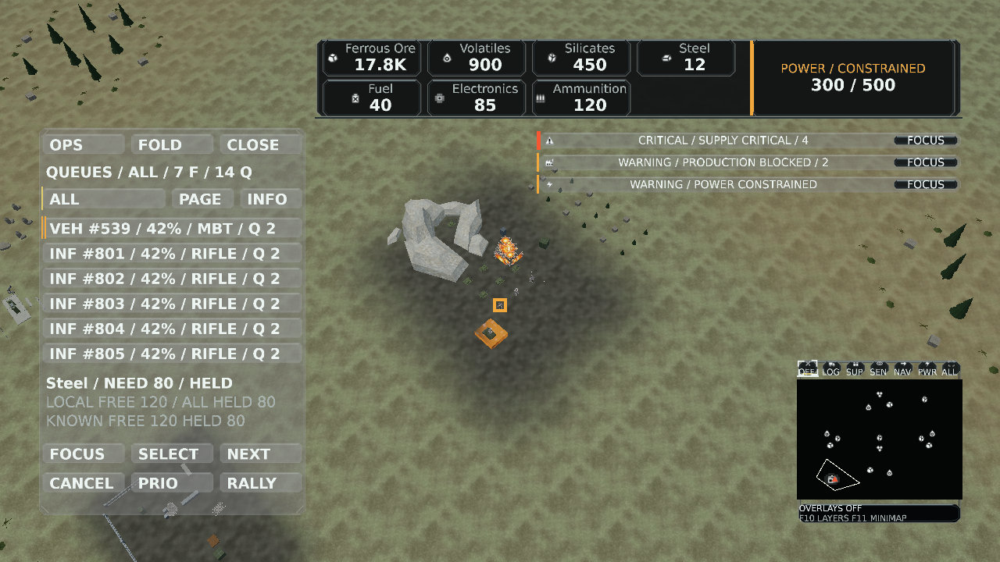
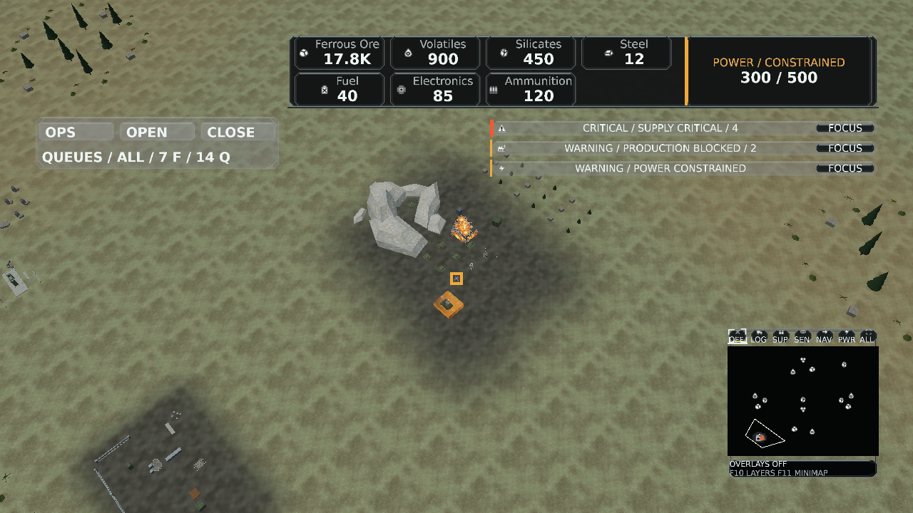

# Global production qualification

## Behavior

The prior Operations list reported factory queue counts and entered selected controls. The QUEUES view adds a bounded per-order projection, role/selection filters, deduplicated free/reserved input detail, collapse and existing cancel/priority/rally actions. Simulation production, inventory transfers, pricing and routing remain authoritative. ETA stays unavailable.

Base: master 8749198f89ce1f1c90684c0bcb3f8a3398e28f45. Release version: 0.1.505. [Source and binary identities](validation/global-production/source-manifest.json) bind the local qualification. Assembly informational metadata identifies that base revision; canonical source blob hashes identify the feature edits.

## Automated results

- Release solution build: zero warnings, zero errors. The final capture-only fixture adjustment also builds the Client project without warnings/errors.
- Presentation suite: 1,913 passed, 66 external native/Blender qualifications skipped. Following the final header-width and pause-input guards, all 150 directly affected cases passed again.
- Client suite: 534 passed, two explicit native-audio cases skipped. Rally uses the existing command.move artwork role; catalog and generator remain aligned.
- Game production/gateway/persistence suites: 61 passed, including input reservation, shortage/power recovery, cancellation, rally movement, owner rejection and exact save/replay state equality.
- Canonical runtime validation: 2,049 assets qualified (940 meshes, 919 textures, 149 materials, 38 animations, two skins). This validates a reused compiled catalog; no new asset compilation is claimed.
- Canonical Windowed and BorderlessFullscreen smoke: passed with the 1,000-instance stress option, matched surface/window dimensions, successful Presents, no pending resize/occlusion and zero material binding failures. The available device did not enable the optional D3D12 debug layer.

## Native visual evidence

The [39-case report](validation/global-production/qualification.json) records repeatable pixel hashes, complete glyph coverage, bounded geometry, exact assembly hash and the NVIDIA RTX PRO 5000 Blackwell Generation Laptop GPU. Cases cover summary/material/collapsed views, three displays, 96/192 DPI, scale 1/2 and reference strategic zoom. Three representative PNGs are retained. The inputs are authored owned snapshot facts over the existing native battlefield fixture; these are not a natural-match recording or an approved golden.

At 1920x1080/96 DPI/scale 1, 64 warmups and 128 samples measured HUD-only median GPU times of 0.113 ms (summary), 0.113 ms (materials), 0.107 ms (collapsed). CPU submit medians were 566/749/605 microseconds and include waits/Present. They are observations on this device, not whole-match FPS or a controlled before/after speedup. Render regression tests separately require zero warm allocations and fixed vertex budgets. Capture retains bounded output at 1/16/300/1,000 owned factories; source scans still scale with live requests.

Physical monitor transitions, a human gameplay journey and route success for every rally destination remain separate acceptance exercises. Rally explicitly promises a destination, with normal navigation from spawn, rather than pre-certifying a route. No simulation migration is introduced.

CI status is recorded on the pull request for its exact head revision. Local results do not substitute for those required checks.
