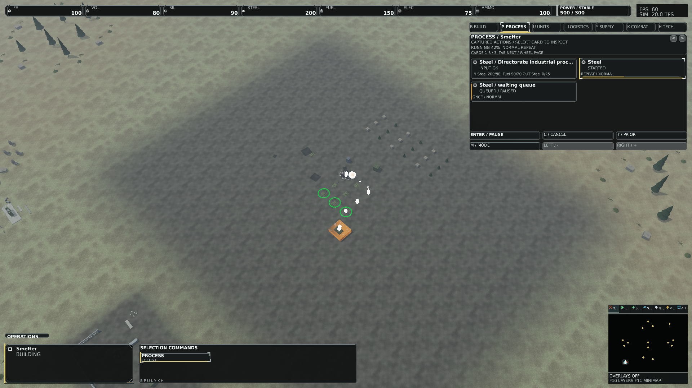
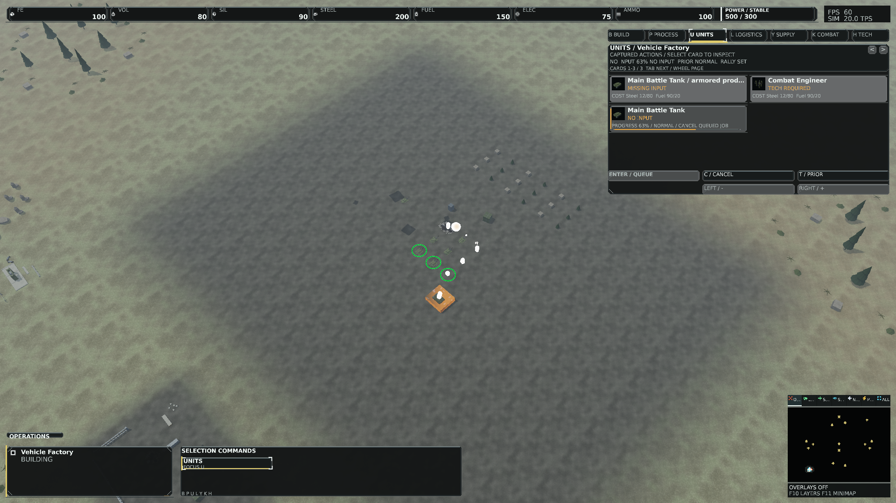
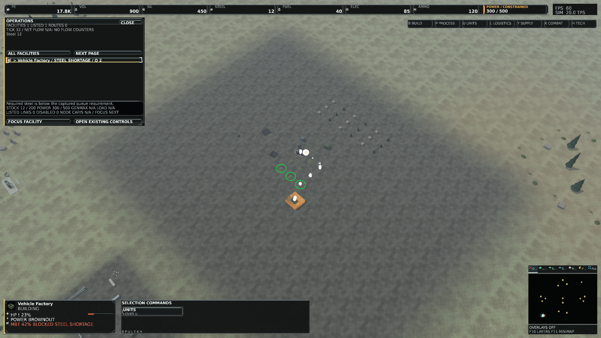
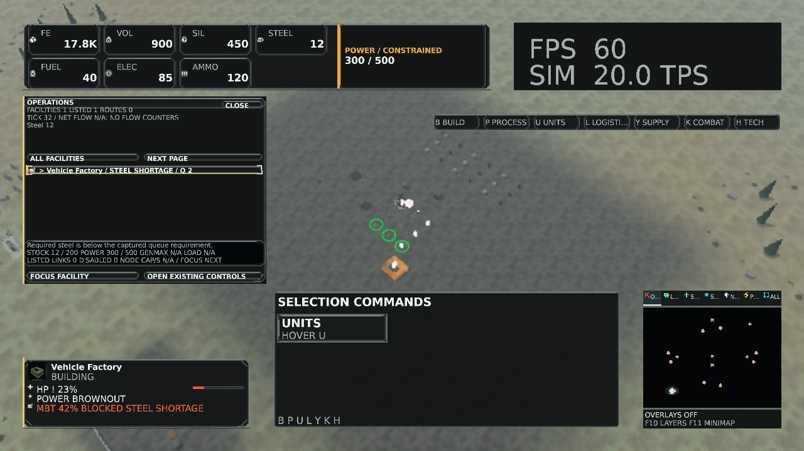
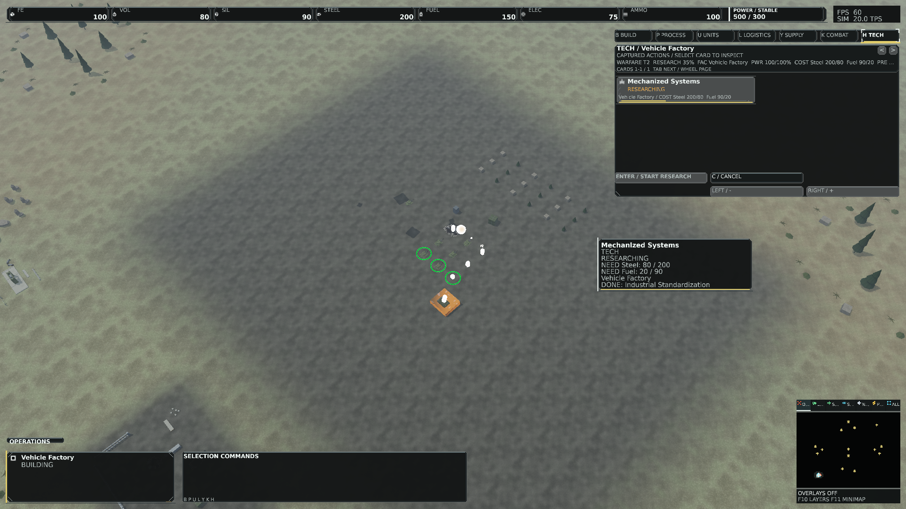

# Graphical production and operations qualification

## Source and status

Base master `dd8ba8bb458c39c25f269ce10604f3de370b988b` (0.1.377-dev); production/test/native/package source `7e408b0357f437ef683fd4f7ecf6af83b09bebb5`. Branch `ui/graphical-operations`, [PR #212](https://github.com/DaveBeusing/Forgeline/pull/212), exactly one PATCH to **0.1.378-dev**. Later commits retain documentation/evidence only. [Implementation and contracts](GraphicalProductionAndOperations.md).

Human art, legibility/accessibility, physical-monitor and live interaction/motion approval remains **pending**. No checksum or automated capture grants that approval. Keep draft while required CI or acceptance is outstanding; no merge, tag or release is performed.

| Check | Result |
| --- | --- |
| Release restore/build | Passed, zero warnings/errors |
| Architecture | Passed, 43 projects, no cycles |
| Version contracts | Passed: grammar, one PATCH, idempotence, isolated allocation harness |
| Canonical runtime asset integrity | Passed, 1,337 registered assets, unchanged payloads |
| Focused presentation/native/geometry tests | 170 passed, zero failed/skipped |
| Complete Client suite | 298 passed, zero failed/skipped |
| Final native layout/state matrix | 412 passed, exact repeated pixels; complete glyphs |
| Complete isolated-module solution run | Passed: 2,071 successful, zero failed, nine skipped |
| Natural terminal match, seed 2026 / 80,000-tick ceiling | Passed: Victory / CommandCoreDestroyed at tick 42,922; exit 0 |
| Reproducible source-less package | Passed; two publish trees matched |
| Packaged rendering / fresh defaults | Six exact PNG/RGBA matches; smoke exit 0, createdDefaults=True |
| Required current-head CI | See source CI and PR; complete green not claimed |
| Human graphical / hardware / accessibility review | Pending |

Exact final solution summary (failed runs remain failed even if a focused check passes):

```text
gesamt: 2080
fehlgeschlagen: 0
erfolgreich: 2071
übersprungen: 9
Dauer: 9m 04s 747ms
```

[Source CI run 38818542593](https://github.com/DaveBeusing/Forgeline/actions/runs/38818542593): completed / failure. No threshold, allocation assertion, fixture golden or natural terminal requirement is weakened. Original source logs and statuses are in the hashed record archive. The preceding allocation-test failure did not recur: the complete current-source suite passed with unchanged assertions. No allocation-root-cause fix is claimed. Main CI stops at the unchanged catalog budget: 99,608,050 gameplay texture bytes exceed 58,720,256 bytes (56 MiB), build/Invoke-WindowModeQualification.ps1 line 232. Source-run steps 22 (battlefield skin) and 24 (economy/Operations privacy) pass; later full-test/publish/terminal CI steps do not execute. Local full regression, package and natural terminal results are separate. [Frame hot paths](https://github.com/DaveBeusing/Forgeline/actions/runs/38818542601) and [Scalability](https://github.com/DaveBeusing/Forgeline/actions/runs/38818542586) pass at the production source.

## Authoritative outcome

The local natural match reaches Victory / CommandCoreDestroyed for player 1 at tick 42,922, below the 80,000-tick ceiling. Integrated copied metrics report 268 completed cargo jobs, 23,386.1 cargo delivered, zero cargo failures and zero route failures. No forced result, resource grant or terminal-gate adjustment is used. Existing gameplay conservation, production, loss-of-power and route tests also pass in the complete suite. Game/economy/logistics/simulation/headless sources are unchanged; no paired baseline-outcome comparison is claimed.

## Native identity and coverage

[Evidence index](qualification/graphical-operations/evidence.json) hashes the original reports/logs, package identity and copied PNGs. [Original records](qualification/graphical-operations/qualification-records.zip) preserve their bytes. Final immutable local roots:

- `artifacts/operations-ui-final`: 17 named 1080p / DPI 96 / scale 1 states.
- `artifacts/operations-ui-final-compact`: 27 cases, nine states at 720p / DPI 144 / scales .75, 1, 2.
- `artifacts/operations-ui-final-4k`: nine states at 4K / DPI 192 / scale 2.
- `artifacts/operations-ui-final-wide`: six Operations full/empty/missing cases at 1440p and ultrawide / DPI 144 / scale 1.
- `artifacts/operations-dock-final-matrix`: 353 cases covering all seven modes, five sizes, three DPIs/scales plus blocked/pending/queue/empty/accepted/rejected states.
- `artifacts/operations-ui-packaged`: six byte/pixel-identical packaged views.

Normal/failure coverage includes shortages, NoPower/NoInput/OutputFull/invalid inventory, absent providers/routes, paused/queued/started requests, pending and accepted/rejected commands, current technology requirements/completion, missing/stale/destroyed facility selection, filter/row/input behavior and privacy. Native state fixtures are authored copied facts, never simulation commands or a naturally played match. FPS/TPS labels in these fixtures are sample values; actual timing evidence is separate.

Client SHA-256 `F618DC0AC7210B1CB13819E8C2AF371B0F81675D19C050A523576318DA94E577`; Presentation SHA-256 `B899D6CD79A57556996F83764D6472828C95EF95A3BF11EEE1B26B0E53C2D74F`. Development runtime fingerprint `7E9E2DF8E7569BD0F8992ED30488040A2CBC4ED7DE071F54A7853D2EC9AD4E3C`. Compiler 1.10.0; content signature `b6cbe90cbbd4dfc780abb28f5d42f7bc3b469ae0cf4e663f594975a2bfd219d9`. No source artwork, definitions, compiled sprites or simulation/headless sources change.

Compact/4K/wide world rendering uses resolution scale .5; UI remains at native output resolution. Requested backbuffer sizes and layout DPIs are recorded separately from the physical host monitor (1280x720, DPI 144). Native WARP functional/lifetime tests pass; the D3D debug layer is unavailable locally, so no debug-layer certification is claimed.

Earlier immutable `operations-ui-current` belongs to c7bbc836. The complete e5830cdc cohort uses `operations-ui-qualified`, `operations-ui-compact`, `operations-ui-4k`, `operations-ui-wide` and `operations-dock-matrix`. These are preceding inspection cohorts, not substitutes for final source evidence. Inspection corrected thin meter centre loss, focus-border overlap and the translucent Operations backing. Native tests now assert those actual pixels; original bitmap command fixtures pass unchanged.

## Measured costs

Seven shared atlas pages still occupy **28 MiB**. Twelve bounded batches retain 48 upload buffers / 5,603,328 bytes. Across final named states: 7-23 skin draws, 1,434-3,102 vertices, 45,888-99,264 uploaded vertex bytes; zero missing/dropped sprites or glyphs. The existing font and legacy geometry costs remain separate. Warm skin recording and copied work-state resolution allocate zero managed bytes in their focused contracts; native recording adds no texture uploads. This is not a claim that every whole-client path is allocation-free.

NVIDIA RTX PRO 5000 Blackwell Generation Laptop GPU. Each row measures a complete clear/HUD/text frame without world rendering: 64 warmups, 128 samples, 126 GPU samples. CPU submission includes waits/Present. No portable performance improvement, approved budget or whole-match FPS claim follows from these observations.

| Mode | GPU P50 ms | CPU submit P50 microseconds |
| --- | ---: | ---: |
| Construction | 2.773216 | 4989.2 |
| Production | 2.810720 | 5212.6 |
| UnitProduction | 2.804736 | 5432.0 |
| Logistics | 2.768352 | 5183.0 |
| Supply | 2.807648 | 5281.5 |
| Tactical | 2.875616 | 5435.1 |
| Technology | 2.747552 | 5152.8 |

## Source-less package

`artifacts\graphical-operations-package\FORGELINE-0.1.378-dev-win-x64.zip`, 39,985,510 bytes, SHA-256 `d59d0aa622bb3bcb85549db117ee329c6fd85e11c2a7f512885f1911458c76c6`. Independently verified 1,403 manifest entries and all 1,337 registered payload sizes/hashes. No source/reference files are packaged. Fresh settings smoke uses a new isolated root and never edits user LocalAppData.

All 1,338 shared runtime files are byte-identical to development. Package runtime fingerprint `E98FAE074E6B4AAB7FA89F02B522856EDFC79B4D8E7F83CC94A0E9947F2DB46A` differs because the package includes six approved PCM/video playback sidecars: four UI cues and the studio WAV/MP4. No file is removed or fingerprint normalized to force equality. Six matching named views have identical encoded PNG and decoded RGBA hashes.

## Reproduce

Use the SDK/Microsoft.Testing.Platform pinned by `global.json`; commit and rebuild before capturing. Fresh roots are mandatory; existing evidence is never replaced.

```powershell
dotnet restore ForgeLine.sln
dotnet build ForgeLine.sln --configuration Release --no-restore
./build/Validate-ProjectReferences.ps1
./build/Build-RuntimeAssets.ps1 -Mode development -NoBuild
dotnet test --project tests/ForgeLine.Presentation.Tests/ForgeLine.Presentation.Tests.csproj --configuration Release --no-build -- --filter-class '*Hud*' '*OperationsTests' '*ActionableAlertTests' '*EconomicInterfaceSkinTests' '*HoverTooltip*' '*BattlefieldProductionSkinTests' '*GameplayUiFixtureTests'
dotnet test --project tests/ForgeLine.Client.Tests/ForgeLine.Client.Tests.csproj --configuration Release --no-build
dotnet test --solution ForgeLine.sln --configuration Release --no-build --max-parallel-test-modules 1
dotnet run --project src/ForgeLine.Headless/ForgeLine.Headless.csproj --configuration Release --no-build -- --scenario central-divide --profile validation --ticks 80000 --seed 2026 --matches 1 --require-terminal --diagnostics-output artifacts/NEW-match.json --telemetry-output artifacts/NEW-telemetry.json
./build/Publish-PreAlpha.ps1 -Configuration Release -VerifyReproducible -RuntimeAssetRoot assets/runtime -OutputRoot artifacts/NEW-package
```

Capture request JSONs with exact displays/states/DPI/scales/options are archived. Invoke `build/Invoke-RtsReferenceQualification.ps1 -Capture` with those parameters and new roots. The apphost must be awaited through the output pipeline. The full dock lane is `ForgeLine.Client.exe --command-dock-capture <fresh-root> <runtime-root> | Out-Host`. Do not run competing native lanes or rebuild executables during capture. These records do not replace live command journeys or physical-display review.

## Native samples







Additional original states: [logistics blockage](qualification/graphical-operations/logistics-blocked.png), [empty Operations](qualification/graphical-operations/operations-empty.png), [critical supply](qualification/graphical-operations/supply-critical.png), [4K blocked technology](qualification/graphical-operations/4k-technology-blocked.png).
