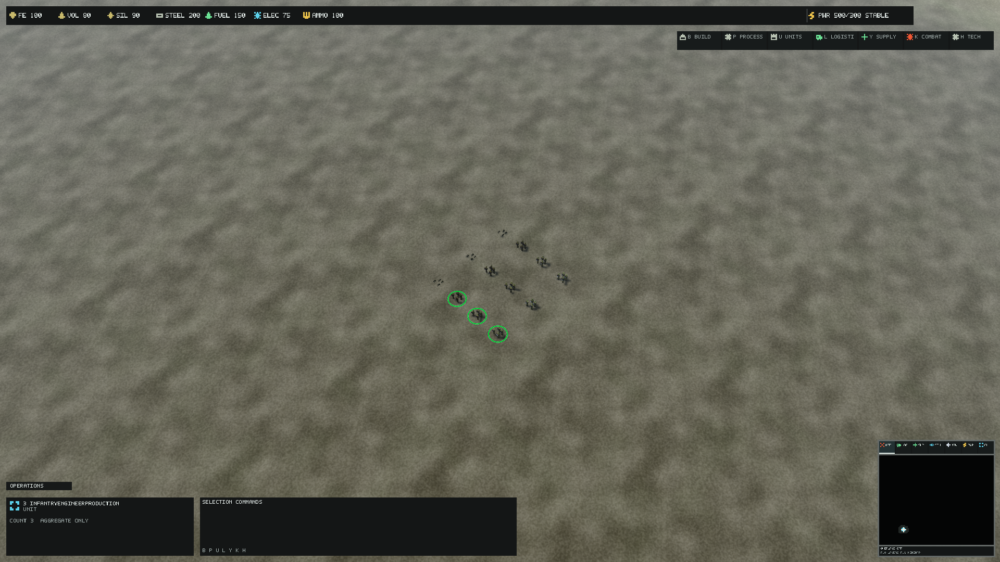
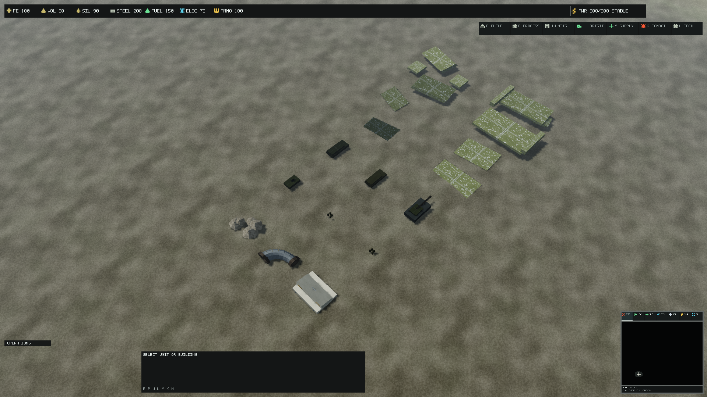
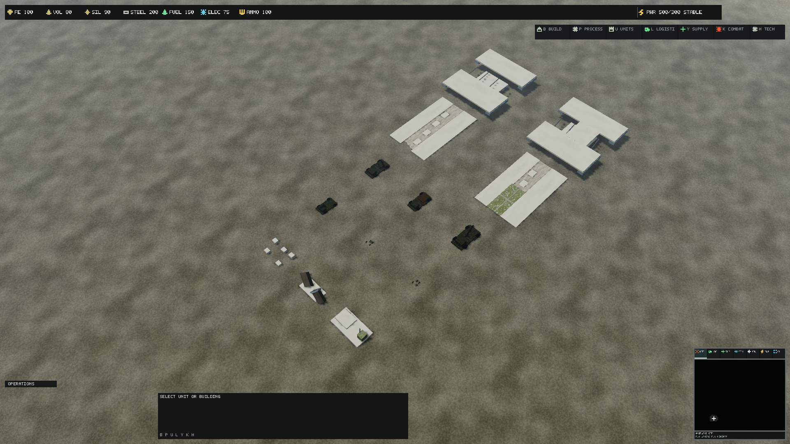
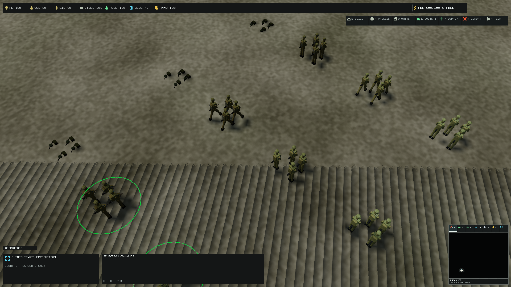
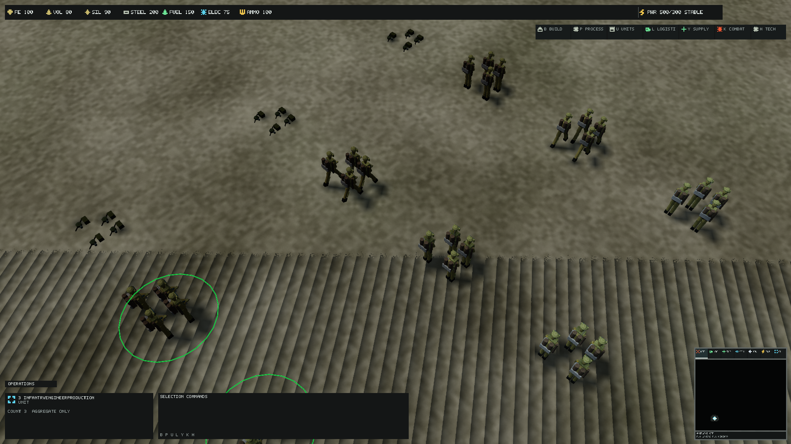
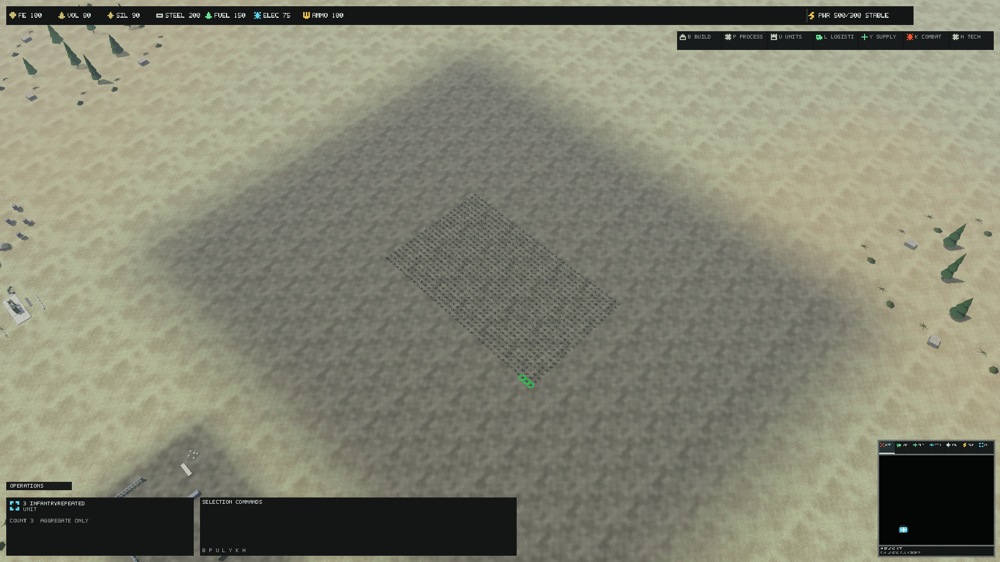

# Infantry and battlefield production

Rifle Squad and Combat Engineer now have distinct editable four-member figure
kits, individual leader equipment, three physical LODs, rigid motion ranges and
dedicated damaged/critical/discarded-equipment meshes. Four other existing unit
families gain collapsed vehicle wrecks. Broken roads/bridges, fractured rubble,
a scorched barrier and a burst pipe extend existing environment conventions.

## Verified baseline and scope

Ordered precheck began with remote master `0263a86f1fbd965bf06ffca55912984c580ab5c9`
(PR #183 integrated). Remote HEAD identifies master as integration; it was the
only remote branch, with no open PR. Closed unmerged PRs #94/#98/#100 concern
session/terrain/material work, not this source owner. Existing IDs, source files,
architecture, tests, CI and governance were inspected before the technical branch.
Baseline catalog: 465 assets, 282 meshes, 56 textures and 127 materials.

The gap was the engineer's intentional rifle-family reuse, compact infantry
figures, generic reduced-mesh vehicle wrecks and unqualified destruction variation.
Existing Command Core/MBT/environment/building production sources are retained;
only the existing rubble and damaged/destroyed road/bridge bindings are upgraded.

## Source and physical contracts

`assets/source/units/directorate/authoring/infantry.kit.json` owns each figure's
body/helmet/vest, limbs, hands, weapon, leader radio and equipment. Engineers add
face protection, shin plates, paired service canisters, tools and a backframe.
`assets/source/world/authoring/battlefield.kit.json` owns the bounded wreck/debris
and infrastructure assemblies. Both are editable geometry recipes, not images.
`build/Author-InfantryBattlefield.py` exports 58 inspectable glTFs: 26 runtime
assemblies and 32 separately inspectable figure component groups. glTF extras
retain component/module names and triangle ranges; the runtime remains one
material section, not a new scene-graph or skeleton resource system.

All sources use +Y up/+Z forward. The unchanged game scale is 1.8 m, movement
height offset .9 m and radius .9 m for both infantry roles. Boots reach local
Y=-.5; the leader antenna reaches .51 (1.818 m cosmetic height). The .738 m rifle
and .630 m carbine retain the exact shared `weapon_muzzle` socket
(.05,.05,.42); individual shoulder/hip sockets are inspectable. Four members are
cosmetic grouping, not four new simulation actors or per-member health truth.

| Family | LOD0 triangles | LOD1 triangles | LOD2 triangles |
| --- | ---: | ---: | ---: |
| rifle_squad | 5120 | 1552 | 864 |
| combat_engineer | 7424 | 2384 | 1344 |

Primary/LOD rifle IDs remain stable. Existing CombatEngineer UnitId/VisualId and
all production, costs, unlocks, navigation, targeting, damage, sensors, supply and
selection rules remain unchanged. Its presentation now resolves dedicated
`unit.directorate.combat_engineer` / `.lod1` / `.lod2` meshes. Material, symbol and
independently controlled collision reuse the existing rifle contracts. No new
unit roster or gameplay content definition is introduced.

World variants add WorldVisualId 120/121 for static decorative scorched barrier
and burst pipe. High/Reduced follows the existing two-level world contract;
there is no invented unsupported third world LOD. Both use
`mesh.world.kit.collision_centered`, with 260/240 m metadata/review hints. Existing
rubble uses its retained 220 m mapping. These references introduce no navigation
obstacle, resource or physics destruction behavior. Existing infrastructure state
mapping remains Operational/intact, Restoring/damaged, Disabled/destroyed.

## Motion, state and intelligence

LOD0 has sixteen contiguous rigid groups: body, two legs and arms/weapon per
figure. Eight hip groups use bounded InfantryStride; four shoulder groups reuse
existing Cannon elevation/recoil. Hip rotation depends on copied TravelMeters,
not wall time; stationary completed-tick history freezes phase. Wrecks disable
motion; existing projected detail fade and LOD1/2 static geometry remain in force.
This is rigid cosmetic articulation, not a skeletal gait, foot-IK, animation
retargeting or a per-member aim/weapon controller. None of those is promised.
Animation asset references remain rejected by the existing compiler.

Infantry damaged/critical attachments remain present through LOD2, so state
geometry is not intentionally reduced to tint at strategic zoom. Vehicle/MBT
LOD suppression is retained. Infantry wrecks show discarded helmets, weapons,
packs and engineering tools; Scout/Artillery/Cargo/Supply wrecks retain their
recognizable collapsed chassis/equipment. Existing lifecycle and bounded VFX own
state; no destruction simulation is introduced.

Opt-in Rifle/Engineer galleries have twelve physical units with all four damage
states. Repeated has 1,000 units (500 per role/4,000 cosmetic figures). The battle
fixture includes known visible infantry and existing bounded effects; its hidden
foreign Engineer stays excluded by real intelligence/extraction. Wreck references
are nonselectable. Real movement radii and terrain-following selection markers
replace the original fixture's generic selection/controllability assumptions.
Infrastructural variants use existing StrategicInfrastructureState components.
The fixtures are frozen visual references, not sustained live combat benchmarks.

## Materials, provenance and compile

Geometry is authored from repository-owned recipes and existing hard-surface/
environment primitive tooling. No external models, downloaded images or new
texture/material families are imported. Existing native 4096px Directorate and
world atlases, inset UV cells, sRGB Base Color, linear Normal/ORM and BC7 capped
mips are retained. Normal/tangent and one-section contracts pass compilation.
Generic detail/mechanical/refinement tools skip this dedicated source owner.

Independent final export reproduces every glTF SHA256 and the complete export
report. Finite positions/normals/UVs, unit normals, nondegenerate triangles,
winding, UV bounds, contiguous ranges and strictly decreasing infantry LODs pass.
Clean official asset compilation, incremental final compilation and final
integrity validation pass. Catalog: 482 assets, 299 meshes, 56 textures, 127
materials. Payload grows from 62,318,992 to 64,652,118 bytes (+2,333,126, mesh only);
texture payload remains 54,798,223 bytes and materials remain 154,875 bytes.

## Native evidence and matched cost

Final capture source is `6f22c77e69b5418f9d65e04733c49d6eda287647`, version 0.1.353,
runtime fingerprint `178FAF3BA0A6E5E9F343F4CA6316A3AC1E818F69F714AEB3FFB83F51C5242314`.
Subsequent evidence/documentation does not change the captured geometry/code.
The accepted set comprises 108 role/battlefield profile/display/zoom cases,
12 Medium repeated cases, 12 High battle cases and two High 20 m inspections.
All 134 are structurally valid and repeat-pixel-identical, with exact requested
native dimensions, zero material/texture binding failures and zero authored
fallback instances. Surfaces are native backbuffers, not enlarged host images.
Ten copied PNGs are unchanged native outputs.

The matched original-geometry baseline is `b4122d0719969678ef266ee7f3622af95c031867`:
start from `195789c`, cherry-pick `a881bd6` and `889fa92`, build and compile the
original source assets in an isolated checkout. This retains the exact corrected
fixture/camera/selection/intelligence inputs while retaining original geometry
and bindings. Nine isolated Medium/FHD before cases match final fingerprint,
seed/tick/visual seconds, camera, lighting, profile, DPI and display inputs.
Earlier fixture/prototype captures are retained locally but are not timing pairs.

Warmups8/samples32/repeat2, VSync off, frozen tick32 and completed fences, NVIDIA
RTX PRO 5000 Blackwell Laptop/driver32.0.15.9653, feature12_1. CPU includes frame
reuse/Present; PNG/readback is excluded. Reference-machine numbers are advisory,
not a portable speedup or sustained60-FPS/live-motion claim. Debug layer unavailable.

| Matched Medium/FHD case | Before GPU ms | After GPU ms | Before CPU ms | After CPU ms | Before/after instance draws |
| --- | ---: | ---: | ---: | ---: | ---: |
| InfantryRifleProduction-CloseTactical | 2.833 | 4.606 | 7.725 | 4.317 | 2/4 |
| InfantryRifleProduction-NormalGameplay | 4.138 | 3.556 | 3.894 | 3.253 | 23/26 |
| InfantryRifleProduction-Strategic | 4.960 | 3.465 | 4.760 | 3.205 | 25/28 |
| InfantryEngineerProduction-CloseTactical | 3.952 | 4.919 | 3.740 | 4.624 | 2/4 |
| InfantryEngineerProduction-NormalGameplay | 4.150 | 4.547 | 3.937 | 4.306 | 23/26 |
| InfantryEngineerProduction-Strategic | 4.932 | 5.408 | 4.698 | 5.130 | 25/28 |
| BattlefieldVariantProduction-CloseTactical | 3.926 | 3.054 | 3.683 | 2.790 | 12/13 |
| BattlefieldVariantProduction-NormalGameplay | 4.114 | 3.076 | 3.899 | 2.906 | 31/34 |
| BattlefieldVariantProduction-Strategic | 4.909 | 7.216 | 4.613 | 6.970 | 33/36 |

| Final cohort | GPU mean range ms | Instance draw range |
| --- | ---: | ---: |
| matrix | 0.539–7.536 | 4–37 |
| repeated | 4.439–11.934 | 2–26 |
| battle | 0.787–7.921 | 6–30 |
| inspection | 0.760–6.349 | 19–19 |

Maximum scene texture residency: 53,746,844 bytes; maximum used descriptors: 188. Both remain below existing budgets. Adapter-local usage spans 209,879,040–731,557,888 bytes and includes frame/device allocations, not asset-exclusive VRAM. Requested resolutions are1920×1080,2560×1440,3840×2160,3440×1440.

One final attempt was stopped by Windows Present-occluded/settled-surface failure;
its partial evidence and failure log are retained locally. A fresh identical
complete run passed. No repeat, active-surface or binding threshold was weakened.
Corrected physical movement/selection/wreck handling removes the striping in
our 40 m High control. The 20 m High inspection still contains foreground
striping and is retained as an open near-view rendering/art gate, not accepted
visual quality. Its structural repeat/binding result does not waive that issue.
The shadow renderer was not changed.

## Tests, window modes and open acceptance

Final full Release suite on the captured source: 1,830 total, 1,821 passed, nine
optional skips, zero failures. Release build has zero warnings/errors; the
42-project graph and one-PATCH 0.1.352->0.1.353 gates pass. Tests cover dedicated
role mappings, all-LOD damage bindings, independent collision, LOD counts,
UV/tangents/ranges/sockets, stride pivot invariance/phase freeze/wreck disable,
nonselectable reference wrecks, exact grouping and hidden-enemy exclusion.

Canonical Headless1,000/10,000 smoke checks pass. Natural terminal match at
seed2026 ends at tick42922/player1 victory/CommandCoreDestroyed/314 entities,
retaining the previously qualified outcome. No gameplay file except the
presentation-identity enum is changed.

Canonical Windowed1600×900 passes at11 instance draws. Borderless3840×2400 also
passes at11 on the actual current display. This does not requalify the previous
5120×2160 desktop's13/11 gap: that mode/display is currently unavailable. Total
measured draws are a different counter (terrain/shadows/overlay included).

Human art/readability signoff, live movement/LOD transitions, per-member
skeletal animation/foot planting, sustained performance and extended physical
window/DPI/device soak remain open. A frozen structurally passing capture is not
human acceptance. Required remote build-test/asset/rendering CI must be inspected
after publication; no merge or release is implied by local validation.

## Native image review

| Before rifle | Final rifle |
| --- | --- |
|  |  |

| Before engineer | Final engineer |
| --- | --- |
|  |  |

| Before battlefield | Final battlefield |
| --- | --- |
|  |  |






## Reproduce

```powershell
# Python with NumPy; this updates only the dedicated source owner.
python build/Author-InfantryBattlefield.py --update-metadata
python build/Author-InfantryBattlefield.py --output artifacts/independent-infantry
# Compare complete exports.json reports and all payload hashes.
dotnet restore ForgeLine.sln
./build/Validate-ProjectReferences.ps1
dotnet build ForgeLine.sln -c Release --no-restore
./build/Build-RuntimeAssets.ps1 -Mode build -ForceRebuild -NoBuild
./build/Export-VisualAssetInventory.ps1
# Commit and rebuild before capture; each output root must be new.
./build/Invoke-RtsReferenceQualification.ps1 -Capture -Scenes InfantryRifleProduction,InfantryEngineerProduction,BattlefieldVariantProduction -Warmups 8 -Samples 32 -RepeatCaptures 2 -OutputRoot artifacts/infantry-matrix
./build/Invoke-RtsReferenceQualification.ps1 -Capture -Scenes InfantryRepeated -Profiles Medium -Warmups 8 -Samples 32 -RepeatCaptures 2 -OutputRoot artifacts/infantry-repeated
./build/Invoke-RtsReferenceQualification.ps1 -Capture -Scenes InfantryBattleProduction -Profiles High -Warmups 8 -Samples 32 -RepeatCaptures 2 -OutputRoot artifacts/infantry-battle
./build/Invoke-RtsReferenceQualification.ps1 -Capture -Scenes InfantryRifleProduction,InfantryEngineerProduction -Profiles High -Displays 1920x1080 -Zooms CloseTactical -InspectionDistanceMeters 20 -Warmups 8 -Samples 32 -RepeatCaptures 2 -OutputRoot artifacts/infantry-near
dotnet test --solution ForgeLine.sln -c Release --no-build --max-parallel-test-modules 1 -- --parallel none
./build/Invoke-WindowModeQualification.ps1
./build/Validate-SemVer.ps1 -BaseRef origin/master -HeadRef HEAD
```

InspectionDistanceMeters is capture-only, finite and zero or20–120. Zero retains
bit-identical120/420/1000 reference settings; nondefault distance is recorded in
both camera metadata and filename. It changes no default gameplay camera.

## Package delivery check

A reproducible local 0.1.353-dev/win-x64 package passes file-hash comparison and
runtime integrity with the existing asset root. The produced archive is
33,761,159 bytes. Its source/evidence revision is eb3ffc2. An installed-package
Windowed1600×900 smoke exits successfully, with 11 instance draws, 938/1551 visible
instances and zero texture/material binding failures. Repository and installed
startup both use the canonical existing smoke path; generated package files stay
under artifacts, outside source ownership. The package is local and is not a
GitHub release. Subsequent updates below record evidence only.
