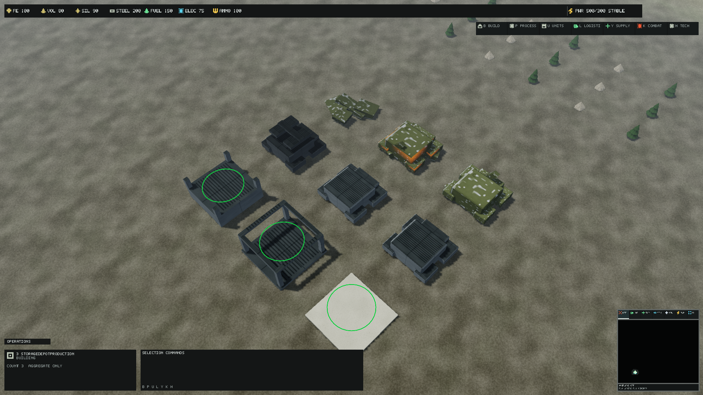
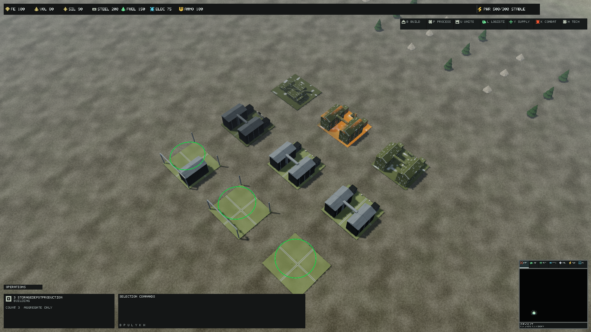
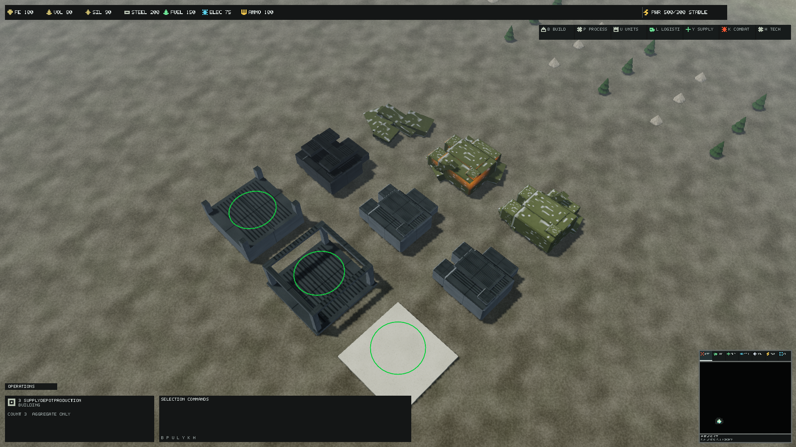
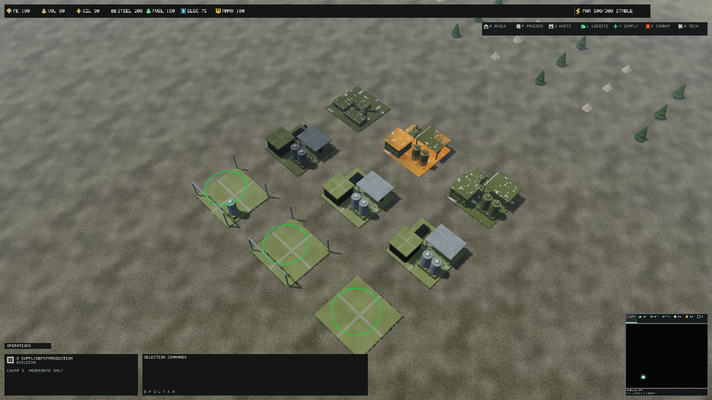
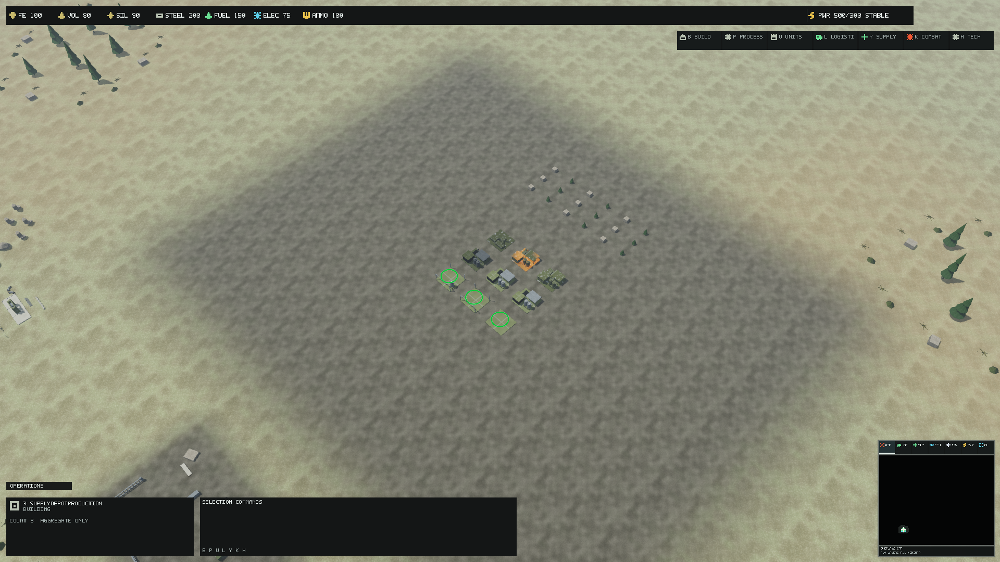
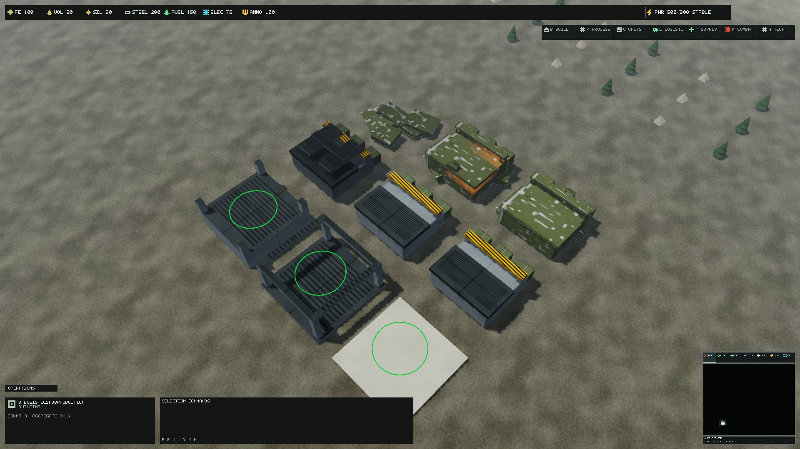
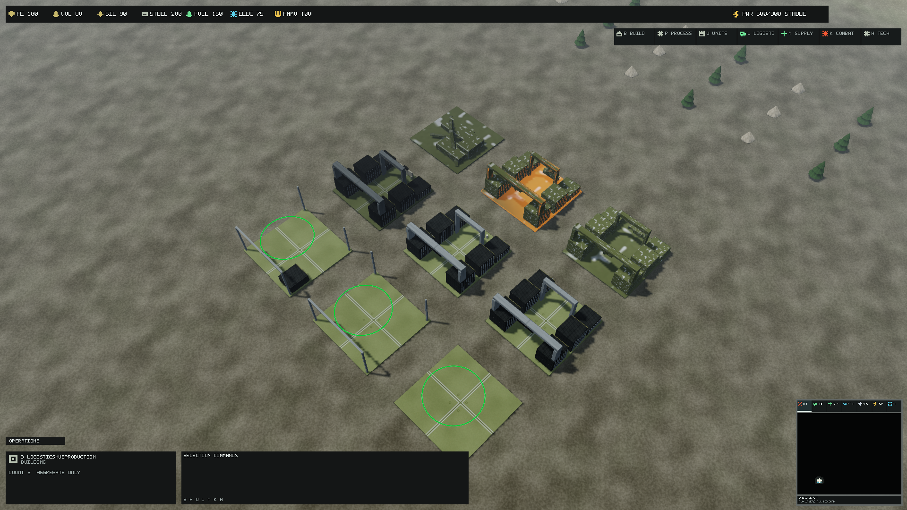
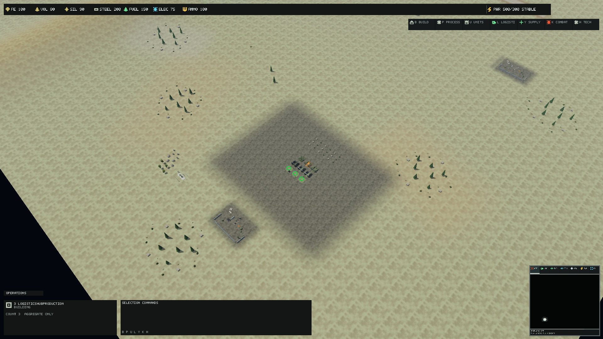
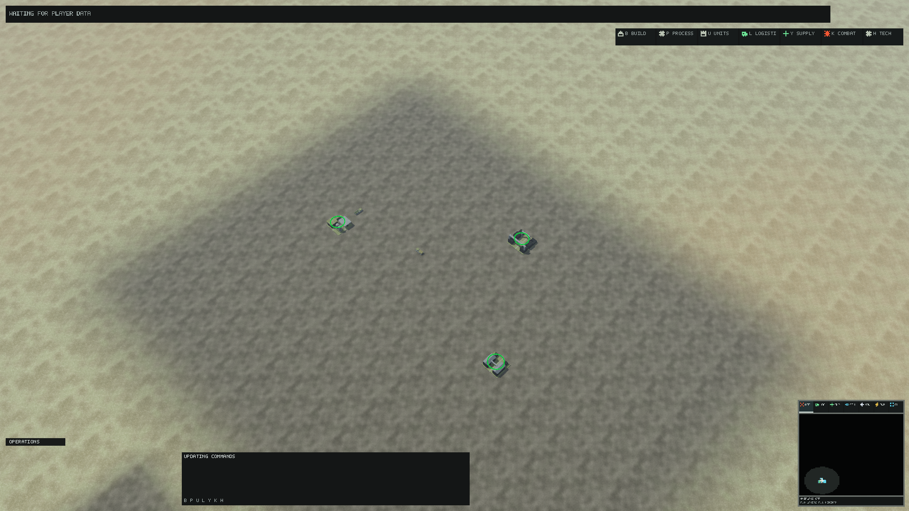

# Directorate logistics building production

[Documentation](README.md) · [Complete catalog](DocumentationIndex.md)

The current [saved Blender workflow](LogisticsBlenderProduction.md) preserves
this integrated artwork in three editable native masters and adopts their
lossless GLB exports through the same LOD/state IDs. The component recipes and
glTF generator below remain historical source material; regular export opens
the saved master. [Source bindings](qualification/logistics-blender/SourceBindings.json)
record exact geometry, metadata, sockets and export hashes.

Storage Depot, Supply Depot and Logistics Hub use editable component recipes,
actual glTF meshes, three dedicated LODs and family construction/status/wreck
geometry. Their public identities, inventory capacities, logistics topology,
vehicle movement, collision/navigation footprints and shared PBR masters are retained.
Human art, live interaction and sustained native performance acceptance remain pending.

<details>
<summary>On this page</summary>

- [Reviewed integration state and scope](#reviewed-integration-state-and-scope)
- [Editable sources and modular reuse](#editable-sources-and-modular-reuse)
- [Dimensions, silhouette and terrain interface](#dimensions-silhouette-and-terrain-interface)
- [LOD, material and collision contracts](#lod-material-and-collision-contracts)
- [States and sockets](#states-and-sockets)
- [Reference scenes and real traffic](#reference-scenes-and-real-traffic)
- [Qualification and reproduction](#qualification-and-reproduction)
- [Original native comparisons](#original-native-comparisons)
  - [StorageDepot, 120 m](#storagedepot-120-m)
  - [SupplyDepot, 120 m](#supplydepot-120-m)
  - [LogisticsHub, 120 m](#logisticshub-120-m)
  - [Logistics Hub, 1000 m](#logistics-hub-1000-m)
  - [Real loading snapshot, 420 m](#real-loading-snapshot-420-m)
  - [Real transit snapshot, 420 m](#real-transit-snapshot-420-m)
  - [Real unloading snapshot, 420 m](#real-unloading-snapshot-420-m)
  - [Real sustained snapshot, 420 m](#real-sustained-snapshot-420-m)
- [Package verification](#package-verification)

</details>

## Reviewed integration state and scope

Ordered precheck verified remote master `8ff5f9dc12803cdee295adfb58855125b008ca67`
as integration branch, then remote branches, open/closed unmerged PRs, current
assets, architecture/pipeline, tests, workflows and governance. Industrial PR182
was already integrated. Operational PR183 concerns different families; its
concurrent changes remain separate until integrated master requires synchronization.
No matching logistics branch or PR existed.

The previous primary models had 264/264/352 LOD0 triangles. Their LOD1 and LOD2
records referenced the same reduced source, had no logistics-specific building
sockets and used shared construction/status/wreck geometry. The new work replaces
those presentation sources, preserving the nine existing primary/LOD IDs and
adding 24 state mesh records. No roster, inventory rule, transfer rate, route,
power, gameplay footprint, renderer batching or LOD threshold is changed.

## Editable sources and modular reuse

`assets/source/buildings/directorate/authoring/` contains three family `.kit.json`
recipes and `logistics.modules.json`. The latter owns reusable containers,
vertical fuel tanks, open loading portals, bollards and service fittings.
Named module instances carry explicit normalized translation/scale; boxes scale
per axis, circular cross sections require equal radial scale. Family-specific
parts include pitched warehouses, tank manifolds, protected ammunition storage,
service awnings and raised cargo gantries.

`python build/Author-LogisticsBuildings.py` requires NumPy and deterministically
exports `assets/source/buildings/directorate/sources/logistics/<family>/`.
`--family` limits ownership; `--output` exports into an independent directory.
There are 90 inspectable glTFs: nine completed LODs, 24 state meshes and 57
individual modules, with export hashes/counts. The common Command Core primitive
and industrial swept-pipe implementations are reused unchanged. The general
fittings tool skips dedicated logistics sources.

All geometry is repository-owned original content; no third-party mesh,
texture, concept raster, generated image or external license grant is added.
Source provenance is explicit in the family/shared recipes. Individual module
exports and named component ranges are inspection/authoring data; the compiled
completed meshes remain one indexed section with one material identity.

## Dimensions, silhouette and terrain interface

| Family | Authoritative width × height × depth | Production silhouette | LOD0 / LOD1 / LOD2 triangles |
| --- | --- | --- | --- |
| Storage Depot | 14 × 8 × 14 m | Two pitched warehouses, container stacks, open central service aisle | 3436 / 348 / 176 |
| Supply Depot | 16 × 8 × 16 m | Separate vertical fuel reservoirs, protected ammunition store, service canopy and pumps | 1860 / 484 / 300 |
| Logistics Hub | 18 × 9 × 18 m | Paired container rows, open transfer lane, elevated gantries and carriage | 5856 / 432 / 276 |

The stored normalized X/Z limits and maximum heights are preserved. Only the
cosmetic foundations now reach the existing Y=-.5 ground plane: world root is
terrain height plus half the authoritative building height. Terrain seating
uses the existing center sample; adaptive corner conforming/grading is not added.
Every physical model stays inside the unchanged full gameplay footprint.

Storage's clear aisle between roof edges is 3.92 m; its wall aisle is 4.20 m.
The loading portal's inner opening is 4.158 m wide. Supply's canopy has about
3.84 m ground clearance; Hub's container rows leave a 7.02 m central aisle.
These are physical authored dimensions, not new simulation drive-through paths.
The existing Cargo Truck uses scale 3.2 × 2.4 × 6.4 m and Supply Truck
3.4 × 2.5 × 6.8 m. Real visible mesh extents and yaw must also be considered
when reviewing arbitrary live maneuvers; nominal scale alone is not collision proof.

CargoTransportSystem keeps its existing approach resolution outside a static
node's bounds, including ObstacleLookAhead + radius + 32 m navigation clearance.
Loading can begin near that authoritative approach while a movement order remains
active. Vehicles are not routed through the cosmetic warehouse or gantry aisle.
Cargo loading and service geometry do not own or move inventory.

## LOD, material and collision contracts

All LODs have finite positions, unit normals, explicit UV0, compiler-generated
orthogonal tangents and nondegenerate indexed triangles. LOD1 removes bevels,
container corrugation and tiny fittings; LOD2 additionally removes door/service
panels while retaining warehouses/tanks/container rows and loading portals.
LOD index counts strictly decrease. Selection continues to use projected
size and hysteresis; 120/420/1000 m are review distances, not universal LOD cutoffs.

Every primary and dedicated state mesh uses
`material.directorate.building.structural`. Existing unpowered/damaged/critical/
wreck material selection still takes priority. Shared Base Color remains sRGB;
Normal and ORM remain linear with the established mip/sampler policy. No new
texture, material, descriptor family or shader is introduced.
The collision reference remains `building.directorate.module.collision_box`;
cosmetic render geometry never replaces the authoritative occupancy/navigation bounds.

## States and sockets

| Existing presentation input | Mesh representation |
| --- | --- |
| Construction below 34% | family foundation |
| Construction 34–67% | family construction frame |
| Construction 67% to completion | family partial shell |
| Completed operational | selected family LOD |
| Unpowered | selected LOD plus isolated loading/service fittings |
| Damaged | selected LOD plus visibly fallen loading beam and dock debris |
| Critical | selected LOD plus larger bent transfer structure and debris |
| Destroyed | family collapsed roof / fallen fuel vessel / broken gantry wreck |

The reserved idle gate attachment uses the existing global Idle state contract,
without inventing a ProductionFacility for logistics buildings. Their production
galleries contain eight actual distinct states across nine plots: two are
Operational; neither supplies a fabricated production-idle component.
Temporary construction frames do not surround completed models. Dedicated
broken geometry supplements the existing state materials and VFX; damage and
wreck remain presentation-only and do not create physical destruction rules.

Every primary publishes three static inspection anchors copied into glTF extras:
`cargo_load`, a `service_access` or `supply_transfer`, and `gantry_pivot`.
Cargo anchors are 1.388 m above the center-sampled ground plane; the Supply
transfer anchor is 1.2 m high, matching existing vehicle scale, height offset
and compiled local sockets. Loading pivots sit at their structural centers.
The names align with existing vehicle transfer vocabulary. They do not snap
vehicles to buildings or feed navigation. Vehicle `cargo_load` and
`supply_transfer` sockets remain unchanged. Native physical traffic extraction
receives the actual runtime catalog so existing logistics VFX resolve the real
compiled vehicle socket. Gantries/doors have no new motion contract and remain
static; wheel motion and transfer VFX retain their existing authoritative inputs.

## Reference scenes and real traffic

The three production galleries use unchanged seed 2026/tick32, yaw45°/pitch−55°,
120/420/1000 m and their established terrain target. The 22 m plot spacing fits
all nine plots at 120 m without the previous nearest-foundation crop.
Construction progress, completed building identities, power, health and wrecks
pass through real faction-scoped PresentationExtractor/intelligence.

The four traffic scenes use the same seeded simulation, actual building
footprints and two vehicles at their Directorate catalog dimensions. InventoryStore,
LogisticsNetwork, CargoTransportSystem, HierarchicalNavigationSystem,
GroundMovementSystem and BattlefieldSupplySystem drive the scene. Navigation
contains the three real static building bounds. A 50-unit cargo order travels
Storage -> Hub -> Supply over two existing road-mode graph edges; source Fe
stock is 100 and is conserved. The nearby Supply Truck physically loads Fuel
from the Supply Depot. No lifecycle is assigned by hand and no fake transfer
is inferred from a proximity animation.

Loading, moving ToDestination and Unloading snapshots are taken only after
the real lifecycle reaches each requested state. The repeated traffic scene
runs 1024 fixed ticks (51.2 s logical time), reassigning completed physical orders
and requiring at least two deliveries plus conserved stock. Fresh fixtures
have equal fingerprints, real-scale vehicles, all three building identities
and no vehicle/building XZ overlap. This is a deterministic traffic exercise
and a bounded render snapshot. It does not certify 51.2 seconds of wall-clock
native gameplay FPS, live camera/LOD transitions or arbitrary fleet maneuvers.

## Qualification and reproduction

The recorded implementation source revision is `3e03aec7e1d0ae9f5a151f008e87b7e658902b78`. The native hardware
matrix has 108 building cases (three families × three profiles × three distances
× four native backbuffer sizes) and 48 real-traffic cases (four phases × three
profiles × four sizes) at 420 m. All 107 passing building cases and all 48 traffic
cases repeat pixel-identically. One building case remains pending after the
main matrix and two independent four-repeat control attempts showed a one-channel
one-LSB discrepancy. Every case has matching requested/actual dimensions, zero
mesh fallback, zero material/texture binding failures and no profile fallback. Nine High/1080p
before cases retain identical fixture fingerprints, cameras, lighting, profile
and device. Fourteen original, byte-verified PNGs are published; all other
native images, failed repeats and raw requests remain in local evidence.

The device is NVIDIA RTX PRO 5000 Blackwell Generation Laptop GPU, driver
32.0.15.9653; hardware D3D12, VSync off, 16 warmups and 64 timed CPU samples.
GPU measurements use distinct completed fences. D3D12 debug layer was unavailable;
its warning counters cannot establish debug-layer acceptance. Native surface
sizes are 1920×1080, 2560×1440, 3840×2160 and 3440×1440, independent of the
1280×720 host-window clamp. Physical monitor/DPI, clocks and thermal stability
are not performance controls established by these captures.

| Family / distance | CPU p50 before → after (ms) | GPU p50 before → after (ms) | Instance draws before → after |
| --- | --- | --- | --- |
| StorageDepot / 120 m | 19.285 → 13.078 | 16.086 → 13.284 | 13 → 13 |
| StorageDepot / 420 m | 20.996 → 11.721 | 19.527 → 11.819 | 34 → 34 |
| StorageDepot / 1000 m | 23.720 → 12.623 | 22.204 → 12.765 | 36 → 36 |
| SupplyDepot / 120 m | 18.272 → 12.059 | 15.397 → 12.163 | 13 → 13 |
| SupplyDepot / 420 m | 18.391 → 11.709 | 15.547 → 11.881 | 34 → 34 |
| SupplyDepot / 1000 m | 18.945 → 12.627 | 16.506 → 12.816 | 36 → 36 |
| LogisticsHub / 120 m | 18.435 → 14.748 | 15.930 → 15.009 | 13 → 13 |
| LogisticsHub / 420 m | 20.850 → 11.570 | 19.477 → 11.843 | 34 → 34 |
| LogisticsHub / 1000 m | 23.916 → 12.578 | 22.518 → 12.828 | 36 → 36 |

These are frozen-scene render measurements, not gameplay FPS or a portable
performance improvement claim. Complete CPU/GPU distributions, FPS, triangles,
LOD counts, draw calls, DXGI process memory, SRVs and texture residency are in
[the capture report](qualification/logistics-buildings.json). DXGI local usage
includes frame targets, terrain and driver allocations; it is not mesh-only VRAM.

The current catalog has 437 assets: 254 meshes, 56 textures and 127 materials,
with 61,747,374 compiled payload bytes versus 60,212,858
before. The 24 new mesh records add no textures/materials. Dedicated LOD1/LOD2
strictly reduce geometry; texture masters/samplers stay shared. Resource totals
and all 33 primary/LOD/state identities are in
[the asset inventory](qualification/logistics-building-assets.json).

An earlier prototype repeat differed at terrain pixel(91,253), one blue-channel
LSB: RGBA(141,142,123,255) versus(141,142,124,255). Its failed image hash and
superseded source cohorts are retained in the capture report. The cause is
unknown; passing final captures do not establish a root-cause fix. The final
cohort's retained failed repeats and exact-case retries are separately recorded
in that report; the Storage/2560×1440/Medium/420 m case remains pending after both control attempts. Pixel
tolerance and test thresholds remain unchanged.

Release build is clean. The complete C# and final-anchor test run passed 1796,
skipped 9 optional tests and failed 0 (1805 total, 8m43.082s). Subsequent authored
contact corrections are separately covered by final asset tests and 90 valid,
independently byte-identical glTF exports. In the final asset test run 96 of 97
passed; one atomic overwrite of a temporary manifest reported a denied access.
All 7 cases of that recovery test then passed serially. Its cause is unknown,
and the original failure remains recorded without changing compiler behavior.
Headless 1000/10000 entity smoke/stress
passed; the validation match naturally ended at tick 42922 with Player 1 victory,
CommandCoreDestroyed and 314 entities. These earlier headless results exercise
unchanged simulation code. Exact source identities and native smoke details are
in [runtime qualification](qualification/logistics-building-runtime.json).

Canonical Windowed passes at 11 instance draws. Borderless retains the existing
13-versus-11 budget failure; both modes have zero texture/material binding
failures. No threshold is relaxed. Human art/readability approval, live LOD transition,
arbitrary vehicle maneuver/collision review, sustained native gameplay timing,
terrain corner seating and required PR CI remain pending. No articulated
building animation is invented for the static anchor contract.

Reproduction (Release binaries must be rebuilt after committing sources):

```powershell
dotnet restore ForgeLine.sln
./build/Validate-ProjectReferences.ps1
python build/Author-LogisticsBuildings.py
dotnet build ForgeLine.sln -c Release --no-restore
./build/Build-RuntimeAssets.ps1 -Mode build
./build/Export-VisualAssetInventory.ps1
dotnet test --solution ForgeLine.sln -c Release --no-build --max-parallel-test-modules 1 -- --parallel none
./build/Invoke-RtsReferenceQualification.ps1 -Capture -OutputRoot artifacts/logistics-review-buildings -Scenes StorageDepotProduction,SupplyDepotProduction,LogisticsHubProduction -Profiles Low,Medium,High -Zooms CloseTactical,NormalGameplay,Strategic -Displays 1920x1080,2560x1440,3840x2160,3440x1440 -Warmups 16 -Samples 64 -RepeatCaptures 2 -ContinueAfterMismatch
./build/Invoke-RtsReferenceQualification.ps1 -Capture -OutputRoot artifacts/logistics-review-traffic -Scenes LogisticsLoadingProduction,LogisticsTransitProduction,LogisticsUnloadingProduction,LogisticsSustainedProduction -Profiles Low,Medium,High -Zooms NormalGameplay -Displays 1920x1080,2560x1440,3840x2160,3440x1440 -Warmups 16 -Samples 64 -RepeatCaptures 2 -ContinueAfterMismatch
./build/Invoke-WindowModeQualification.ps1 -SettingsRoot artifacts/logistics-review-settings
```

Use fresh output roots: reference evidence is never overwritten. Baseline runs
must use the recorded baseline source/binaries/assets and identical parameters;
the final implementation cannot recreate the old mesh baseline from its sources.

## Original native comparisons

### StorageDepot, 120 m

Before:



After:



At 420 m:


### SupplyDepot, 120 m

Before:



After:



At 420 m:



### LogisticsHub, 120 m

Before:



After:



At 420 m:


### Logistics Hub, 1000 m



### Real loading snapshot, 420 m


### Real transit snapshot, 420 m


### Real unloading snapshot, 420 m



### Real sustained snapshot, 420 m


## Package verification

Two clean publishes were byte-identical. The exact prepared runtime root was
validated without source recompilation and installed outside the checkout.
All 438 canonical runtime files (437 payloads plus manifest) match byte-for-byte;
the only two extra runtime files are the existing studio intro video/audio.
No authoring sources or asset compiler are deployed. Fresh installed Windowed
smoke with 1000 stress instances renders at 11 instance draws with zero texture/
material binding failures. The local archive is not part of this publication;
its SHA256 and portable checks are in
[package qualification](qualification/logistics-building-package.json).

At 2026-10-13 04:15 UTC, the unchanged integration master remained 8ff5f9d. Its
[CI run](https://github.com/DaveBeusing/Forgeline/actions/runs/38334215906)
was still in the Windows window-mode smoke step; later mandatory checks were
pending. The cause is unknown. Logistics PR CI remains pending publication.
