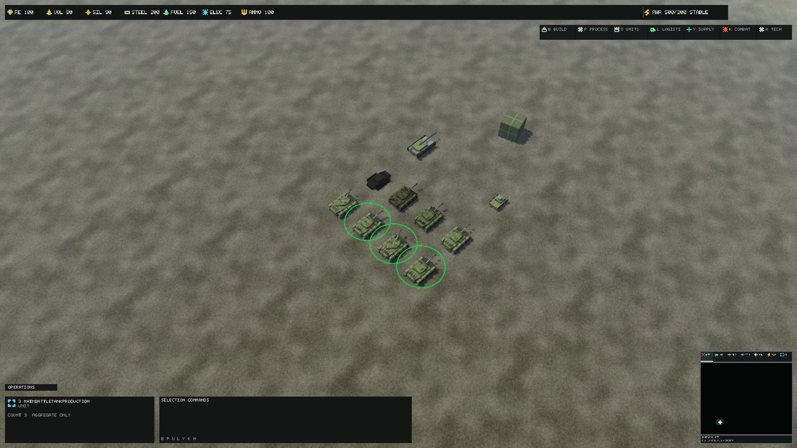

# Directorate Main Battle Tank production brief

Base revision: `b67d142b1587d6dca8b5ef9b3da793a57c179825` on master.
The existing identity is `unit.directorate.main_battle_tank`; its visual scale
is 4 x 3 x 7.2m, ground movement centre offset 1.5m, +Y up and +Z forward.
Collision, navigation, combat hitboxes, strategic symbol and gameplay remain
unchanged. The four weapon/turret sockets retain their exact coordinates:
turret_pivot (0,.10,.02), gun_pivot (0,.16,.10), weapon_muzzle (0,.16,.64),
recoil_anchor (0,.16,.16). Turret yaw and cannon elevation/recoil continue to
use the existing rigid-range read-model contract, not a second animation path.

The previous chassis has 744 triangles, turret 216; LOD1/2 share cheap
36-triangle silhouettes. Chassis bounds are X +/-.49, Y [-.22,.10],
Z [-.43,.41]; turret bounds X +/-.27, Y [0,.29], Z [-.17,.64].
The old track bottom floats .84m above the terrain at the gameplay offset.
Deliberately extend the new track bottom to Y -.5 to meet sampled ground,
within the retained conservative normalized collision/selection box.
X/Z/top extents and all gameplay bounds remain unchanged. Cosmetic wheel
anchors move down to the new axle line; their stable names and motion kind
remain. They are not targeting or simulation anchors.

Author a low, wide tracked chassis with sloped wedge glacis, reinforced
shoulders, segmented guards, raised rear powerpack/grille, towing fixtures,
four road wheels per side, end idlers/sprockets and a closed tread belt.
The turret has an angular frontal wedge, rear bustle, hatches, observation
optics, smoke-launcher hardware and a long hollow cannon with thermal jacket,
trunnion/recoil hardware and a clear muzzle opening at the retained anchor.
The tank must read as a broad frontal turret/weapon platform, distinct from
the rear-mounted artillery and elevated scout sensor.

The shared four-by-four PBR atlas remains the material source: painted and
worn armor, structural steel, rubber, heat-treated steel, glass, grille and
service panels. No new texture, shader or per-tank material is required.
Authored face charts retain existing cell insets; normals are explicit and
tangents come from the compiler. Fine wear is shared material detail, not
painted lighting or a unique texture approval.

Editable component recipes and deterministic original geometry export to
standalone glTF. LOD0 separates hull and articulated turret; reduced LODs
combine neutral hull/turret/cannon and omit fittings. Road-wheel shells retain
their authored profile; hub detail uses existing bounded wheel motion.
Tread links are static authored geometry: circulating links and physical
suspension are outside the existing rigid motion contract.

Damaged/critical attachments add displaced armor and exposed service details
through existing extracted damage state. A dedicated collapsed wreck replaces
the operational strategic silhouette. Damage tint/VFX and wreck authority
remain existing behavior; no gameplay lifecycle or weapon event changes.

Qualification must include source/export determinism, compiled normals/UVs/
tangents, socket and range coverage, aim/recoil alignment, pause/session reset,
LOD/state rendering, repeated tanks, native reference displays and canonical
1,000-instance smoke. Static camera evidence is not artistic approval or
continuous lifecycle/physical-display acceptance. Results follow qualification.

## Editable source and reproduction

The original parametric source is
`assets/source/units/directorate/authoring/main_battle_tank.kit.json`.
With Python and NumPy installed, run
`python build/Author-MainBattleTank.py --update-metadata` from the repository
root. `--output <isolated-directory>` exports without altering definitions;
compare `exports.json` for exact geometry hashes and rigid bindings.
The exporter shares the existing hard-surface primitives in
`build/Author-CommandCore.py`, but never modifies Command Core content.
Legacy general unit-detail and mechanical-part authoring explicitly skip this
family. Each glTF 2.0 file embeds its own buffer and supplies positions,
explicit normals and UV0. The runtime compiler generates tangents. The glTF
material names/cell metadata describe the atlas convention; the ForgeLine
asset definitions bind the actual existing material and PBR textures.
Importing geometry into a general mesh editor does not automatically load
those ForgeLine materials. Direct export edits are independent mesh forks;
the editable recipe remains the deterministic source of truth.

All geometry is original ForgeLine work, with no external model or reference
image input. Recipe provenance records that no external license grant is
implied. Existing shared texture lineage remains unchanged. Export hashes,
vertex counts, triangle counts, bounds and rigid-range sockets are recorded
in `sources/main_battle_tank/exports.json` under the unit family.

## Runtime mapping and detail levels

Every runtime ID below starts with `unit.directorate.main_battle_tank`.
All sources are under `assets/source/units/directorate/sources/main_battle_tank/`.

| Runtime suffix | Source | Triangles |
| --- | --- | ---: |
| primary | chassis_lod0.gltf | 6272 |
| .turret | turret_lod0.gltf | 1752 |
| .lod1 | combined_lod1.gltf | 892 |
| .lod2 | combined_lod2.gltf | 244 |
| .damaged | damaged.gltf | 88 |
| .critical | critical.gltf | 180 |
| .wreck | wreck.gltf | 300 |

Full LOD0 totals 8,024 triangles. The `kit/` exports expose the hull (408),
left/right tracked modules (2,932 each), turret body (1,020) and cannon (732)
for independent editing/import. These five module exports are source-only;
they do not add runtime catalog entries or GPU buffers.
The unchanged `.collision` asset remains separate. Only three state mesh
IDs are added; the four prior operational IDs retain their identities.
Reduced LODs combine a neutral turret/cannon with the hull, omit hub motion,
and retain the same -.5 ground plane. Projected-size 90/28 reference-pixel
thresholds, 12% hysteresis, profile scaling and existing mechanical fade remain.
At LOD2 the distinct wreck replaces the operational silhouette. Damaged and
critical attachments accompany LOD0/1 only; existing damage tint/effects
remain on all levels. All models use one section and the same existing
`material.directorate.unit.main_battle_tank`.

## Rigid motion and authority

Nine contiguous chassis ranges cover static geometry plus eight moving hub
ranges. Two turret ranges cover the stationary turret body and moving cannon.
No triangles belong to multiple ranges and no unbound ranges are left over.
Cosmetic wheel sockets retain their names and Z positions, with Y moved to
-.30; the existing 1.5 rotation rate is retained. Static circular tire/rim
profiles account for the unit's nonuniform 4 x 3 x 7.2 scale; bounded hub
motion provides the supported movement cue. Track circulation and physical
suspension are not implemented. The suspension housings are authored geometry.

Yaw, elevation, recoil, movement and damage continue to consume existing
immutable extracted state. Cannon elevation retains [-.15,.55] radians and
.045 recoil travel. The hollow muzzle terminates at retained Z .64. Existing
weapon/VFX socket transforms apply elevation about the retained gun pivot and
yaw about the retained turret pivot. No targeting, projectile, hitbox,
navigation, ground movement, fog-of-war or destruction authority changes.
Existing mechanical regression coverage exercises hierarchy, pivots, recoil,
elevation bounds, pause, sampling gaps, session reset, fade and allocation
behavior. Dedicated state-ID resolution adds no managed allocation in a warmed
1,000-resolution test. Selection and strategic material identity remain.

The gallery uses eight tanks at actual gameplay scale, fixed idle/moving/
aimed/firing poses, authoritative health states and a non-commandable wreck,
with actual-scale scout/artillery comparators. The formation contains 1,000
intact tank identities. Frozen firing pose evidence does not demonstrate a
live projectile or muzzle-flash lifecycle. The existing VFX path remains;
flash/projectile origin under continuous firing and at neutral reduced LODs
still needs live visual review. Recoil and LOD fade already differ from the
full-aim event anchor during parts of their cosmetic transitions.

## Local qualification

Source geometry checks passed for all twelve exports: finite, nondegenerate,
outward-wound triangles and unit normals. A final isolated re-export matched
all twelve source hashes and rigid bindings. Restore and 42-project dependency
validation passed. The final serial Release build completed with zero warnings
or errors (`artifacts/mbt-final-build-serial.log`). An earlier parallel build
hit an asset-compiler file lock; the serial build resolves that tooling failure.

Asset compilation passed with 351 assets: 168 meshes, 56 textures, 127
materials; no qualification issues. Runtime containers total 58,393,031 bytes,
including 3,447,985 mesh bytes, 54,795,759 texture bytes and 149,287 material
bytes. These are disk payloads, not device residency. The separate startup
splash accounts for 1,786,147 texture bytes. Source-only kit exports are absent
from runtime totals. Reports: `artifacts/mbt-assets-final.json` and
`artifacts/mbt-inventory.json`; generated runtime output remains untracked.
No new texture/material allocation is introduced by repeated tanks.

The focused presentation suite passed 730 tests with seven optional hardware
measurements skipped. The first focused asset run caught an 18mm LOD1 ground
plane mismatch; source geometry was corrected, not the assertion relaxed.
The full solution suite passed 1,737 tests with nine optional tests skipped,
zero failures, in 6m 03s (`artifacts/mbt-full-tests.log`). This includes the
corrected compiled-asset ground/socket/range tests and existing graphics/game
regressions.
No gameplay content definitions changed, so separate headless/terminal-match
qualification is not triggered by this asset-only change.

## Native reference evidence

The final source revision for captures is
`16cf71f565961c48016f11faf188f493c1ae4844`, runtime fingerprint
`21BC2503C22DB5974FDEB3B0333BA230092755086EFC7A091CC2CBBFD94A0C9E`.
Adapter: NVIDIA RTX PRO 5000 Blackwell Generation Laptop GPU, feature level
12_1, 25,309,478,912 dedicated bytes, driver 32.0.15.9653. Native D3D12,
software=False; debug layer unavailable. All cases use eight warmups,
32 samples and two repeated captures at fixed tick 32.

`artifacts/mbt-gallery-native/manifest.json` reports structural-pass for all
36 cases: Low/Medium/High, 120/420/1,000m and
1920x1080/2560x1440/3840x2160/3440x1440. Requested backbuffer dimensions and
profiles are active, repeated pixels agree, and no missing-mesh fallback,
material/texture binding failure, pending retirement or submission fault is
reported. Maximum per-case statistics across profiles/zooms:

| Display | GPU mean ms | GPU p99 ms | CPU p99 ms | Max local device usage bytes |
| --- | ---: | ---: | ---: | ---: |
| 1920x1080 | 27.419 | 32.469 | 36.476 | 402714624 |
| 2560x1440 | 34.059 | 41.233 | 43.702 | 494055424 |
| 3840x2160 | 45.141 | 50.677 | 52.566 | 732606464 |
| 3440x1440 | 37.115 | 42.213 | 46.096 | 567914496 |

Maximum visible instances: 207, instance batches: 27. Resident texture payload:
52,707,564 bytes, 186 descriptors. These short complete-scene measurements
include terrain, HUD, shadows and dressing; they do not isolate mesh cost or
prove smooth 60 FPS. The existing conservative normalized collision/picking
bounds remain independent of the new track ground contact.

The 1,000-tank formation has six structural-pass cases, Medium at Full HD/
1440p with all three zooms (`artifacts/mbt-formation-native/manifest.json`).
No runtime mesh fallback or binding failure is reported.

| Display / distance | Visible incl. dressing | LOD0 / LOD1 / LOD2 | Batches | GPU mean / p99 ms | CPU p99 ms |
| --- | ---: | --- | ---: | --- | ---: |
| 1080p / 120m | 331 | 331 / 0 / 0 | 11 | 335.176 / 346.204 | 348.827 |
| 1080p / 420m | 1049 | 18 / 1031 / 0 | 15 | 31.471 / 41.301 | 44.439 |
| 1080p / 1000m | 1196 | 0 / 196 / 1000 | 16 | 31.868 / 36.049 | 39.819 |
| 1440p / 120m | 331 | 331 / 0 / 0 | 11 | 344.702 / 351.891 | 355.267 |
| 1440p / 420m | 1043 | 18 / 1025 / 0 | 15 | 29.524 / 32.053 | 36.154 |
| 1440p / 1000m | 1196 | 0 / 196 / 1000 | 16 | 33.152 / 33.566 | 33.708 |

Formation local device usage peaks at 250,335,232 / 341,635,072 bytes.
The dense close view fails practical frame-time expectations and remains an
explicit performance blocker for production acceptance. Even the reduced
views exceed the 16.67ms analysis target. No matched pre-change formation
baseline was captured, so these data do not isolate regression magnitude or
attribute it to a particular mesh/shadow/renderer stage. No budget gate or
quality profile was weakened to obtain technical image acceptance.

Canonical `--smoke-test --render-stress 1000` exited successfully in both
native modes. Windowed 1600x900 passes the retained budget at 11 instance
batches, 938/1517 visible. Borderless 5120x2160 produces a valid report with
13 batches, 950/1517 visible, then fails the unchanged 11-batch gate. The same
wide-display gate was already open in Command Core qualification; this run
neither resolves it nor establishes its cause. Deliberate stress cubes are
fallback geometry by design, not missing tank models. Reports:
`artifacts/mbt-window.json`, `artifacts/mbt-borderless.json`.

## Visual observations and pending acceptance

Unmodified Medium/Full HD captures: [120m](images/main-battle-tank/CloseTactical.png),
[420m](images/main-battle-tank/NormalGameplay.png),
[1,000m](images/main-battle-tank/Strategic.png). These are review evidence,
not approved goldens or runtime textures.

The close image shows the wide tracked hull, angular turret, long cannon,
armor/service panels and displaced/collapsed states. Scout and artillery are
provided as scale/role comparators. Reduced views preserve the turret/cannon
mass, but the units occupy few pixels at Full HD; recognition without selection
rings or color still needs human review. Small optics and the muzzle opening
are authored geometry, not readable detail promised at strategic distances.
Continuous weapon-effect alignment, articulation transitions, pause/resume
and damage/wreck lifecycle in a live match remain visual acceptance work.
Physical-monitor/DPI transitions, device removal, a sustained performance soak
and final art approval are not established by these static captures.
Required remote build-test/rendering/asset CI remains pending publication.
This is a reviewable draft with concrete art/performance gates, not a claim
that production or merge acceptance has been achieved.

## Blender source preservation

The [Blender round-trip fixture](BlenderAssetRoundTrip.md) imports this family's
current source definitions, companion states, LODs and collision dependencies into
an editable project with named pivots and sockets. Isolated GLB exports pass the
same asset compiler and compare against the original runtime geometry/metadata.
This does not replace the parametric source owner or change gameplay dimensions,
material identities, rigid animation ownership or production asset paths.
