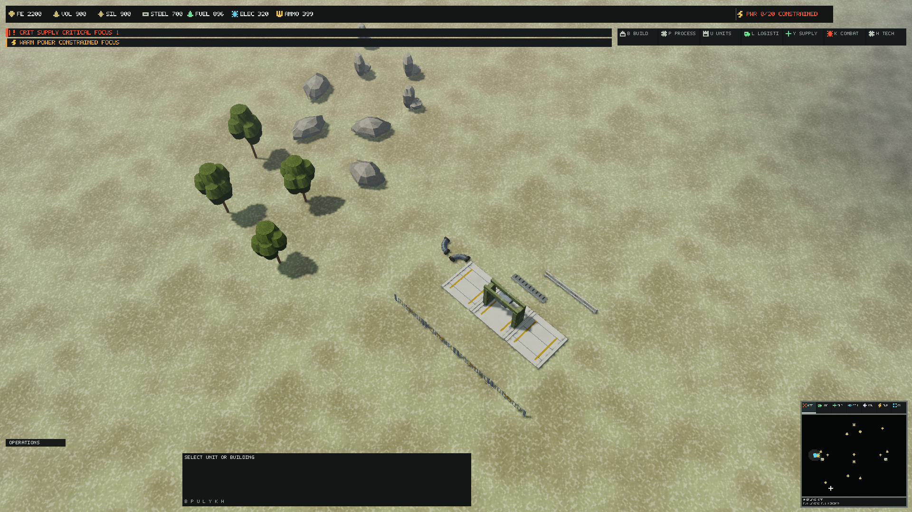
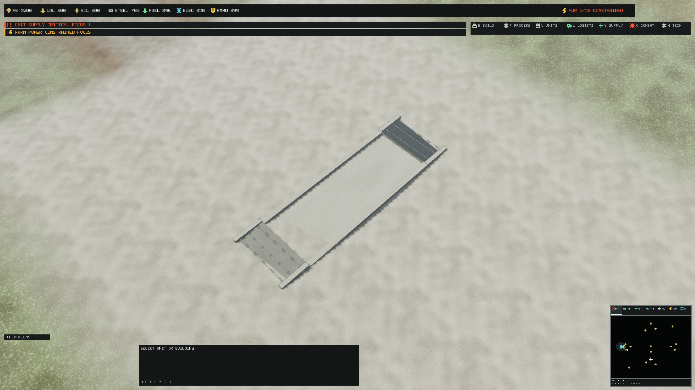
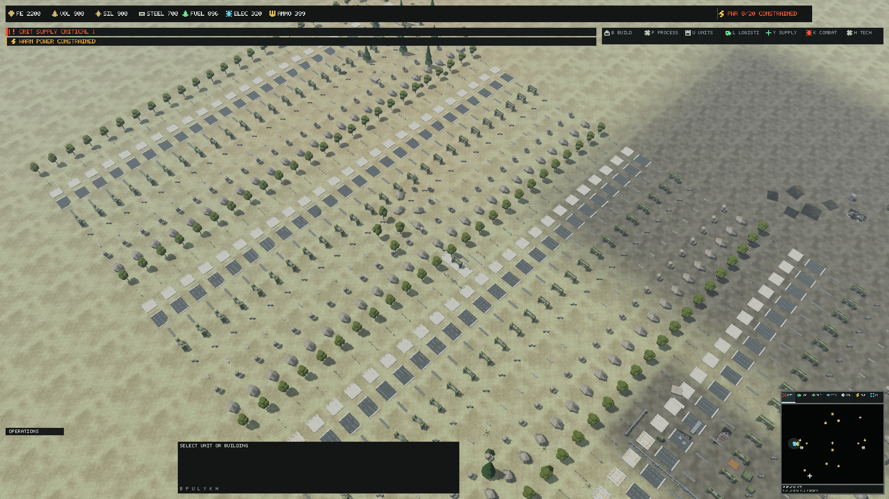

# Central Divide modular environment kit

Starting master: `fad0f7a69842c5a4b96eda1524e1841255288e69`.
Runtime-integrity integration: `fb08045edceeeefc0db1c89183d738c462453cec`.
PR version: 0.1.349, one PATCH above the refreshed master.
Existing world content already supplies conifer/scrub/grass, mineral clusters,
eleven industrial props, two world LODs, shared PBR surfaces and presentation-only
authored dressing. Roads, crossings and resource state are gameplay authority.

The representative batch adds two rock silhouettes, a branched broadleaf tree,
Jersey-style barrier, open service fence, hollow pipe elbow, loading gantry,
road-edge drain, bridge approach apron and loading slab. Upgrade the existing
ferrous deposit geometry without changing its identity, resource state or bounds.
This is a bounded batch; additional families require review of these results.

Use existing normalized world-mesh conventions: +Y up, +Z forward, prop centre
at the origin inside [-.5,.5], vegetation root at Y=0 with height 1. A reference
mesh unit is one metre; map instance scale supplies documented physical dimensions.
Import scale remains 1. No implicit scale conversion or terrain-height mutation.
Fence/road modules snap at 8m lengths; barriers at 4m. Road/bridge approach
dressing is low profile and non-blocking. Gantries preserve a clear loading bay.

Each family has an editable recipe and self-contained glTF High/Reduced exports.
One shared industrial or vegetation material per mesh/LOD; atlas cells retain
their .018 inset. Minerals use cell 11, timber 10, foliage 13, concrete 6,
steel 1 and warning strips 5. Normals are explicit; compiler generates tangents.
Broadleaf crowns use solid, closed geometry, with no alpha cards or new overdraw
policy. Simplified collision proxies are tooling metadata only, never navigation,
cover, sensor, selection or buildability authority.

New scenery must remain PresentationOnly and preserve every original key and
transform. Service-yard/natural groups respect existing clearance exclusions.
Low road-edge/bridge modules may sit at corridor boundaries as explicit authored
transitions; they do not add road edges, blockers, concealment or gameplay state.
No ruined bridge/damage state is fabricated by decoration.

Qualification will record source determinism, compiled bounds/material/LOD
references, map reproducibility, headless authority parity, native reference
views and repeated-instance cost. Static pixels are review evidence, not final
art, continuous LOD-motion, live route or sustained performance acceptance.

## Editable sources and catalog

`assets/source/world/authoring/environment.kit.json` is the editable source of
geometry, atlas regions, physical dimensions and provenance.
`build/Author-EnvironmentKit.py` exports explicit triangles, normals and UV0 to
self-contained glTF 2.0 buffers. Import into a glTF-capable DCC at scale 1;
engine PBR material IDs are resolved by adjacent asset metadata, rather than
embedded as standalone glTF textures. The exporter owns only this kit and the
two ferrous source references. All new geometry is original ForgeLine work,
with no external model/image input. Existing production masters retain their
documented provenance. No texture or material is added.

| Family | Runtime high ID | High / Reduced triangles | Physical reference dimensions |
|---|---|---:|---|
| rock_slab | `mesh.world.prop.rock_slab` | 192 / 48 | [9, 3, 6] |
| rock_spire | `mesh.world.prop.rock_spire` | 192 / 48 | [4, 7, 4] |
| barrier_module | `mesh.world.prop.barrier_module` | 232 / 24 | [4, 1.2, 0.9] |
| pipe_elbow | `mesh.world.prop.pipe_elbow` | 912 / 240 | [3, 1, 3] |
| loading_gantry | `mesh.world.prop.loading_gantry` | 584 / 152 | [8, 6, 4] |
| road_edge | `mesh.world.prop.road_edge` | 164 / 24 | [8, 0.4, 1.4] |
| bridge_apron | `mesh.world.prop.bridge_apron` | 136 / 36 | [12, 0.3, 8] |
| loading_apron | `mesh.world.prop.loading_apron` | 160 / 36 | [8, 0.45, 8] |
| service_fence | `mesh.world.prop.service_fence` | 280 / 132 | [8, 2.4, 0.35] |
| broadleaf | `mesh.world.vegetation.broadleaf` | 624 / 152 | [7, 12, 7] |

Ferrous retains its existing High/Reduced IDs and fitted bounds, with 400/100
triangles. Two shared 12-triangle collision proxies retain centred and rooted
conventions. They are compiler metadata; navigation never derives blocking,
cover or visibility from them. The catalog adds 20 visual meshes and two proxies,
for 373 compiled assets: 190 meshes, 56 textures and 127 materials.

## Map integration and review scenes

`CentralDivideKitDressing` adds 34 stable `kit.*` PresentationOnly records.
The yard groups a loading gantry, three slabs, barriers, fences and pipes;
four broadleafs and two four-instance rock groups flank it. Two 18m-wide aprons
join the actual north-bridge mesh ends at Z=899/941. The 1m ramp height
puts its crest within 1cm of the existing deck height before terrain sampling. Six drains sit outside
the existing 12m road lane. No road edge, obstacle, build site, resource, cover
or sensor is added. Original map records and replay authority remain intact.
Corridor-edge exceptions apply only to thin drains/aprons; other scenery
retains start/site/resource and route clearances.

The opt-in `EnvironmentKitYard` and `EnvironmentKitBridge` scenes extract the
actual Central Divide scenario at tick 32, seed 2026. `EnvironmentKitRepeated`
adds 1,000 copied presentation instances, 100 per family, in a 40 by 25 grid.
They allocate no simulation entities. Fingerprints retain visible/action state
but exclude the ephemeral player-action session ID. Every copied render
instance must still compare equal between independently extracted scenes.

## Reproduction

```powershell
python build/Author-EnvironmentKit.py --output artifacts/kit-reexport
# Compare SHA-256 records against committed exports.json.
dotnet build ForgeLine.sln -c Release --no-restore --disable-build-servers -m:1
./build/Build-RuntimeAssets.ps1 -Mode build -ForceRebuild -NoBuild -QualificationOutput artifacts/kit-integrated-assets.json
./build/Build-RuntimeAssets.ps1 -Mode validate -NoBuild -QualificationOutput artifacts/kit-integrated-assets-validated.json
dotnet run --project tools/ForgeLine.MapCompiler -c Release --no-build -- --output artifacts/maps/kit-central-divide.flmap.json --qualification-output artifacts/kit-map.json
dotnet test --solution ForgeLine.sln --configuration Release --no-build
./build/Invoke-RtsReferenceQualification.ps1 -Capture -Scenes @('EnvironmentKitYard','EnvironmentKitBridge') -Profiles @('Low','Medium','High') -Zooms @('CloseTactical','NormalGameplay','Strategic') -Displays @('1920x1080','2560x1440','3840x2160','3440x1440') -Warmups 8 -Samples 32 -RepeatCaptures 2 -ContinueAfterMismatch -OutputRoot artifacts/kit-native
./build/Invoke-RtsReferenceQualification.ps1 -Capture -Scenes @('EnvironmentKitRepeated') -Profiles @('Medium') -Zooms @('CloseTactical','NormalGameplay','Strategic') -Displays @('1920x1080','2560x1440') -Warmups 8 -Samples 32 -RepeatCaptures 2 -ContinueAfterMismatch -OutputRoot artifacts/kit-repeat-native
```

Use a fresh evidence directory per native run. Runtime outputs and logs remain
generated artifacts; source exports and representative native images provide
portable review material.

## Visual observations and acceptance limits

The bounded yard demonstrates open gantry access, repeated slab/fence modules,
hollow pipe silhouettes, branching broadleafs and two contrasting rock shapes.
The corrected aprons meet the actual bridge mesh ends; the initial image review
found and removed a placement based incorrectly on the navigation envelope.
The existing bridge visual remains along Z while its logistics crossing runs
along X. This pre-existing infrastructure presentation mismatch is outside this
geometry batch: no authoritative transform, navigation or road graph is changed.
Road-edge drains stay outside the 12m lane. There are no decorative damage states.

Repeated still images establish pixel reproducibility and structural loading,
not continuous LOD transitions, aliasing/shimmer, wheel contact or live route
acceptance. Foliage uses opaque closed crowns, so there is no new alpha-card
pass; this is not a measurement of every possible foliage arrangement.
The broadleaf shares the existing root-preserving vegetation motion and fade.
Continuous camera/LOD motion, terrain contacts on uneven ground, surface/exposure
matching, fog-of-war/live convoy review and human art acceptance remain open.
The batch must remain bounded until these items are reviewed.

The 120/420/1000m matrix is a fixed-state workload with 8 warmups and 32 samples,
not a sustained 60-FPS guarantee. No universal triangle ceiling is inferred.
The existing camera projected-diameter LOD policy and hysteresis remain in force.
The debug layer is unavailable on the qualification hardware; zero reported
debug errors cannot certify debug-layer diagnostics or device recovery.
Physical high-resolution displays, focus recovery and DPI transitions require
separate review. Exact offscreen backbuffer sizes are recorded independently
of the host window.

Required hosted build-test, frame-hot-path and scalability completion remains
pending until publication. Local checks do not replace CI. No image is promoted
to an approved golden and no final production art/performance approval is claimed.

## Qualification results

Hardware/source: `e00558febd3a289aed94666ea2d0ff2b1430fba5`; runtime fingerprint
`73B77E4DB3F1F10A1E1877C8846E1BBE92F6941474AD5AAE5ED194050C59E310`; NVIDIA RTX PRO 5000 Blackwell Generation Laptop GPU: 32.0.15.9653; Intel(R) Graphics: 32.0.101.8724.
Native Direct3D 12, feature level 12_1, hardware adapter; debug layer unavailable.

The integrated Release build passes with zero warnings/errors. All 1,767 tests
complete: 1,758 pass, nine opt-in measurement tests skip, zero fail. The source
geometry check validates 24 exports; an isolated re-export matches every committed
SHA-256 report. The compiled root-origin, bounds, normals/UV/tangents, material,
collision/LOD references and retained replay authority checks pass.

The clean current build/validate asset modes and runtime process-contract tests
pass. Runtime inventory is 373 assets (190 meshes, 56 textures, 127 materials),
59,015,415 compiled bytes, with no qualification issues. The refreshed map has
71 reachability checks, two alternate-navigation and two alternate-road checks,
27 buildable zones, nine contested resources and 65.38687m elevation range.
The final 64-tick seed-2026 headless comparison matches all 24 deterministic
match fields, including full participants, lifecycle and opponent-work state.
Only timing/allocation/GC metrics are excluded. Historical authoritative snapshot
expectations remain unchanged. The integrated terminal run completes at tick
42,922, winner 1, CommandCoreDestroyed, 314 entities, matching the retained
pre-integration terminal result.

The 72 native yard/bridge rows cover three profiles, three zooms and four exact
backbuffer sizes. Six additional Medium repeated-kit rows cover Full-HD/QHD and
all three zooms. Every repeated image matches; every requested surface is exact.
There are zero fallback meshes, material/texture binding failures and submission
faults. Resident texture payload remains 52,707,564 bytes and peak SRV usage is
186. Total local-video-memory usage peaks at 732,606,464 bytes in these captures;
this includes render targets/shadows and is distinct from texture payload.

| Native display | Worst GPU mean, ms | Worst GPU p99, ms | Worst CPU p99, ms |
|---|---:|---:|---:|
| 1920x1080 | 25.587 | 29.097 | 103.642 |
| 2560x1440 | 28.174 | 40.614 | 127.455 |
| 3840x2160 | 43.381 | 51.925 | 78.118 |
| 3440x1440 | 36.471 | 40.752 | 65.290 |

These are maxima across both scenes/profiles/zooms, not an average scene.

| 1,000-kit workload | Visible | High / Reduced | Instance draws | GPU mean / p99, ms |
|---|---:|---:|---:|---:|
| 1920x1080-Medium-CloseTactical | 177 | 163 / 14 | 12 | 17.801 / 23.487 |
| 1920x1080-Medium-NormalGameplay | 958 | 139 / 819 | 30 | 17.106 / 25.077 |
| 1920x1080-Medium-Strategic | 1187 | 10 / 1177 | 30 | 24.167 / 36.374 |
| 2560x1440-Medium-CloseTactical | 177 | 163 / 14 | 12 | 25.136 / 30.002 |
| 2560x1440-Medium-NormalGameplay | 943 | 131 / 812 | 30 | 27.281 / 38.589 |
| 2560x1440-Medium-Strategic | 1187 | 10 / 1177 | 30 | 26.016 / 30.959 |

All repeated-kit states contain 1,552 presentation instances: the existing
snapshot plus 1,000 added copies. Different views cull different subsets;
whole-frame GPU timing includes terrain, shadows, HUD and post-processing.
There is no matched before/after isolation of mesh cost. These observations
retain an open sustained-performance gate, including the 16.67ms 60-FPS target;
no workload or acceptance budget was relaxed.

The canonical 1,000-stress windowed 1600x900 run passes at 11 instance draws and
75 total measured draws, with 938/1551 visible and no binding failures. Both
client processes exit normally. Borderless 5120x2160 renders at 13 instance draws,
80 total draws and 950/1550 visible, then fails the unchanged 11-batch assertion.
The same 13/11 condition was previously recorded for the tank integration; see
[Main Battle Tank qualification](MainBattleTankProduction.md). This is an open
combined-script failure, not a borderless acceptance pass. Short startup rates
are not sustained-performance evidence or proof of focus recovery.

Native evidence lives in `artifacts/kit-integrated-native/manifest.json` and
`artifacts/kit-repeat-native/manifest.json`. Window evidence is
`artifacts/kit-window.json` / `kit-borderless.json`; build/asset/inventory/tests,
map, parity and runtime-contract logs use the `kit-integrated-*` / `kit-runtime-*`
paths. Earlier `kit-native*` matrices are retained separately; the first exposed
the bridge placement error and is not the final geometric review evidence.

## Representative native images

These unchanged Medium 1920x1080 pixels are review evidence, not approved goldens.







For current road/bridge/ford masters and graph-derived display transforms, see
[Road, bridge and crossing Blender sources](InfrastructureBlenderMasters.md).
Earlier captures in this document remain historical.
