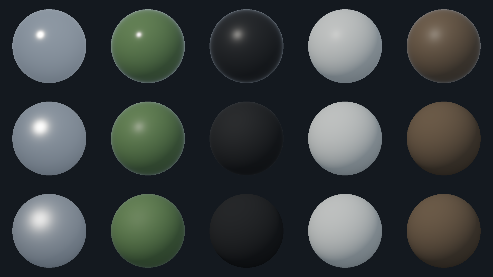

# Material lighting qualification

The metallic-roughness foundation replaces duplicated heuristic shading while reusing established lighting, FP16 composition, shadows, grading and spatial AA. See the [decision and resource boundaries](adr/MetallicRoughnessLightingFoundation.md), [graphics contract](Graphics.md), [native evidence workflow](VisualReferenceEvidence.md) and [performance workflow](GraphicsReferencePerformance.md).

## Controlled materials

`-Scenes MaterialFoundation` is an optional analytic sphere fixture using the same production lighting shader. Columns are steel, painted armor, rubber, concrete and rough terrain. Rows multiply the stated roughness by 0.5, 1 and 1.5, clamped to [0,1]. Values are linear factors:

| Material | Base Color RGB | Roughness | Metallic |
| :--- | :--- | ---: | ---: |
| Steel | 0.56, 0.57, 0.58 | 0.35 | 1 |
| Painted armor | 0.12, 0.18, 0.08 | 0.45 | 0 |
| Rubber | 0.025, 0.025, 0.025 | 0.85 | 0 |
| Concrete | 0.50, 0.50, 0.47 | 0.90 | 0 |
| Rough terrain | 0.14, 0.10, 0.065 | 1.00 | 0 |

Native Medium tactical control from the recorded changed source (PNG SHA256 is in the portable summary):



Sphere size scales by `120/camera.Distance`, using the same 120/420/1000 m reference bookmarks and camera basis. These are mathematical controls, not catalog textures or asset provenance claims. The six default world fixtures remain unchanged. Material inputs are recorded in capture metadata and included in the fixture fingerprint. The capture host still initializes the approved terrain/asset catalog; its resource counts include unused catalog allocations and cannot represent sphere-only or gameplay performance.

Build the exact committed source and qualify assets first. Invoke scripts directly when passing PowerShell arrays:

```powershell
& ./build/Invoke-RtsReferenceQualification.ps1 -Capture -Scenes MaterialFoundation -Profiles @('Low','Medium','High') -Zooms @('CloseTactical','NormalGameplay','Strategic') -Displays @('1920x1080') -Warmups 3 -Samples 8 -RepeatCaptures 8 -OutputRoot artifacts/material-controls
& ./build/Invoke-RtsReferenceQualification.ps1 -Capture -Scenes @('IndustrialBase','BattlefieldCombat') -Profiles @('Low','Medium','High') -Zooms @('CloseTactical','NormalGameplay','Strategic') -Displays @('1920x1080') -Warmups 3 -Samples 8 -RepeatCaptures 8 -OutputRoot artifacts/material-world-matrix
pwsh ./build/Invoke-ReferencePerformance.ps1 -Samples 256 -OutputRoot artifacts/material-performance
pwsh ./build/Compare-ReferencePerformance.ps1 -CurrentRoot artifacts/material-performance/run-2 -BaselineRoot artifacts/master-performance/run-2 -ReportPath artifacts/material-performance/master-comparison.json
```

Use separate output roots and serialize builds, GPU tests and captures. Warm and renderer-cold sampling, camera sweeps and the thousand-vehicle preset use the existing performance workflow. Cold renderer reconstruction does not mean OS cache eviction. Native PNGs and full manifests remain per-run artifacts; the [portable summary](qualification/pbr-foundation.json) preserves hashes, fixture/build/runtime identity, timings, allocations, pass means, draws and residency.

## Recorded hardware cohort

Baseline: master `8df749b68337592c7a0417a8528e709f4f2406e3`, version 0.1.355. Changed shader/control source: `666f3e5d967e3f5e2b9509a1095fa1c65fadbf15`, version 0.1.356. Both use runtime fingerprint `357A636CB94F0EFDA219178864BC2F6E530FEB5592F4E9440512EAE2EFE56CD3`.

Hardware: NVIDIA RTX PRO 5000 Blackwell Generation Laptop GPU, driver32.0.15.9653, feature level12_1; Intel Family6 Model198 Stepping2, 24 logical processors; Windows10.0.26300, x64, SDK10.0.401, Release. Native1920x1080, VSync off, Medium. The debug layer was unavailable/disabled; zero recorded warnings is not debug-layer certification.

Two sequential process runs per revision each used64 warmups and256 CPU samples per case (254 completed GPU fence samples). The matching second runs yielded:

| Scene/bookmark | CPU baseline → changed, ms | GPU baseline → changed, ms | GPU delta | Instance draws |
| :--- | :--- | :--- | ---: | ---: |
| Industrial/tactical | 32.212 → 32.218 | 30.599 → 30.511 | −0.29% | 23 |
| Industrial/strategic | 31.667 → 31.474 | 29.701 → 29.777 | +0.26% | 40 |
| Combat/tactical | 35.295 → 35.738 | 34.576 → 34.873 | +0.86% | 24 |
| Combat/strategic | 30.369 → 30.583 | 29.792 → 29.829 | +0.13% | 33 |

CPU mean deltas range −0.61% to +1.25%. No mean/p50/p95/p99 gate exceeds the configured15% threshold; this is a small observed difference, not a demonstrated speedup. Texture residency and draw counts are unchanged:52,707,564 bytes for industrial and52,708,956 bytes for combat. Changed DXGI local usage is250,392,576 through250,466,304 bytes; adapter usage is broader than payload residency. The GPU frame remains approximately30–35 ms, above the16.67 ms prototype target.

Eight changed performance cases, nine material/profile/bookmark controls and eighteen production scene/profile/bookmark cases passed structural qualification. The controls and profile matrix each have eight exactly equal readbacks; performance cases have two. The previous High shadow-edge mismatch did not reproduce in this cohort, which does not establish a universal fix or known cause. Short eight-sample matrix timings are functional evidence, not performance comparisons.

## Review limits

Window qualification preserves eleven canonical base mesh/material batch families. Additional LODs can split those families: the ceiling adds `min(11,lod1Instances)` and `min(11,lod2Instances)`, bounded at33 total instance draws. Negative, fractional, partial or over-visible LOD counts are rejected; legacy reports keep the eleven-batch ceiling. Terrain, composite and shadow draw accounting retains its separate bounds. Contract tests cover the boundaries in CI. The earlier fixed eleven-batch gate rejected the5120x2160 borderless view with13 instance draws on both unchanged master and the new material shader; their identical counts establish that this qualification repair is independent of shading cost.

The material controls show the expected metallic versus dielectric and roughness response. Production terrain is darker under normalized diffuse lighting; tactical overlays stay in their existing sharp output-space pass. Native repeatability and numerical BRDF contracts do not grant human art acceptance. Inspect actual units/buildings at every bookmark for readable scale, lighting, normal detail, shadow acne/peter-panning and clipping before accepting goldens.

The existing spatial AA plus normal-variance roughness broadening has no temporal history. Camera sweeps inspect spatial shimmer, but readback interrupts pacing and cannot certify live judder, sustained FPS or monitor DPI transitions. There is no new bloom, temporal upscale, environment map or physical HDR display path. Additional display sizes, physical monitor transitions and device/debug-layer investigations remain separate qualifications.

The optional [procedural CPU atlas producer](ProceduralPbrProduction.md) preserves the existing atlas and runtime budgets in isolated, verifiable source generations. Production promotion and art approval remain explicit; see its qualification report.
