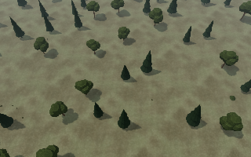

# Procedural map qualification

The generator-v1 golden and headless contracts pass. Native production-asset captures are reproducible, but **art and performance acceptance remain open**. The existing 15% performance comparison rejects 13 statistics between independent runs of the same executable. No threshold was relaxed and no 60 FPS claim follows from these measurements.

## Versioned seed contract

[`qualification/procedural-map-seeds.json`](qualification/procedural-map-seeds.json) pins manifest, gameplay, visual, terrain, geography, biome and decoration SHA-256 identities. Its fixed `a…a` asset identity is a portable compiler fixture, not an actual asset catalog.

| Cases | Extent | Expected result |
| --- | --- | --- |
| Seeds 17, 0, 1, 2, 7, 42 | 8×8 chunks, 2048 m | Rejected; exact normalized error hashes pinned |
| Seeds 17, 18, 0, 42 | 12×12 chunks, 3072 m | Qualified |
| Seed 17 | 16×16 chunks, 4096 m | Qualified reference size |
| Seed 18446744073709551615 | 12×12 chunks | Qualified unsigned boundary |
| Seed 17, base height −100000 / +100000 mm | 12×12 chunks | Qualified height extremes |

Every case is compiled twice. Accepted cases regenerate scatter in forward order with maximum parallelism 1 and reverse order with maximum parallelism 4; this machine actually used 1 and 4 workers. Canonically ordered hashes match both runs and the manifest. Each accepted case has zero audit errors and warnings. Rejections preserve their diagnostic messages; they do not count as playable small maps. In particular, the tested 8×8 seeds remain failures of the existing strategic geography constraints.

The first package is written and reloaded through the runtime loader. Independent 20-tick headless starts, serialized save restoration and replay produce identical authoritative states. The committed [`headless report`](qualification/procedural-map-headless.json) retains allocation/time samples and diagnostics. Two samples per seed establish repeatability, not a stable generation-time percentile estimate. Observed accepted compile times span approximately 0.79–2.50 seconds on the measured host.

Generator v1 supports a fixed temperate full-map profile and rejects negative package origins. Lower-level World tests separately cover signed chunk coordinates, reordered terrain construction, seeds 0/17/ulong-max, terrain/biome/scatter byte identity and standalone −50°C/+50°C climate inputs. They do not imply additional supported full-map climate presets.

## Native evidence

[`qualification/procedural-map-native.json`](qualification/procedural-map-native.json) records the exact executable revisions, catalog signature, environment, distributions, timed-frame peaks and hashes of complete frame reports. The initial measured source is `94e63996143b71e65258893574d106191fea3efb`, build `0.1.528-dev` with its source stamp. All 997 C# build-input/source files were checked against committed Git blob identities; the evidence records a verified source snapshot, not a clean local Git checkout. Later bridge reconnaissance has its own recorded source/build identity. The final PR's one PATCH changes release metadata after these measurements.

The host is an Intel Core Ultra 9 285HX, 24 logical processors, 68137205760 bytes physical RAM, NVIDIA RTX PRO 5000 Blackwell Generation Laptop GPU, 25309478912 bytes dedicated VRAM, driver 32.0.15.9653, Windows 10.0.26300, .NET 10.0.13, x64. The integrated Intel driver is 32.0.101.8724. Software fallback is disabled. The complete current AssetCompiler 1.13 catalog was rebuilt and integrity-validated: 2055 assets, including 946 meshes and 919 textures, 94884440 runtime payload bytes, content signature `135b44877d4882ac539073738a43af7b4794ff35819cc2c1f55c353771743020`. Older local catalogs are not substituted.

Main cohorts use Medium, 1920×1080, native resolution, immediate presentation, 32 stationary warmup frames and 128 timed traversal frames per case. The camera crosses chunk boundaries with up to 384 m lateral / 512 m forward displacement, changing yaw and distance; visual time spans four seconds. Each case also exports 32 poses, two identical native readbacks at each pose, PNGs, pose/pixel fingerprints and an HTML sequence player. CPU measurements include Prepare, submission and Present, excluding readback and event pumping. GPU distributions contain distinct completed fences after warmup, with actual sample counts; they need not have 128 samples. Timed CPU duration is the sum of the retained per-frame CPU measurements. This is a renderer traversal over a frozen authorized snapshot, not a running-match throughput measurement.

The generated fixture includes real starting buildings/vehicles, public resources and scatter. Green annotations show build areas; reported 2 m yard samples pass the actual buildability query. One nonselectable render-only copy of an already authorized owned unit sits under a forest canopy for occlusion review. It creates no gameplay entity or intelligence. The generated seed-17 map has 79564 scatter instances, 618 road edges and **zero crossings**. Bridge coverage is therefore a separately named Split Basin authored control. Its initial 20-tick snapshot does not identify the bridge; a separate legal movement/reconnaissance run at revision `5348e87240c3aa02864e59062dc3a0fe6d9d6f1c` reaches tick 5020 and identifies one visible bridge. Neither control is presented as a generated bridge seed.

The optional road mask in this benchmark is derived through `TerrainInfrastructureMask.FromRoadSegments`. This exercises the existing biome material infrastructure contract; it is not a claim that every client profile enables that optional mask. Authoritative road graphs, navigation and resource quantities are unchanged.

Selected current-cohort measurements, milliseconds; complete baseline/current and extra-seed values are in the JSON:

| Seed / scene / camera distance | CPU mean / p95 / p99 | GPU mean / p95 / p99 |
| --- | --- | --- |
| 17, yard, 120 m | 15.160 / 37.462 / 41.574 | 0.694 / 1.428 / 1.913 |
| 17, yard, 420 m | 14.068 / 22.256 / 27.385 | 0.653 / 1.421 / 1.775 |
| 17, yard, 1000 m | 28.733 / 65.008 / 72.715 | 1.363 / 3.261 / 4.824 |
| 17, corridor, 120 m | 13.945 / 33.133 / 49.144 | 0.655 / 1.482 / 2.152 |
| 17, corridor, 420 m | 12.148 / 16.618 / 25.525 | 0.676 / 1.444 / 1.701 |
| 17, corridor, 1000 m | 24.641 / 72.454 / 91.067 | 1.055 / 2.373 / 3.066 |
| 17, forest, 120 m | 4.846 / 7.177 / 7.450 | 0.674 / 1.724 / 2.354 |
| 17, forest, 420 m | 5.996 / 9.365 / 12.349 | 0.668 / 1.625 / 2.223 |
| 17, forest, 1000 m | 10.440 / 15.875 / 18.612 | 0.580 / 1.431 / 1.909 |
| 17, 16×16 reference forest, 1000 m | 37.459 / 78.289 / 91.152 | 1.679 / 4.651 / 7.308 |
| 18, corridor, 420 m | 16.149 / 31.504 / 36.365 | 0.717 / 1.404 / 1.654 |

Observed timed-frame peaks include 56220 resident decoration instances, 12 decoration color draws, 4096 shadow casters and 284491776 bytes DXGI local video-memory usage. Raw diagnostics distinguish retained CPU instance data, instance upload/buffer bytes, terrain geometry/control textures, shared catalog meshes, texture residency and process-local DXGI usage. Those categories overlap and must not be summed as a VRAM estimate. Existing limits remain intact: 128 resident terrain/decor chunks in this fixture, 65536 expanded decoration instances, four terrain layers, 64 mask candidates per chunk, 13 terrain bindings per draw and the resolved Medium shadow limits. Every completed native case has zero fallback meshes, texture-binding failures and submission faults.

Both nine-case cohorts match workload and pixel fingerprints. The unchanged `Compare-ReferencePerformance.ps1 -GatePerformance` reports 13 statistics above 15%, zero incomparable cases. This is recorded as a failed repeatability threshold on identical code. It is not evidence of a speedup or an attributable code regression. Additional unpaired cases are structural observations only. Stable repeated cohorts and an agreed hardware target remain necessary before performance acceptance; several CPU averages and tails already exceed a 16.67 ms frame budget.

## Visual review and remaining limits



This small preview is a lossless APNG repack of sixteen **native 320×200** forest captures, played at 8 fps. Its [`metadata`](qualification/procedural-forest-preview.json) contains the original poses and RGBA hashes. It is not a rescaled full-resolution result or a performance video. Full 1920×1080 sequences remain in the run output and can be reproduced with the same request.

Sampled traversal frames show terrain-anchored trees and shadows, changing visible populations and finite-world edges. Road/approach edges visibly intersect or break into conspicuous pale pieces; canopy-covered units can be unreadable. These are review findings, not art acceptance. The sparse sequence is insufficient to certify absence of LOD popping, continuous vehicle clearance, fog behavior during exploration or sustained live 60 FPS. The 20-tick save/replay proof likewise does not establish long-term generated-map resource flow or win-rate balance. Existing navigation, logistics, persistence and terminal-match gates remain required. No gameplay stock or audit threshold is changed to hide those limits.

## Reproduce

Run from a clean committed checkout with .NET 10 on Windows. The wrapper restores/builds Release with a source stamp, runs the golden package/headless matrix, and optionally captures native evidence. Use fresh output directories; outputs are never overwritten.

```powershell
./build/Invoke-ProceduralMapQualification.ps1
# Build the complete repository asset catalog before native captures:
dotnet run --project tools/ForgeLine.AssetCompiler -c Release --no-build -- --mode build --source assets/source --runtime assets/runtime --qualification-output artifacts/procedural-assets.json
```

Create a native request with `runtimeRoot`, fresh `outputRoot`, exact `sourceRevision` (40 lowercase hex), recorded GPU `driver`, `requireSourceStamp: true`, `seed: 17`, `side: 12`, `quality: "Medium"`, `width: 1920`, `height: 1080`, `warmups: 32`, `samples: 128`, `motionFrames: 32`, `scenes: ["yard","corridor","forest"]`, `distances: [120,420,1000]`. Then:

```powershell
./build/Invoke-ProceduralMapQualification.ps1 -OutputRoot artifacts/procedural-first -NativeRequest first.request.json
./build/Invoke-ProceduralMapQualification.ps1 -OutputRoot artifacts/procedural-second -NativeRequest second.request.json -BaselineRoot artifacts/native-first -GatePerformance
```

The requests must differ only in their output directory for a repeatability comparison. For a bridge reference, use `authoredControl: true`, `authoredTraversalTicks: 5000`, `scenes: ["crossing"]`; the harness uses human-controlled participants and submits an owned unit's movement through the player command gateway, advances the real simulation, and fails unless a bridge is actually visible to that viewer. Do not compare its different workload with the 20-tick control.

For connector-verified source snapshots, `-SourceRevision` also requires `-SourceManifest`, a revision plus repository-relative Git blob SHA-1 entries. The wrapper verifies each file and still requires the executable's source stamp. `-NoBuild` never disables native source-stamp checks. `requireSourceStamp: false` is a development probe only and cannot satisfy the existing performance gate.

CI runs the golden test matrix, headless qualifier, signed World scheduling tests and focused road/shadow regressions, preserving JSON artifacts. Physical-GPU measurements stay separate from WARP functional CI. The existing full `build-test`, canonical scenario audits, save/replay and terminal-match requirements are retained.

## Confirmed fixes

Long navigation road graphs previously exceeded the existing 64-candidate visual mask budget when each short collinear piece was indexed separately. `FromRoadSegments` joins contiguous collinear intervals at deterministic millimeter precision, preserving gaps/turns and the existing budgets. Tests cover reversed/negative/duplicate input, separated intervals and normalized controls.

An articulated vehicle counted as one visible root while submitting multiple shadow mesh parts. Decoration then received too much of the shared remaining caster budget and D3D12 rejected the frame. The remaining allowance now subtracts submitted mesh parts. A native two-part vehicle plus dense decoration reproduces the old failure and passes at the unchanged 1024-caster test limit.

Local regression validation: 94 World, 80 Game, 42 Presentation, 34 Client and 53 Navigation tests passed (303 total), together with Test-GeneratedMaps, Test-CompiledScenarioLoading, Test-StrategicMapAudit and the 46-project architecture check. Full terminal-match CI remains a separate required result.
