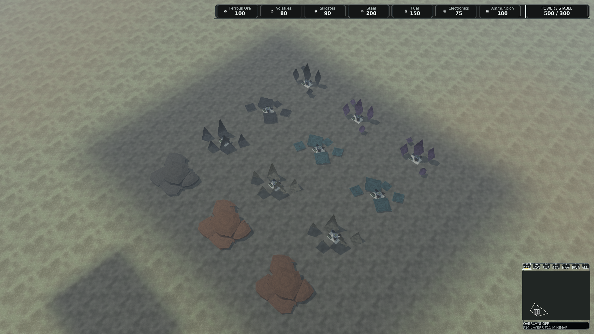

# Resource deposit Blender masters

The canonical geometry now uses [modular cluster sources](ResourceDepositClusterGeometry.md).
The preserved sources, screenshots and results below remain historical evidence
of their original geometry and revisions; they do not qualify the replacement clusters.

## Current review status

Integration base: master **6445ed102bfbec4a5033917196f9464578086be4**, version
0.1.434, including infantry refinement PR #277. This PR has exactly one PATCH
increment to **0.1.435**. The merge preserves every published master scene ID
and appends the four resource scene kinds after the six infantry load scenes.

The retained native rendering and package evidence below belongs to the earlier
tank-integrated base **3c732aa519bb54bec17070bcdad378c232ea9de1** and product
snapshot **525a329ee77e656a232e69efcecd6a35ce22bbea**, version 0.1.434. Those
images, metrics and package hashes retain their original execution identities;
they do not qualify the new infantry-integrated product.

Four editable Blender 5.2.2 rest masters and four separate packed-PBR inspection
projects preserve the existing mineral artwork. Eight High/Reduced GLBs bind the
existing mesh IDs in the regular source catalog. Shared materials, texture atlases,
LOD thresholds, minimap symbols and source-only entities are retained.

The branch is a review candidate. Production acceptance remains blocked by the
rendering milestone's physical/performance gates and human art approval.

## Infantry integration validation

Master 6445ed102bfbec4a5033917196f9464578086be4 was merged into this branch.
The enum conflict retains all 90 published scene IDs in their master order and
appends four resource kinds. Both infantry and resource dispatch paths remain.
Version 0.1.435 is one PATCH above that base.

The combined working tree passed the full Release solution build with zero
warnings/errors, 131 presentation/resource/reference/tank/infantry tests and
15 client capture/loading tests. Two optional full-catalog/cache helpers were
skipped. The retained-master verifier and portable-signature regression test
also passed. This conflict-resolution checkpoint adds no new native images,
package or performance qualification. The acceptance gates below remain open.

## Visible change and gameplay boundary

Native review exposed flattened silhouettes: map deposits use X/Z scale 50.4,
but Y scale 8. PresentationExtractor now applies family-specific minimum Y scales:

| Family | Minimum render Y scale | High triangles / vertices | Reduced triangles / vertices |
| --- | ---: | ---: | ---: |
| Ferrous Ore | 16 | 400 / 1,200 | 100 / 300 |
| Silicates | 28 | 30 / 80 | 18 / 48 |
| Volatiles | 8 | 38 / 112 | 24 / 72 |
| Rare Elements | 32 | 40 / 120 | 24 / 72 |

The copied render center rises by half the added height, preserving the ground
anchor. X/Z, rotation and taller authored transforms are retained. Logical
WorldTransform, resource bounds, extraction radius, quantities, economy,
selection and intelligence authority remain unchanged. Source-only identities
retain their existing behavior without gaining a ResourceDeposit component.

The existing ferrous environment-kit revision is reused. Geometry density and
runtime texture payload stay unchanged. Untouched/Active/Depleted use the real
existing presentation states and tint treatment.

Historical appearance before the height correction:


Current native player view, with all four families and three presentation states:



These illustrate appearance. The historical image predates later master
synchronization and provides no controlled performance baseline.

## Audit and synchronization

The ordered initial remote audit used master
a6fe118583be842e00416bcb100d1210f3240a00, version 0.1.431-dev. Master is the
default/integration branch. Related resource PRs #47, #112, #181, Blender #229,
readiness #269 and rendering #268 were inspected alongside branches, changed
paths, available review comments and CI. Existing art and state/material/LOD
support were reused.

Logistics PR #273 subsequently merged at a391a5bb0c0e25f079fa394613a5f84dfe7e9728.
Tank PR #278 subsequently merged at 3c732aa519bb54bec17070bcdad378c232ea9de1. This branch was
rebased after each integration. Published logistics and tank reference enum IDs
are preserved; resource kinds are appended after them. Versioning was reconciled
against each latest base without accumulating multiple PATCH increments.

## Authoring and source ownership

assets/staged/resource-deposits/<family>/ retains the rest master, packed
inspection project, two exports and lineage. Regular definitions under
assets/source/world/meshes/resources/ reference byte-identical GLBs under
sources/blender/<family>/. Original glTF sources remain available.

Lineage records original bindings, portable source signatures, native/export
hashes, previous native hashes and the current authoring contract. Status
review-bound-not-accepted keeps the acceptance boundary explicit.

The family adapter delegates to the bounded shared round-trip. Rest scenes
retain metric scale, root pivots, engine-to-Blender (x,y,z) to (x,-z,y), topology,
material order, normals, UVs and High/Reduced metadata. The unit-scale,
translated/rotated fixture probes authoring contracts independently of gameplay
deposit dimensions.

Inspection projects pack the existing Base Color, Normal and ORM sources.
Their roughness/metallic preview approximates the runtime shader; AO is evaluated
in game. Inspection graphs and cameras remain separate from compiler-accepted
rest scenes. The player package contains zero .blend, .py, .gltf or .glb files.

After GLB binding, the previous raw source signature correctly refused export.
Masters were regenerated against current bindings. The mineral adapter now
normalizes JSON/glTF line endings in its frozen signature and retains raw hashes
for unchanged-input checks. Content/path/material changes still invalidate the
contract. The signature regression test verifies both behaviors. Shared exporter
module files remain unchanged.

## Reproduction

Use a clean checkout, pinned SDK and Blender 5.2.2 x64, and fresh short output
paths. Short paths avoid Blender Python's Windows path-length boundary.

```powershell
dotnet restore ForgeLine.sln --disable-parallel -m:1
dotnet build ForgeLine.sln -c Release --no-restore --disable-build-servers -m:1
python build/resource-deposits/test_contract.py
python build/resource-deposits/retained.py
pwsh ./tools/blender/Invoke-Blender.ps1 -Action Check -OutputRoot artifacts/bcheck
pwsh ./build/resource-deposits/Qualify-Masters.ps1 -OutputRoot artifacts/rb -NativeBatch
pwsh ./build/Validate-ProjectReferences.ps1
pwsh ./build/Validate-SemVer.ps1 -BaseRef origin/master
```

Qualify-Masters creates independent first/second factory scenes and reopens the
first saved project. Six actual native mutations per family must be rejected:
unbaked transform, changed envelope, modifier, animation, material slots and
unexpected object. Unchanged reopen/export must pass. NativeBatch runs these
fresh scenes in one pinned process; the default mode uses separate processes.

Each family has baseline/first/second/reopened compiler catalogs, absent-source
integrity checks and repeated source/runtime byte comparisons. Typed tests compare
positions, normals, UVs, tangents, indices, material/LOD, socket and collision
references. Canonical sources must remain unchanged during qualification.

prepare-materials.py prepares four materials and three shared textures without
mesh records. The native CI workflow compiles that source once, uses the opt-in
ResourceDepositMaterialCacheTests to seal four verified family seeds, then passes
-MaterialCacheRoot to qualification. Every variant still imports its two meshes
through the actual compiler. ReuseAuthored checks native rejection evidence,
current raw source hashes and fresh runtime destinations.

For a qualified binding/signature migration, retained.py --refresh-native ROOT
checks the entire qualification and unchanged exports before refreshing native
files. It refuses undeclared edits to existing masters. Initial retention with
a positional root refuses existing retained destinations.

Capture-Review.ps1 takes complete baseline/candidate runtime roots and the actual
built **ForgeLine.Client.exe** path. The native workflow uses Release win-x64
output. Publish-PreAlpha.ps1 -VerifyReproducible verifies paired publish trees.

## Observed validation

| Check | Observed result |
| --- | --- |
| Latest full Release solution build | 0 warnings, 0 errors; 4m36.66s |
| Latest resource/world/reference/tank presentation tests | 115 passed, 2 optional helper skips |
| Latest native client/reference capture tests | 9 passed, including session handoff |
| Architecture and SemVer | 44 projects, no cycles; one PATCH to 0.1.434 |
| Real Blender | 5.2.2 LTS, build d13f752e3b9c |
| Bound-master native qualification | Four families; 24 mutation rejections; 16 compiler catalogs and 16 source-less validations; deterministic exports/runtime |
| Typed compiled family comparisons | 9 passed, 1 optional full-overlay helper skipped |
| Latest retained-master reopen | Four actual saved masters; all eight GLB exports byte-identical |
| Native D3D12 comparisons | 14 paired cases / 28 images; zero changed pixels |
| Runtime binding/resource observations | Zero fallback mesh instances, material/texture binding failures, submission faults or repeat-pixel mismatches |
| Published player | Gallery renders all four families; pixels match review; source-less integrity passes |
| Reproducible package | Two publish trees identical; 0 authoring files; 1,363 runtime records |

The earlier complete solution run on the logistics base executed 3,285 cases:
3,246 passed, 37 optional skips and two native session-handoff timeouts during
parallel cold production compilation. The unchanged isolated class subsequently
passed all three cases with the original deadlines. Its asset module passed,
including clean production compilation. The latest-base targeted results are
listed separately above. No timeout or performance threshold was increased.

Earlier evidence also includes 102 passing portable authoring tests, a complete
typed full-catalog overlay comparison and fixed seed 2026 ending naturally at
tick 55,210 with CommandCoreDestroyed/Victory, winner 1. Those retain their actual
historical source identities.

The first cold repeated texture run was interrupted. A copied runtime folder
correctly tripped the fresh-output guard. Native-only evidence was resumed with
verified material-only seeds. A stale master signature and a long output path
were correctly rejected before the final regenerated run. These failed or
interrupted attempts are excluded from passing results.

## Runtime, images and package evidence

The current complete baseline contains 74,844,665 container bytes; the bound
candidate contains 74,844,887 (+222 mesh metadata bytes). Both have 1,363 assets.
Only eight resource mesh payloads differ; every nonmesh payload is identical.
Texture containers stay at 59,453,925 bytes. After the existing splash exclusion,
gameplay textures are 57,667,508, below the unchanged 58,720,256-byte gate.
Container file lengths and live GPU residency are recorded as separate metrics.

The actual device is NVIDIA RTX PRO 5000 Blackwell Laptop, feature level 12_1,
25,309,478,912 bytes reported dedicated VRAM, hardware rendering, debug layer off.
The matrix covers 1080p/4K, three zooms, Low/Medium/High, 1/100/1,000 instances,
dark and wet. Three warmups, eight CPU samples and two repeat captures provide
functional evidence. GPU sample counts and quantiles are retained per case.

All 28 original PNGs, one historical appearance image and one published-player
image are retained with compact metrics and original manifest hashes in
resource-deposits/evidence/native/. Latest source-less/catalog/reopen/validation
records are under evidence/latest/. The index hashes retained bytes.

The 0.1.434-dev package was built from clean snapshot
525a329ee77e656a232e69efcecd6a35ce22bbea. Archive SHA-256:
8bf9851849549bca4c321c82a341df08658c5a97f4d269e5dcda592a80329cba.
Package UI, font/icon and audio contracts passed. Published-player integrity
was checked against an absent source root.

## Remaining acceptance gates

Rendering PR #268 is merged, but its recorded physical/performance/human gates
were not all accepted. A merged milestone and deterministic pictures do not
establish production qualification.

Required gates remain: current-head complete CI, four terrain-material review,
real extraction/depletion placement review, moving-camera LOD/lifecycle coverage,
controlled sustained CPU/GPU and resource-churn measurements, and explicit human
art approval. Native backbuffer captures do not qualify physical display timing.

The centered ferrous stress fixture obscures much of its colocated extractor.
Real placement visibility needs review before art acceptance. The fixture uses
copied presentation states and completed-building appearances; economic behavior
remains covered by the existing game tests and needs the separate play review.

No budget, golden or gameplay rule is relaxed. No merge, release, tag or golden
approval is performed.
