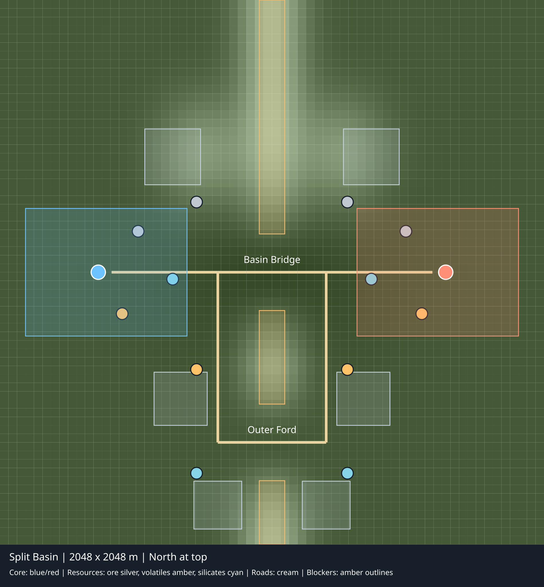

# Split Basin

Split Basin is a 2,048 × 2,048 m Directorate battlefield loaded through the same compiled scenario registry as Central Divide. The original map remains the default. Select Split Basin with Up/Down in New Game, or use the client/headless option `--scenario split-basin`. The stable composition key is `split-basin.directorate.v1`; the map key is `battlefield.split_basin`.



The view is generated from the reloaded artifact, sampled terrain, explicit build areas, blockers, resources, roads and Command Cores. North is at the top. Decoration does not establish cover or traversability.

## Geography and economy

West/east starts at (320, 1024) and (1728, 1024) are reflected about X=1024. Cores stand at (370, 1024) and (1678, 1024). Each 304 × 480 m starting yard has the same three finite reserves: 5,500 Ferrous Ore at 7.5/s, 3,500 Volatiles at 5/s and 4,000 Silicates at 5.5/s. All are within 450 m of their start. Extraction uses the existing deposit, placement, power, ownership and transport systems.

Both sides receive the unchanged normal stock: 2,200 Ore, 900 Volatiles, 900 Silicates, 700 Steel, 900 Fuel, 320 Electronics and 420 Ammunition. The tested industrial opening pays for three Power Plants, three Extractors, Smelter, Electronics Fabricator, Ammunition Plant and Supply Depot from that stock, then pays the conveyor Steel separately. Its building costs total 1,470 Ore, 620 Silicates and 170 Volatiles; 173 power demand fits the three plants' 300 generation before the conveyors. The finite local deposits exceed this bootstrap demand; the map adds no free income or material source. Steel takes 10 Ore, Electronics takes 10 Silicates and Ammunition takes 6 Steel plus 2 Electronics per existing recipe cycle.

Richer paired contested reserves sit outside the yards: 12,000 Ore, 8,000 Volatiles and 10,000 Silicates per side. Six explicit shared sites provide northern overlooks, mining outposts and southern staging areas. Rare Elements are absent and introduce no new bootstrap gate. The existing placement validator still rejects slopes, collisions and invalid dock/footprint positions.

The central Basin Bridge at (1024, 1024) is the short exposed route. The Outer Ford at (1024, 1664) creates a longer southern approach around the divide. Terrain rises around the northern overlooks and between the two passages; real static blockers close the divide outside the authored gaps. The lower central basin and elevated flanks are simulation terrain, using normal slope rules. Current visual sensing uses range and faction intelligence; terrain/vegetation occlusion and an elevation sight bonus are not implemented. Route geometry changes proximity to observers. A production-sensor probe uses the existing Scout Vehicle's 320 m visual range at the northern bridge approach: the bridge target is identified, while the outer-ford target loses current identification. This is one observer placement, not a claim that the complete outer route is concealed. No terrain cover or safety advantage is promised for the outer route. Trees and decorative props have no extra gameplay effects.

Both crossings use the normal disable/restore commands and fixed-tick infrastructure system (80 bridge ticks, 120 ford ticks). Each disables its actual road edge and navigation passage. Either single loss retains a real alternative; losing both disconnects the two halves. Road capacities remain explicit (bridge 160/s, ford 90/s) and use the existing routing implementation. No teleport or route override exists. Crossings currently expose host disable/restore commands, not weapon-damage targets or a player repair action. Those existing host commands are outside the player replay codec; persistence correctly rejects their unrecorded history. The paid active-logistics save/replay proof runs before that separate infrastructure lifecycle check. Combat destruction/repair and recovery after host-triggered crossing loss remain an explicit existing integration limitation.

## Identity and compatibility

Map revision 1, artifact format 3 and terrain recipe version 1 reuse the existing Directorate content revision `directorate.v1`. The content hash remains `192624b7d2011b4ae6d0858d74d2fdfa9dc0d361c029444bf663f785556ffbd9`.

Map JSON SHA-256: `2340ae49d9fd58b5c4e08347a8a14cbe4ca88f34b66dcbeca73af2e5bd5bd608`.

Terrain SHA-256 over every little-endian height sample in chunk/Z/X order: `ee7f0c7e872c2e32528729eca98171ebbcbd9d0d4d846a007fb4d5eb0d9562cd`.

The registry pins those bytes plus the mandatory digest sidecar. Save/replay payload 7 stores the exact scenario identity; envelope 1 and authoritative schema 7 are unchanged. A mismatching saved map identity fails explicitly. The historical Central Divide legacy mapping remains separate. Setup, new/load/restart and installed-package validation resolve the selected descriptor rather than falling back to the default map.

## Reproduction

From the repository root after the canonical Release build:

```powershell
dotnet run --project tools/ForgeLine.MapCompiler/ForgeLine.MapCompiler.csproj --configuration Release --no-build -- --scenario split-basin --output artifacts/maps/split-basin.flmap.json --qualification-output artifacts/split-basin-geography.json --preview-output docs/SplitBasinBattlefield.svg
dotnet test --project tests/ForgeLine.Game.Tests/ForgeLine.Game.Tests.csproj --configuration Release --no-build -- --filter-class '*SplitBasin*'
pwsh ./build/Test-CompiledScenarioLoading.ps1
dotnet run --project src/ForgeLine.Headless/ForgeLine.Headless.csproj --configuration Release --no-build -- --scenario split-basin --profile validation --ticks 80000 --seed 2026 --require-terminal --diagnostics-output artifacts/split-basin-terminal.json
dotnet run --project src/ForgeLine.Client/ForgeLine.Client.csproj --configuration Release --no-build -- --scenario split-basin --smoke-test --settings-root artifacts/split-basin-settings --visual-qualification-output artifacts/split-basin-native.json
```

The compiler reloads and qualifies the actual serialized terrain/map, records the full height-sample hash and bidirectional route lengths, and can regenerate the SVG. The package includes exactly both registered maps and their sidecars. Installed validation constructs both real scenarios and reconstructs their saves and replays using deployed files only. Package provenance lists each map digest.

## Qualification and limits

The loaded-map compiler passes 49 reachability checks, two alternate-navigation checks and two alternate-road checks, with 39.774094 m sampled elevation range. At 16 m navigation cells / 8-cell sectors, Infantry, Wheeled and Tracked each take 1,408 m between starts. Closing the bridge produces a 2,115.677 m west→east path and 2,115.8376 m east→west path. The 0.161 m refinement difference is reported rather than treated as exact path symmetry. Closing only the ford leaves the 1,408 m path. These are geometric distances, not arrival times or balance acceptance.

The build-policy regression samples every road and its ±16 m shoulder strip with 2 m footprints for both owners, while requiring each full Core footprint to fit its own yard. Local Silicates now sit 144 m from the central road rather than 26 m; contested Volatiles and outer Silicates also clear the actual 72 m mining-zone padding. The base rectangles stop before the road entry. The qualified industrial layout leaves real dock approaches free; normal placement validation remains authoritative.

Thirty-three focused Game cases pass, including all ten Split Basin geography/runtime cases plus compiled-terrain/navigation parity, scenario persistence and custom composition contracts. They cover all three movement classes, both starts, every resource/site/objective, either crossing lost and both lost, actual logistics rerouting/restoration, normal paid industry/conveyors/Fuel, active save/replay/continuation and wrong/missing identities. Sixteen Client scenario/argument cases pass, including actual registered new/load/restart. Repeated same-seed 2,000-tick comparisons exchange the existing opponent configurations between starts; these bounded comparisons are not completed games.

The actual CLI validates both scenarios through new/save/load/replay and independently rejects missing data for each. Split Basin's seed-2026 validation state at tick 20 is `0A5D62CFDD2ACF7C1FC29281817BFD7AF06A604FBA406C0C94083CD477249572`; Central Divide retains `410F9179FD17B30F9203643F6038CF8FA9319B38FF67E0A74191400572E2D185`.

The refined map finishes the unchanged 80,000-tick/seed-2026 validation command naturally at tick **34,281**, player 2 Victory / CommandCoreDestroyed. It records 50 completed and two failed Cargo orders, zero route failures, 5,832 delivered cargo, 1,017.5014 transferred Fuel and 647 Ammunition. No artillery shot occurs in this outcome. Its terminal save pins the registered map above and authoritative state `31CF750FD8141DFDECD23D8D725EF0A4B8C53E0D3C7A56FF095281030859F09E`. The earlier layout's outcome is superseded. Validation retains the existing accelerated stock and asymmetric opponent configurations; one outcome is not normal-stock balance or win-rate evidence. The paid openings separately use Gameplay/Standard stock.

The unchanged Central Divide control finishes naturally at tick 50,862, player 1 Victory / CommandCoreDestroyed. The 1,000/10,000-entity lightweight smokes and 44-project architecture check pass. Fresh forced asset compilation/qualification succeeds with 2,049 assets, 118,619,195 runtime bytes and no issues. Complete solution, native/WARP, reproducible package, installed validation and actual-head CI remain pending at this checkpoint. The branch must integrate the newer runtime-binding fix on master before those final checks; master still carries 0.1.469-dev and this PR prepares 0.1.470-dev.

Current terrain/vegetation sensing has no occlusion or elevation sight bonus. Host-only crossing disruption/restoration and its unrecorded-history rejection remain the separate infrastructure limits described above. Automated native/WARP execution, sustained reference-performance qualification and human visual/gameplay acceptance are separate evidence classes. Existing required gates remain unchanged.
