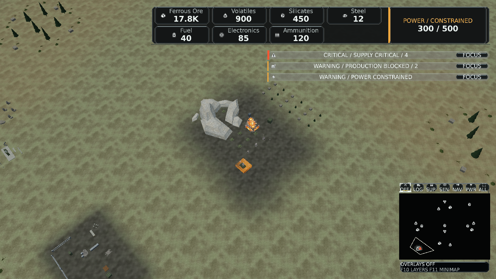
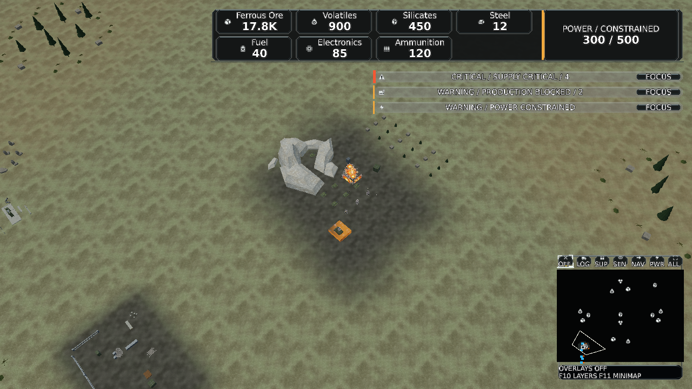

# Tactical display inspection

Product source: `754daa7e3e0214967eec3a08dbc1ba67324207fd`.
Base master: `201af6aad7ace07df21608c1d058d23b0828b070`.
Version: 0.1.504-dev; one PATCH for the PR.

The local checkout retains its base revision in assembly informational metadata.
[Source comparison](source-comparison.json) verifies the Git blob identities of all
29 changed product files against the product commit. The subsequent focus/schema
expectation corrections and this evidence do not change runtime sources. The
native report additionally retains the actual Presentation assembly SHA-256.

## Native result

[Original native report](native.json): 54 cases, each captured twice with identical
pixels, zero missing/dropped glyphs, and no submission fault. NVIDIA RTX PRO 5000
Blackwell Generation Laptop GPU, D3D12 FL12_1, hardware adapter, debug layer
unavailable. Actual window DPI is 144; injected layout DPI is 96. The matrix uses
1280×720 / 1920×1080, scale 100/125/150%, mixed/supply/production copied facts and
standard / high-contrast blue-orange / high-contrast grayscale preferences.

[Canonical asset qualification](assets.json): 2,049 assets, zero issues, content
signature `f8416ea299da82358086ec219bedbe38fbb27d2a7680b6691d3f78da352b4c3b`.
The final series uses this freshly compiled catalog. Earlier cached-catalog
inspections are excluded from these records.

Two unchanged original 1280×720 / 125% images are retained below. The complete
54-case metadata retains all pixel hashes; other original PNGs remain in the
local capture output. No composite, retouch or accepted golden is introduced.

Normal:

SHA-256: `92388cfc526ee7f14f5bd6dcb49b6830698e98c4fb90ea6e20f2c90f6bd42acc`.

High contrast:

SHA-256: `799b41f69e72870df3b0a0633d4f17715bafd97916506f22c1891d7c25ca0034`.

## Validation and open gates

- Canonical Release solution build: zero warnings/errors.
- Focused display/settings and existing UI regression groups: 276 passed.
- Focus/schema expectation alignment rerun: 21 passed. Schema 4 was already on
  base master; the legacy-migration test had still expected schema 3.
- Repository Windowed 1600×900 and Borderless 5120×2160 stress smoke passed at
  144 DPI with 1,000 requested stress instances, matching submitted/presented
  counts and zero texture-binding failures. Gameplay texture payload 44,874,170
  bytes passes the unchanged 56 MiB budget. This startup smoke makes no sustained
  FPS, populated-match pacing or physical-monitor transition claim.
- Final full Client: 537 passed / 4 failed / 2 opt-in skipped. Remaining failures:
  ObjectActionRingTests (P/Production opens Closed), UiArtworkCoverageTests
  (semantic-enum inventory), ClientScenarioSessionTests (resolved identity), and
  MainMenuModelTests (controls binding list).
- Full Presentation: 1,888 passed / 4 failed / 66 opt-in skipped. Remaining failures:
  WorldPresentationTests.StaticDressingPublishesRootedNonInteractiveInstancesWithoutChangingReplayState;
  OperationsChainDiagnosisTests.AmmunitionWaitsForElectronicsWhoseSilicateInputRecoversThroughAPaidConnection
  (97 / false); SimulationPresentationReadModelTests.CurrentPlacementPreviewProducesPlacementRequest;
  SimulationPresentationReadModelTests.PlacementControllerRejectsStalePreview.

These eight remaining local failures exercise unchanged input, scenario, artwork,
world and read-model paths. Their clean-master reproductions have not been run in
this qualification; they are not silently classified as passing or repaired here.
No test exclusions, assertions or thresholds were relaxed.

At the product commit, Movement quality, Conveyor reliability, Scalability and
Frame hot paths CI passed. [Required Main CI](https://github.com/DaveBeusing/Forgeline/actions/runs/40603712317/job/122537948318)
fails 12 Game cases in paid research, fleet recovery and opponent production
policy. The same named cases are documented for integrated master in
[the existing integration blocker](https://github.com/DaveBeusing/Forgeline/issues/405).
Later CI stages do not establish success after this failure. Evidence/test-only
commits still require their own current-head checks.

Keep the PR draft: resolve required CI and local suite failures, obtain real
monitor/DPI/fullscreen and F1/selection/reset journey evidence, and obtain human
readability/motion acceptance before integration. Automated authored snapshots
do not provide that acceptance. Reproduce the native matrix with the command in
[the display contract](../../TacticalDisplayAccessibility.md).
