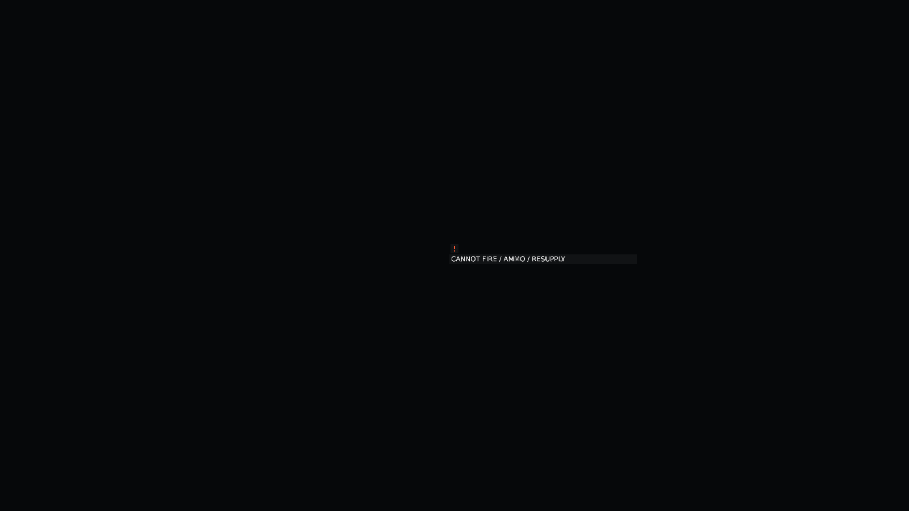
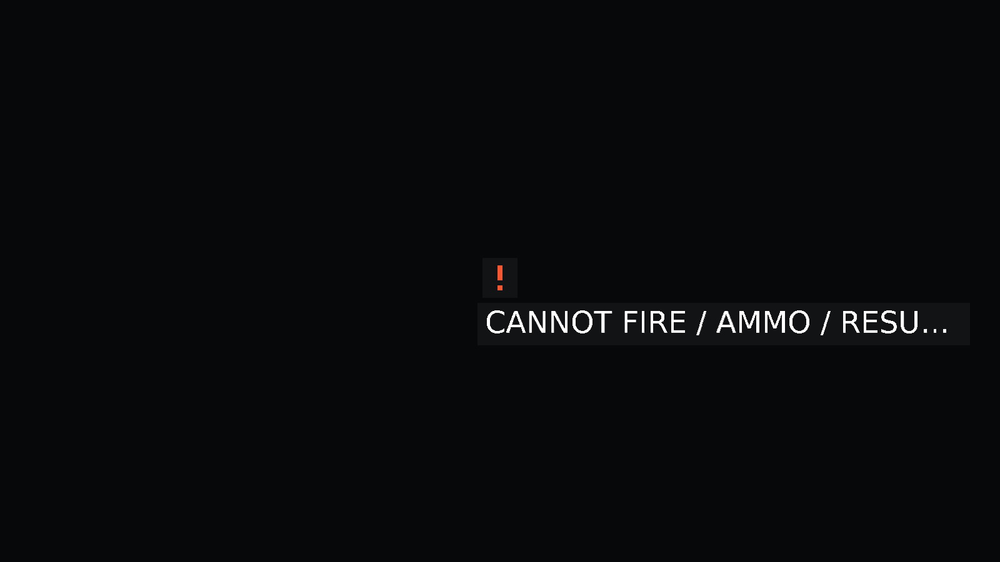

# Battlefield status qualification

Product revision: bcda51fcd4cd78d985061ca0308138795a3d9a57, built with the final PR version 0.1.504. SourceBindings.json records every affected product/test compiler input, its canonical LF Git hash, and the measured assembly hashes. Windows checkout line endings were normalized only for Git publication; compiled code and test behavior are unchanged. Base master is 201af6aad7ace07df21608c1d058d23b0828b070.

## Executed checks

- SDK 10.0.402, Windows x64, Release/Public: complete ForgeLine.sln build, 0 warnings and 0 errors (4m39.78s). Command: dotnet build ForgeLine.sln --configuration Release --no-restore --disable-build-servers -m:1. Normal dotnet restore ForgeLine.sln --disable-parallel completed first; audit and warnings remained enabled.
- Final Presentation selection: 75 passed, 0 failed, 0 skipped. Includes the new projection/native fixtures, group overview/registry, intelligence, strategic overlays, inspector, hover, information-layer, selection privacy and placement classes.
- Existing Game PlayerSelectionSummaryTests, BattlefieldSupplySystemTests and CombatReadinessSystemTests filter: 18 passed, 0 failed, 0 skipped.
- Validate-ProjectReferences.ps1: 46 projects, no cycles, architecture boundaries preserved.
- The new headless regression compares the complete authoritative state hash before and after owned status extraction at a completed tick. It passes. This is an immutability check, not a new full-match timing claim.

The first test compilation identified a missing xUnit cancellation-token argument; the fixture now passes TestContext.Current.CancellationToken. Earlier isolated compiler preparation omitted required map/icon files; those files were restored from the pinned master. No validation gate was suppressed.

## Native images

The actual RtsInformationOverlayRenderer runs on Windows x64 D3D12 WARP at 1600x900. Tactical uses distance 120, 96 DPI, UI scale 1. Strategic uses distance 1000, 192 DPI, UI scale 2. Captures are repeat-byte-identical. Foreign and stale group data paint no status; owned empty artillery adds a cause marker. Native text reports no missing/dropped glyphs. PNG files losslessly encode the native RGBA buffers.

The before files mean the same isolated renderer without authorized status paint, not an old-master terrain screenshot. The after files show copied owned artillery state. This fixture isolates geometry and dark-background contrast. It does not qualify live terrain, moving VFX, all weather profiles, hardware GPU cost or sustained frame pacing. At large UI scale the world label may ellipsize; the contextual inspector retains the complete cause.

## CPU projection measurements

Each raw JSON records 128 warmups, 256 samples, total CPU milliseconds and allocated bytes. All units overlap; priority/collision admission retains one marker. Initial implementation f8b72ffb6ec9e5c727e7e4b09e12fa17f21c4b8e repeatedly calculated camera matrices and scanned membership. The final projection reuses one matrix and stable priority buckets.

| Instances | Initial mean ms/update | Final mean ms/update | Final allocated bytes |
|---|---:|---:|---:|
| 100 | 0.5162 | 0.0615 | 0 |
| 4096 | 4.7568 | 2.3046 | 0 |

These are sequential observations on a shared host, with no statistical speedup or sustained GPU/tick-time acceptance claim. Projection is render-owner work; authoritative combat and transport systems are unchanged.

## CI baseline and remaining acceptance

The predecessor PR head 01a983cd064fa79d2a6045bc707ca95140b25fd8 and base master have the same Git tree 5c40a9e8e8b87ecbd351033136b1aed633bb9120. Its [main CI job](https://github.com/DaveBeusing/Forgeline/actions/runs/40596452925/job/122513741342) failed 12 of 57 technology/opponent progression cases, including TechnologyPaidProductionTests, TechnologyNormalMatchTests, SkirmishProductionPolicyTests and TechnologyFleetRecoveryTests. The separate windows-game check also failed. [Existing integration tracking](https://github.com/DaveBeusing/Forgeline/issues/405) is outside this presentation change. Other predecessor conveyor, navigation, CPU, portable and frame checks passed; native-reference was skipped.

The new PR must retain its own CI results; this baseline evidence cannot waive new failures. Keep draft pending required CI and live gameplay acceptance across terrain/night, combat VFX, zoom transitions, dense formations, last-known contacts and supported display profiles. No gameplay balancing, hidden sensing, logistics-rule change or release is included.
