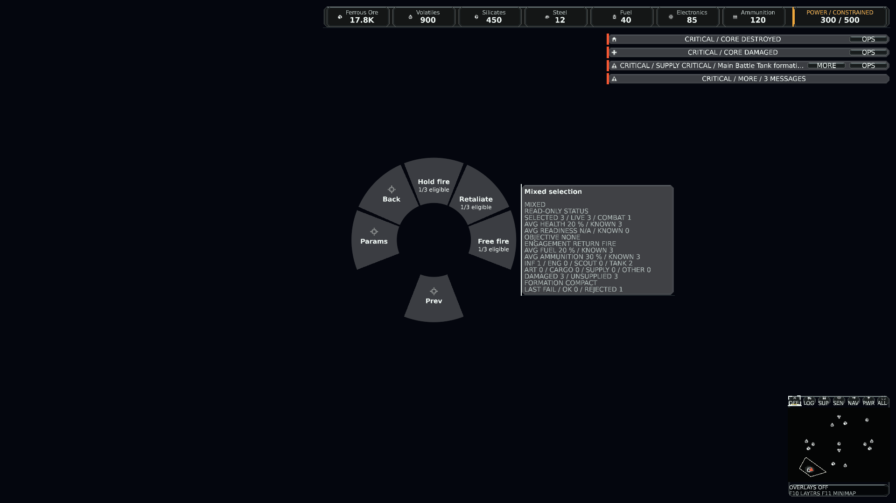
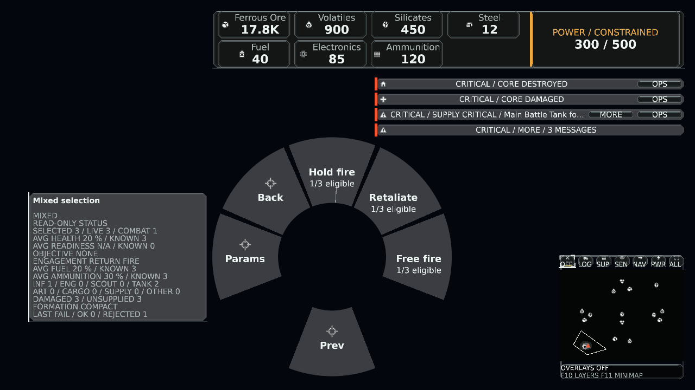
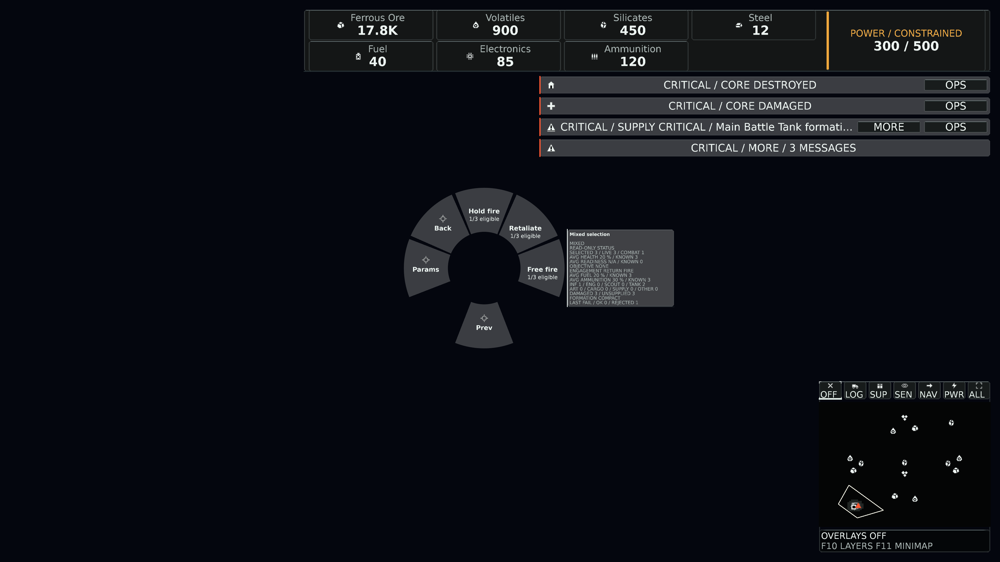

# Tactical group and engagement qualification

Source producer: 32dab603fd6bfefb10b63d2495b9799d203e3ab8 on master 8749198f89ce1f1c90684c0bcb3f8a3398e28f45. Version 0.1.505; Windows x64; SDK 10.0.402. source-bindings.json records canonical source and executed assembly hashes. Local archive builds do not carry a Git-derived informational SHA; the explicit source/assembly bindings identify these executions.

## Executed checks

- Canonical Release solution build: zero warnings/errors.
- Game: 92 passed, zero failed/skipped, across EngagementPolicyTests, TacticalCombatSystemTests, MatchPersistenceTests and PlayerCommandBoundaryTests.
- Presentation: 98 passed, zero failed/skipped, across engagement groups, registry/input/overview/selected groups, action panel/dock, hover rendering, status privacy and combat snapshot publication.
- Client: 63 passed, zero failed/skipped, across control-group saves, scenario sessions, group ring and object ring.
- Existing headless 1,000-entity / 64-tick smoke: exit 0. Report retained here.
- Architecture graph: 46 projects, no cycles, boundaries preserved.

The new regressions cover all three fire rules preserving explicit Hold/group membership, mixed/foreign/stale/disabled/unarmed rejection, no invented retaliation target, policy save/replay hash equality, payload/metadata rejection, full mailbox and oversized selections, an unreachable queued leg without reissue, bounded detached selection saves, overlapping slots, generation pruning, partial/mixed summaries, ordinary movement/patrol/completed-order objectives, action availability and the actual client file/load transfer.

## Native D3D12 evidence

The existing ring capture host was exercised with the production controller, owned copied fixture identities and real GPU rendering. Adapter: NVIDIA RTX PRO 5000 Blackwell Generation Laptop GPU, feature level 12.1, hardware device. The fixture is HUD-only over a plain background: it does not claim a new world/combat visual or an interactive full-match qualification.

Three retained captures: 1920×1080 / 96 DPI / UI scale 1; 1280×720 / 144 DPI / scale 1; 3840×2160 / 192 DPI / scale 1.5. Every capture repeats exactly; missing/dropped glyphs, missing assets and dropped quads are zero. Native diagnostics are in native-capture.json. All three images were checked for ring placement, readable action labels and complete selected-group status. Compact Retaliate means Return Fire; Free fire means Fire At Will. The first inspection exposed truncated long labels, which were shortened before these retained captures.

These captures reuse an existing local runtime resource catalog; its manifest checksum is recorded. No sprite, texture or geometry changed. The new request maps to the existing command.hold role in the source artwork binding catalog and authoring script.

## Acceptance limits

Hosted exact-PR CI is a separate required result and was not complete at this local checkpoint. No full match-duration, multiplayer, sustained hardware-performance or human playtest acceptance is claimed. There is no navigation or opponent change. Native capture proves the added ring/status rendering and controller paging; deterministic fixed-tick tests and save/replay checks establish simulation behavior independently of rendered frame rate. Required repository gates remain intact.
