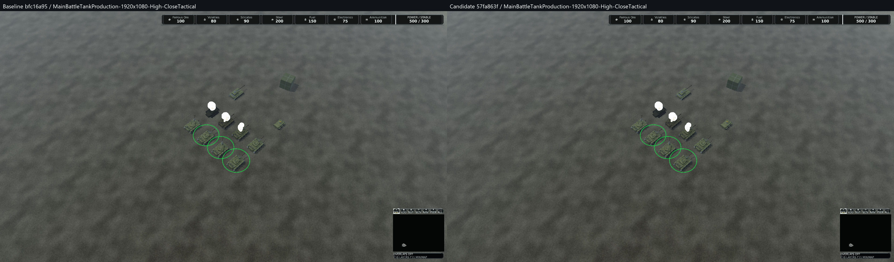
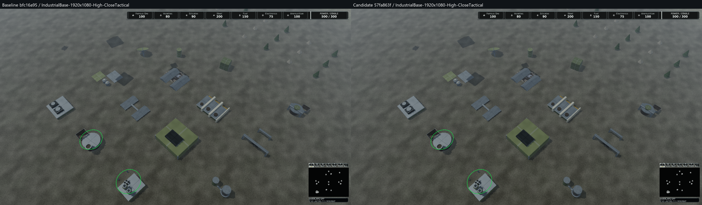

# Material and shadow candidate review

Status: **human material and shadow-contact decisions approved** for the six final image pairs, version 0.1.424. The [recorded approval](evidence/visual-approval.json) identifies their source and image hashes. Strict timing gates, gameplay failures and CI remain independent and unresolved.

Baseline `bfc16a953d731a844321a0848a2ebadc71c5875f` (0.1.423); candidate production source `57fa863f540f283ffbed742923de3e9fa6b3f80c` (0.1.424).
High, 1920x1080, fixed lighting and assets; close/normal/strategic cameras are 120/420/1000 metres. Original goldens are unchanged.

Review material identity, normal seams, silhouette/readability, contact, acne and detached shadows separately. The existing specular variance filter is retained; the two rejected experiments are not the candidate.

The material/shadow delta is intentionally local. Do not infer a broad artwork improvement or an accepted performance result from these images.

| Reference | Baseline | Candidate | Side by side | Changed pixels | Maximum channel delta |
|---|---|---|---|---:|---:|
| MainBattleTankProduction-1920x1080-High-CloseTactical | [Original](evidence/objects/c091b5b91419dd6808ba1358fc5a58068681fb64451311f79ba5618a99497320.png) | [Candidate](evidence/objects/510c55b2f6d79193b52625560c371dab11a606e0f1a89a445bf5a744d17bf359.png) | [Comparison](evidence/comparisons/MainBattleTankProduction-1920x1080-High-CloseTactical.png) | 1,741 | 26 |
| MainBattleTankProduction-1920x1080-High-NormalGameplay | [Original](evidence/objects/f156028d99a9d5ca869306b7ab30b6aae4ef4a22a84639560a09d252d54d3ae0.png) | [Candidate](evidence/objects/24447bb490912e759628e67f069cb9564bcff769d2dfa41e4189ccefffd73ad5.png) | [Comparison](evidence/comparisons/MainBattleTankProduction-1920x1080-High-NormalGameplay.png) | 1,363 | 23 |
| MainBattleTankProduction-1920x1080-High-Strategic | [Original](evidence/objects/573ecfead47910b9aa0a13202505fdcc3f5338d02fa91008e304563613ce036a.png) | [Candidate](evidence/objects/d19411e1a5faf1c5631894581a78f2c055fa1bebec3a53a2718d2682c311cd95.png) | [Comparison](evidence/comparisons/MainBattleTankProduction-1920x1080-High-Strategic.png) | 974 | 11 |
| IndustrialBase-1920x1080-High-CloseTactical | [Original](evidence/objects/555f1271216befa60296f390dcc123e3993117b8cfb4f8a6c92864a9a0cdb69f.png) | [Candidate](evidence/objects/13a9bb36106e1cad2d22ae011dfc03b0c924306b3ef326b8f071b13e5aa85e99.png) | [Comparison](evidence/comparisons/IndustrialBase-1920x1080-High-CloseTactical.png) | 6,719 | 15 |
| IndustrialBase-1920x1080-High-NormalGameplay | [Original](evidence/objects/54930583f7e8adfb1e233249234e589e82ffece34b25b6be80ed2d6d639a262c.png) | [Candidate](evidence/objects/34d6d0b624af6974597b9ba8490d7505a2b5ef4da4d2ddd998215a29d0dd7bae.png) | [Comparison](evidence/comparisons/IndustrialBase-1920x1080-High-NormalGameplay.png) | 1,998 | 23 |
| IndustrialBase-1920x1080-High-Strategic | [Original](evidence/objects/0488ee1d61fc565f9a2d83c8376fd6a3fe716a602078c24cffa0b975cbc47264.png) | [Candidate](evidence/objects/5b4e5f65ec837250af8137e8be6f706c81e22b4706ac8466ff33f4396368e011.png) | [Comparison](evidence/comparisons/IndustrialBase-1920x1080-High-Strategic.png) | 1,107 | 11 |

Side-by-side figures preserve every original pixel and add only a 48-pixel label strip. Open at 100% for native-size inspection.

## Native GPU costs and unresolved gates

Both full-client pairs pass the unchanged 15% total-GPU checks. They still fail 13 CPU metric/statistic observations (2/4 and 2/5 for fixed/sweep pairs). These are not shader gains.
The focused world/shadow probe retains 25 metric/statistic exceedances: 10 world GPU, 5 shadow GPU, 7 total GPU and 3 CPU. It does not pass performance acceptance. No unavailable metric is replaced by zero.

The table gives measured mean changes for both independent focused pairs. Raw p50/p95/p99 and every failed observation remain in the evidence index. The focused probe omits dedicated atmosphere/particle passes; full-client references remain separate.

| Profile / scene | World mean pair 1 / pair 2 | Shadow mean pair 1 / pair 2 |
|---|---:|---:|
| Low / Tank | -2.99% / +0.85% | -13.13% / -17.65% |
| Low / Industrial base | -1.98% / +13.34% | +17.73% / +45.18% |
| Medium / Tank | +16.26% / +5.49% | +6.58% / -18.36% |
| Medium / Industrial base | +25.76% / +5.18% | +21.50% / +1.17% |
| High / Tank | +19.57% / +3.02% | +14.78% / -6.03% |
| High / Industrial base | +8.76% / -4.19% | -22.57% / -5.43% |
| Ultra / Tank | +20.22% / -0.47% | -5.94% / -0.44% |
| Ultra / Industrial base | +5.52% / +4.10% | -3.83% / +3.09% |

## Separate decisions

- Material appearance: approved; see the source-bound approval record.
- Shadow contact and receiver stability: approved; see the source-bound approval record.
- Additional GPU costs / timing qualification: not accepted; strict gates remain open.
- Complete solution and CI: see [qualification](Qualification.md), including baseline failures.

All 32 focused native measurements release asset textures and pending retirements; the same one device-owned registered resource remains after every renderer disposal. This is a registered-resource plateau, not a physical VRAM-cap claim.

The [evidence index](evidence/index.json) maps original artifacts to content-addressed PNGs or compressed records, with original/retained/stored hashes. The rejected experiment pixel packs are lossless and independently verified by `Retain-Sequences.py`.
