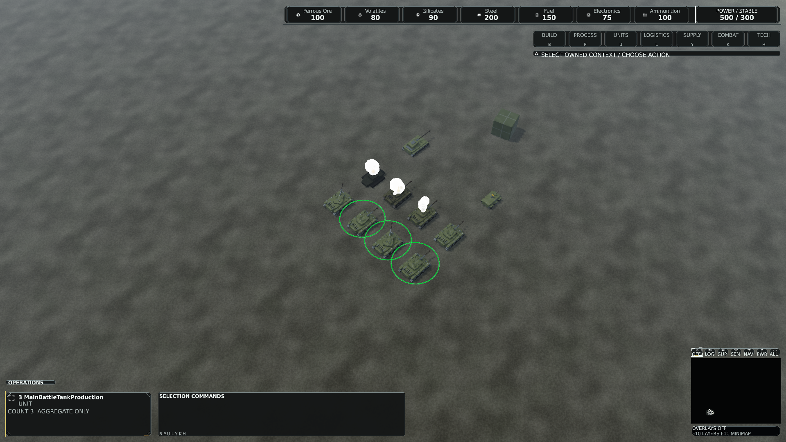
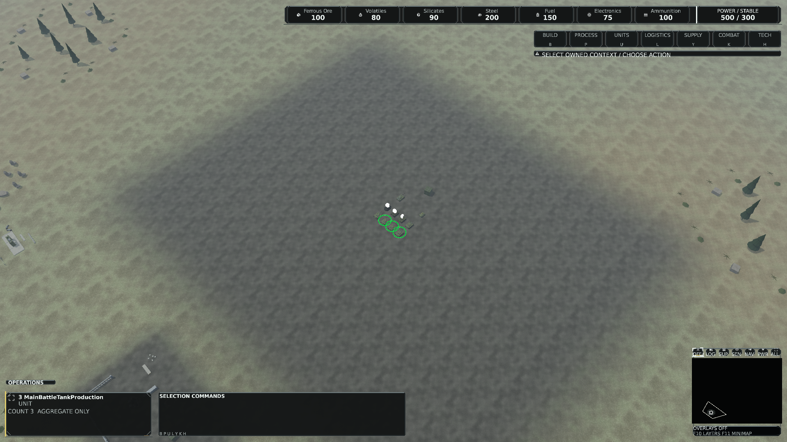
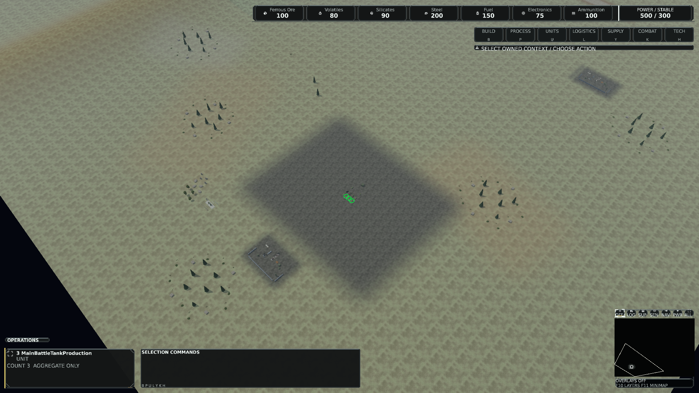
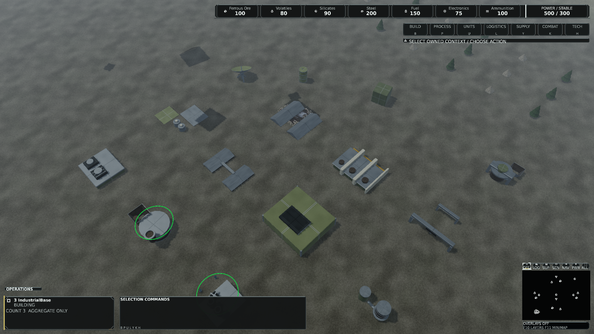
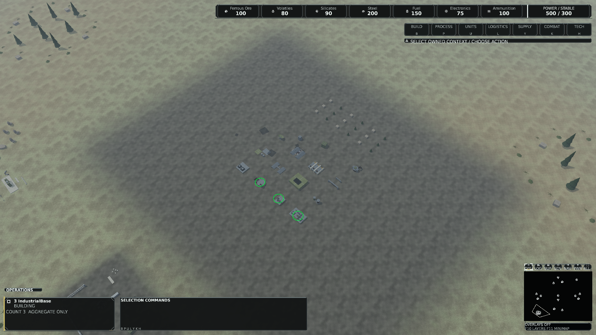
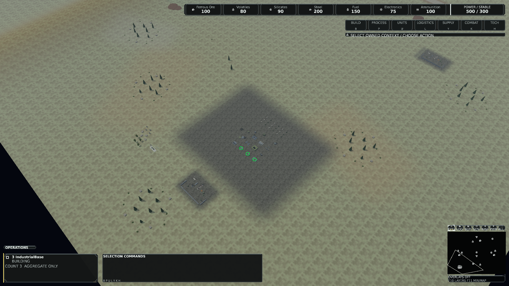

# Integrated render foundation acceptance

Status: **technical qualification passed; human native review approved**.
The project owner explicitly approved visual equality of all six images on
**19 October 2026**. `parallelReleased=true` records that decision. The release
record takes effect after integration of PR #241 into master; dependent
implementations must start from that master. No dependent implementation has started.

## Integrated source and required checks

Foundation PR #236 is integrated at
`17810ee192fac495173a7e9da44c973595833f2b`. Repair PR #237 is integrated at
`d4c7b62077c98500d6309cdd6c6dbf5e6bd6490c`, product **0.1.406**.
The repair head `5b621693346b17dabf9d598ff96c41ff333d548a` and integrated master
have identical Git trees. This checkpoint updates documentation, without runtime,
shader, asset, ABI, queue, test-budget or workflow changes.

[Integrated master CI](https://github.com/DaveBeusing/Forgeline/actions/runs/39175397659)
and [movement qualification](https://github.com/DaveBeusing/Forgeline/actions/runs/39175397640)
pass. The complete hosted suite has **2,821 passed, zero failed, 16 optional skips,
2,837 total**. Native WARP, window modes, original texture/draw budgets, rendering
benchmark, reproducible packaging, fresh-install and menu lifecycle checks pass.
The unchanged seed-2026 terminal match ends at tick **64,536** with
Completed / Victory / CommandCoreDestroyed, winner one, within the original 80,000 limit.

The final repair-head workflows also pass:
[main CI](https://github.com/DaveBeusing/Forgeline/actions/runs/39169826348),
[frame hot paths](https://github.com/DaveBeusing/Forgeline/actions/runs/39169826478),
[scalability](https://github.com/DaveBeusing/Forgeline/actions/runs/39169826427), and
[movement](https://github.com/DaveBeusing/Forgeline/actions/runs/39169826344).
This does not recast optional native-reference skips as hardware qualification.

## Measured performance and image identity

The fixed fixture-seven B-A-A-B protocol compares baseline `617312bb` with
renderer source `ae6865b0`: both complete six-case cohorts pass the unchanged
15% CPU/GPU mean/p50/p95/p99 gate with no unqualified cases. Largest observed
increases are 6.08% and 9.85%. All twelve paired images are exact; resource plateaus
and device health pass. Process observations are bounded two-second samples,
not a guarantee that no shorter unrelated activity occurred. The later Game repair
and test-host/guard-process corrections are separately attributed in [Repair](Repair.md).

All six final-code images at `0cf888b0` match the timed renderer images exactly.
The complete `src`, `assets` and asset-compiler trees of that capture source and
integrated repair master are unchanged. These short correctness captures do not
replace the timing protocol or constitute an additional performance acceptance.
All historical failures remain retained in the [complete summary](evidence/repair/foundation-repair-complete-summary.json).
The [machine-readable checkpoint](Acceptance.json) names the integrated source and CI.

## Native review set

The following are the original hardware readbacks, High 1920x1080, fixed cameras
at 120/420/1000 metres. Review both scenes for missing geometry, materials, shadows,
effects, readability and unexpected changes against their retained exact baseline.
Pixel equality is automated. The project owner approved the complete six-image
review set on 19 October 2026; approval covers foundation visual equality, without
claiming new artwork-quality or performance targets.

### Tank, 120 metres

### Tank, 420 metres

### Tank, 1000 metres

### Industrial base, 120 metres

### Industrial base, 420 metres

### Industrial base, 1000 metres

## Release condition

The implementation, repair and technical qualification are integrated. Explicit
human approval of this six-image native comparison was received from the project
owner on 19 October 2026. The ownership manifest now records
`parallelReleased=true`. The release record must be integrated through PR #241
before dependent implementations start from master. Required checks for that PR
remain separate from the already successful integrated-runtime checks above.
Revalidate ownership against the then-current master and preserve the frozen
interfaces. This approval does not start the eight implementations, merge a PR,
create a tag or publish a release.
