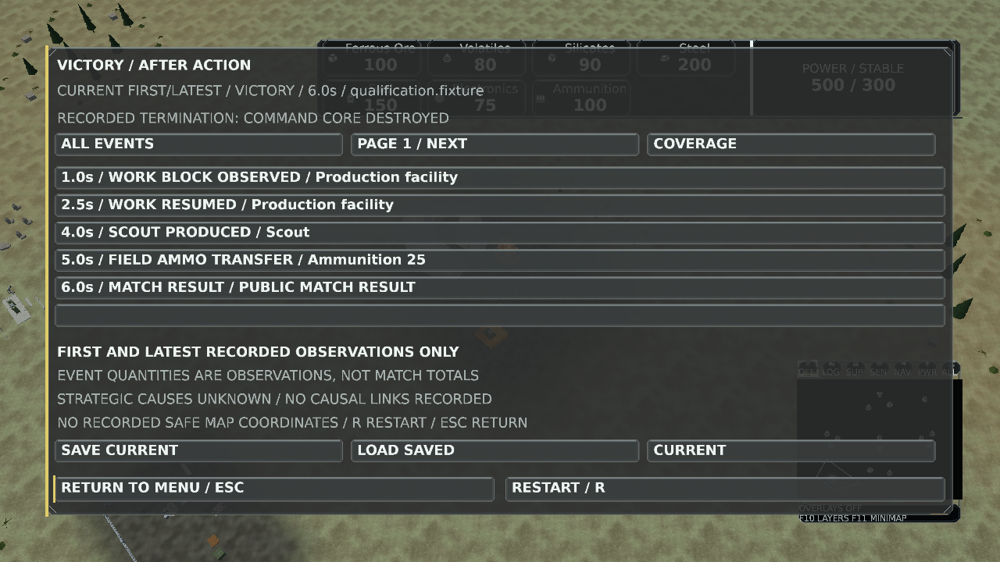
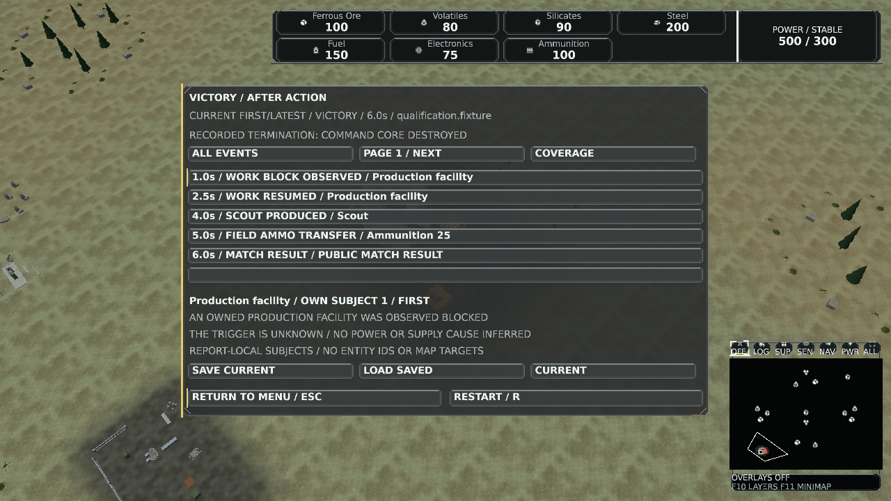
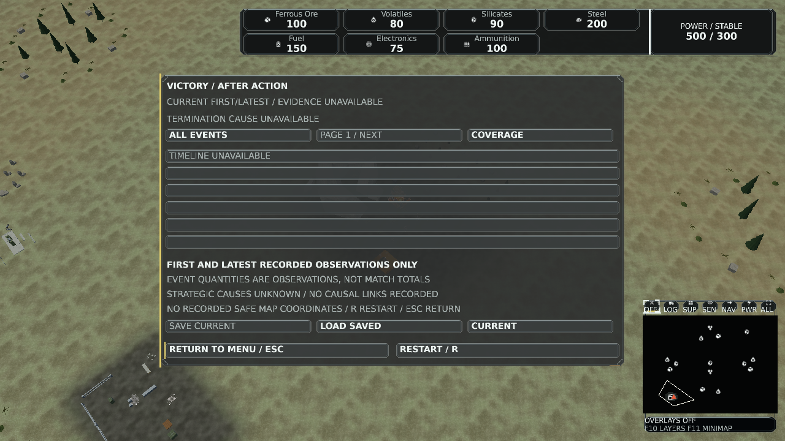

# After-action result-view qualification

Local version 0.1.507 on master base d1bb676d7d779bae4ef5d943a0305e3115b79e66. source-manifest.json binds normalized changed source files; qualification.json binds the native Client, Presentation and Game assemblies, fixture and repeated image hashes. The assemblies identify the master base plus these working-source changes, not an already-published feature commit.

## Results

- Release solution: zero warnings/errors.
- Full Presentation: 1,916 passed, 66 explicit opt-in hardware/Blender tests skipped, zero failures.
- Full Client: 538 passed, two explicit opt-in audio-device tests skipped, zero failures.
- Relevant Game journal/pacing/telemetry/lifecycle/persistence/composition/debrief tests: 66 passed before the additional cancellation case; final debrief-only rerun: 17 passed, including cancellation after a completed tick and malformed JSON header types.
- Deterministic single-match CLI contract script passed, including invalid player/batch/colliding output cases and repeatable incomplete summaries.
- Existing runtime catalog validation: 2,049 assets, 94,731,442 bytes, success. The catalog was reused without recompilation; no asset sources changed.
- Canonical window mode qualification: windowed 1600x900 and borderless 3840x2400 passed. D3D12 debug layer was requested but unavailable; no debug-layer validation is claimed.
- Project references: 46 projects, no cycles or architecture violations.
- Native debrief: 28 cases, repeated pixels identical within each case, zero missing/dropped glyphs, Return/Restart hit rectangles passed, no submission faults. Maximum total HUD geometry across these scenes: 61,194 vertices. No performance improvement is claimed.

All native scenes use authored bounded owned records over the existing world fixture, not natural-match outcomes or approved goldens. Actual result authority and snapshot caching are exercised by real lifecycle integration tests. DPI settings exercise layout and do not certify physical monitors. Missing causal, battle, contact, territory and coordinate evidence remains unavailable.

## Representative views

The complete 28 images are generated by --debrief-capture; three representative images are retained here. Hosted PR checks have not run yet.
